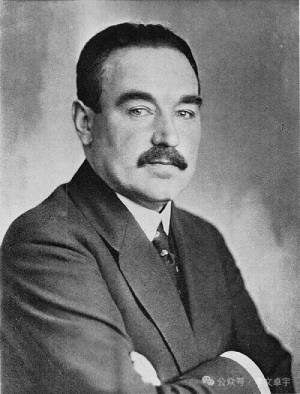
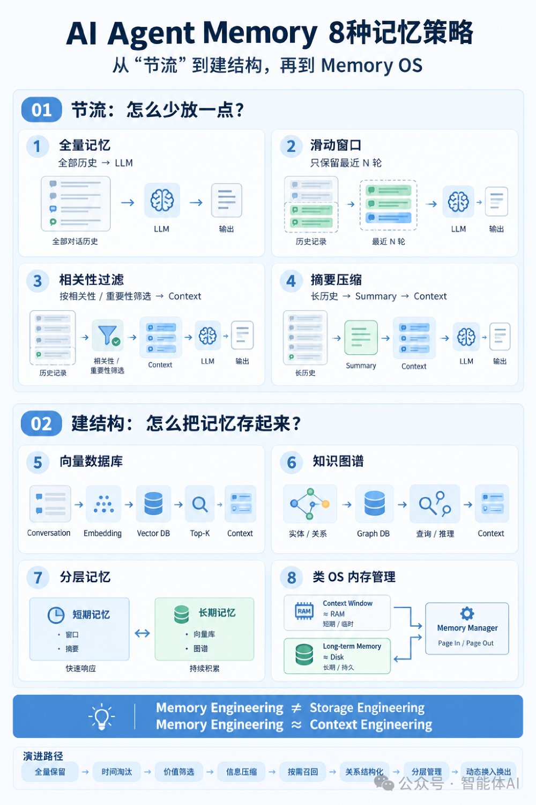

# Weekly #123

@Range : 2026-10-18 - 2026-10-24

@City: Hangzhou

[readme](../README.md) | [previous](202610W3.md) | [next](202610W5.md)


\**Photo by [无尽夏-](https://www.douyin.com/user/MS4wLjABAAAAJx8VXrPnvPI0dGCHZ6u-lbitNErkNlzzAr8h2DhWLZI) on [Douyin](https://www.douyin.com/note/7654964231649309297)*

-[toc]

## algorithm [🔝](#weekly-123)

## review [🔝](#weekly-123)

### 1. [血珀骑羊俑（曹魏）背后的故事](https://www.douyin.com/note/7654964231649309297)

> 发布时间：2026-06-24 22:10:50
>
> 正面见本期 banner，下图为背面图


3.3cm血珀里藏着的父爱。世人印象里的魏明帝曹叡 素来阴郁偏执、城府深沉

十七岁那年 他亲眼目睹生母甄氏被父皇曹丕赐死 下葬时以糠塞口、乱发覆面 屈辱至极 他却无力阻拦

终其一生 也从未得到过父亲半分温情 心底常年积压着无人消解的伤痛

太和六年 公元 232 年

他尚在襁褓、未及满月的长女曹淑骤然夭折

巨大的悲痛冲垮了帝王恪守的礼制底线：

他破格追封幼女为平原懿公主 在洛阳专立庙宇供奉 强令满朝文武素服哭祭 更不顾百官极力劝谏 亲自送灵下葬

他亲笔撰写哀辞 落笔满是悲恸 却仍觉词不达意 特意下诏请才高八斗的叔父曹植 写下《平原懿公主诔》寄托哀思

曹叡遗传了母亲的美貌 也因为母亲遭受的灾厄而变得阴郁有些神经质 本质上他还是那个思念母亲的孩子

他对于女儿一定是抱有美好的期望与幻想 却不幸破灭

这让他的情绪更加的歇斯底里的疯狂 至亲至爱皆留不住

曹淑降生不足一月便离世 不曾长大婚嫁 终生没有亲生骨肉 不存在属于自己的血缘后代

曹叡心疼爱女孤身无伴 特意为她操办全套冥婚、立嗣事宜：

选定文昭甄皇后（曹叡生母）早亡的侄孙甄黄作为冥婚夫婿 追封甄黄为列侯 与曹淑合葬

又将郭皇后堂弟郭德过继给二人传承香火 令郭德改姓甄 更名甄德 册封平原侯 负责世代主持公主祠庙祭祀、承袭爵位 是礼法意义上的继承人

甄德承袭平原侯爵位 迎娶曹魏宗室郭氏公主 膝下生有子嗣 这一脉仅能算作承接祭祀的名义后人 与曹淑并无半点血缘关联

七年后曹叡离世 归葬高平陵

帝陵距离女儿曹淑的墓葬仅四百余米 生前倾尽一切宠爱 死后也要以一父之身 长久守在女儿身侧 相伴千年

曹淑墓中出土一件仅 3.3 厘米高的血珀骑羊俑

是父亲留给她的小小玩伴

三国时期血珀产量稀少 价值远胜黄金 这件玲珑小巧的琥珀雕件 藏着帝王不加掩饰、近乎疯狂的父爱

朝堂之上 他执掌曹魏天下 杀伐决断、威严冷硬

可面对痛失爱女的刻骨悲伤 他也只是一个无助的父亲

女儿早夭无血脉传承 只能依靠过继后人维系祠祀

他唯有寄望琥珀通灵、骑羊升仙

默默祈祷襁褓里的小女儿

在另一个世界平安无忧、岁岁顺遂

所以

当你站在它面前

看的不是一个工艺品

而是一位心碎帝王无处安放的父爱

是曹魏王朝流星般短暂又璀璨的奢华审美

也是一个生命在历史宏大叙事中留下的

一滴最纯净的血色琥珀

它那么小 却又那么重

### 2. [获得了庞大权力的无产阶级革命者，还依然是无产阶级吗？](https://mp.weixin.qq.com/s/A6bxmU1pY8Z7AWD1i9K5-g)

> 李文卓宇 2026年10月16日 13:12 甘肃


1918 年 5 月 23 日，莫斯科克里姆林宫里发出一份措辞严厉的书面警告。

收件人是人民委员会办公厅主任邦契 - 布鲁耶维奇和秘书戈尔布诺夫，签发人是列宁。

让列宁大发雷霆的原因是这两人自作主张，从当年 3 月 1 日起把他的月薪从 500 卢布提高到了 800 卢布。

列宁在训令里直接定性，说这种做法公然违法，撞上了 1917 年 11 月 18 日人民委员会通过的一项法令。

按照那项法令，布尔什维克夺取政权后，所有人民委员（相当于内阁部长）每月的最高薪水不得超过 500 卢布。

这个数字是怎么来的？

参照的是 1871 年巴黎公社的原则：国家公职人员的收入，不能超过一名熟练工人的平均工资。

当时莫斯科一个熟练金属工人的月收入，差不多就是四五百卢布，这项制度后来在党内有了一个专门的名词，叫党员最高工资限额。

同一年夏天，人民委员会正在开会，汇报全国粮食调拨情况的粮食人民委员亚历山大 · 瞿鲁巴说着说着，突然从椅子上滑下去，晕倒在地毯上。


医生赶过来解开他的衣领检查，得出的结论让满屋子的人沉默了：长期营养不良导致的虚脱。

瞿鲁巴手里掌握着整个苏维埃俄国的粮仓钥匙，每天签字调拨成千上万普特的小麦去支援前线和城市，他自己家里却严格按定量领那一点掺了麸皮的黑面包。

单看 1918 年的工资单和瞿鲁巴瘪下去的胃，这群刚刚接管了庞大帝国的职业革命家，在物质生活上跟工厂里的翻砂工、钳工没有任何区别。

他们名下没有股票，没有地产，兜里揣着和工人一样的卢布，饿着肚子在办公室里批文件。

打破这种局面的，恰恰是随后的内战与行政运转本身。

瞿鲁巴晕倒在会场之后，中央委员会意识到一个很现实的问题：捷尔任斯基当时也在吐血，好几个人民委员因为斑疹伤寒和过度劳累倒在办公桌上。

如果这几十个核心部门的负责人全饿垮或者病死，整个国家的战争机器明天就得停摆。

到了 1919 年，国内战争全面爆发，卢布贬值成了废纸。

莫斯科黑市上一磅面包能卖到几百卢布，纸面上的 500 卢布最高工资限额失去了意义。

在没有货币和市场的情况下，要保证中枢机构运转，唯一的办法就是搞实物配给。

克里姆林宫卫生管理局和特别口粮制度就是在这个时候建立起来的。

全俄中央执行委员会书记阿维尔 · 叶努基泽负责大院的后勤，他必须排出一张表：谁每天能领到黄油、肉类和白面包，谁能住进征用来的贵族疗养院，谁出门能配一辆汽车。

这套分配逻辑原本是为了救急，就是谁承担的行政和军事责任重，谁就优先获得维持生命的卡路里。

可一旦生存物资跟行政级别挂了钩，裂痕就顺着配给证蔓延开来。

1920 年 9 月，俄共（布）第九次全国代表会议在莫斯科召开。

从外省前线和饥荒地区赶来的基层代表走进克里姆林宫，看到了专门的食堂、特批的皮靴和疗养院通行证。

会议速记档案里记录下了那几天的激烈争吵，代表们在发言里高频使用了两个词：上层与下层。

距离十月革命才过去不到三年，没有一个人把工厂变成私产，所有人都还穿着打补丁的旧军装，党内却已经需要先解决一个问题：拿特批口粮证的人，和拿普通工人口粮证的人，算不算同一群人？

九大代表会议开过半年，1921 年 3 月，俄共（布）十大在莫斯科开幕。

这次站在讲台上发难的，是一个叫亚历山大 · 施略普尼科夫的人。



在布尔什维克高层里，施略普尼科夫的履历很硬，他不是流亡瑞士、伦敦的知识分子，他 16 岁就进圣彼得堡的金属加工厂当学徒，是个实打实的车工，双手布满老茧，十月革命后担任第一任劳动人民委员。

施略普尼科夫和柯伦泰等人在党内组建了工人反对派，让他感到困惑和愤怒的，是他在工厂里看到的景象。

革命前，工人对付的是资本家和沙皇警察，革命胜利三年后，资本家跑了，国家派来了穿皮夹克的红色厂长和政委。

因为军事共产主义时期的严酷环境，工厂实行一长制和劳动军事化，工人们如果对口粮克扣或者车间管理不满，哪怕提出一点抗议，就会被扣上破坏生产的帽子，甚至被送进劳动营。

施略普尼科夫在十大上提出了一个看似最符合马克思主义初衷的方案：既然是无产阶级专政，那就应该把国民经济的管理权直接交给全俄生产者代表大会，也就是交给工会，让工人们自己管理工厂，党组织退回到思想领导的位置上去。

列宁在会上对施略普尼科夫进行了严厉的驳斥。

就在十大召开的同一周，彼得格勒外海的喀琅施塔得水兵发动了暴动，打出的口号是不要布尔什维克的苏维埃。

会场里将近三分之一的代表甚至直接从会场被抽调去前线平叛，在这样紧绷的空气里，列宁没有跟施略普尼科夫兜理论圈子，直接摊开了当时俄国的人口与工业底牌。

从 1914 年一战爆发到 1921 年，整整七年的战争把俄国的工业底座打碎了。

1921 年的生铁产量只有战前的百分之三点几，大批工厂因为缺煤缺原料停工。

原本在彼得格勒和莫斯科大工厂里干活的那批产业工人，几十万人死在了同白卫军作战的战场上，几十万人为了活命逃回农村找粮食。

列宁在大会上反问施略普尼科夫：你说的那个纯粹的无产阶级，现在到底在哪儿？

留在工厂车间的很多人，是为了逃避兵役混进来的小商贩、手工业者，他们每天干的活是用公家的铁皮偷偷打火机、做铁水壶，装进麻袋里去黑市换土豆。

列宁把这种状况称为无产阶级的非阶级化，他的逻辑是：真正的产业工人队伍已经流血漂橹、七零八落了，如果你现在把经济命脉交给下面自发选举的工会，苏维埃政权一个星期就会在无政府状态和小农投机中垮台。

在这个生死关头，要保住无产阶级革命的果实，唯一的办法就是由党这个先锋队替那个已经虚弱不堪的阶级掌管国家。

施略普尼科夫辩不过列宁，因为列宁说的是事实。

十大通过了著名的《关于党的统一》决议，解散了包括工人反对派在内的所有派别。

但 1921 年春天的这场争论，在制度上留下了一个无法回避的拐点。

当一个阶级在肉体和组织上无力直接行使权力，必须由一群全职的行政干部替他们代管国家机器时，无产阶级这个词就裂变成了两半：一半是还站在冰冷的车间里用铁皮换土豆的具体工人；另一半是坐在莫斯科各大部委办公室里、代表无产阶级签署命令的干部。

一个原本在车间里拧螺丝的工人，被提拔进机关办公室之后，他身上会发生什么变化？

1928 年 8 月，被流放到伏尔加河下游阿斯特拉罕的克里斯蒂安 · 拉科夫斯基，给朋友写了一封长信，题目叫《论权力的 “职业病”》。


拉科夫斯基做过乌克兰人民委员会主席，也当过驻英、驻法外交代表。

在流放地，他不再用某某人变节了、小资产阶级思想腐蚀了革命队伍这种道德词汇去解释党内的变化，他盯住了一个具体的现象：职能分工。

一个阶级在夺取政权之前，内部是扁平的。

大家都在地下印传单、组织罢工、蹲沙皇的监狱，风险共担，利益一致。

可政权拿到手里的第二天，几百万工人不可能同时挤进克里姆林宫批文件。

为了管理庞大的铁路网、煤矿、银行和军队，必须从工人和革命者里抽调几十万人，脱产进入国家机关。

拉科夫斯基在信里推演了一个普通工人的轨迹：假设一个普梯洛夫工厂的钳工，因为忠诚能干，被调到州委或者煤炭托拉斯当了负责人。

第一天上班，他还戴着工人的鸭舌帽，满嘴车间俚语，可过了半年，他的日常作息、信息来源和生存焦虑就跟原来的工友完全错开了。

在车间里干活时，他的收入取决于计件工资，他害怕的是工头罚款，他的天然盟友是旁边车床上的工友。

坐进办公室之后，他的口粮等级、住房分配和政治前途，全部取决于上级机关对他的考核。

这时候，如果他原来的工厂因为拖欠工资或者面包发霉闹起了罢工，这位昔日的钳工会怎么看？

在他的办公桌上，罢工不再是阶级兄弟争取生存权的斗争，变成了一起影响本季度煤炭调拨计划、会让他在州委书记面前挨批的行政事故。

不需要任何贪污腐败，也不需要他半夜突然在思想上背叛信仰，仅仅是他每天需要处理的报表和考核指标，就会推着他站到原来工友的对立面，把昔日的同伴看作需要被管理、被弹压的统计数字。

拉科夫斯基看到的这种职能分化，在 1923 年底已经通过一套严密的档案制度固定了下来。

当时主持中央组织局工作的卡冈诺维奇和斯大林，建立起了后来影响深远的官职等级名录制度。

中央委员会把全国最重要的几千个职位（从各部人民委员、军区司令，一直到大型工厂厂长、报社主编）分成一号名录和二号名录。

进入这张名录的人，其任免、调动、待遇和医疗，全部由中央组织分配部统一调配，跟基层的选举彻底脱钩。

到了 1932 年 2 月，政治局静悄悄地通过了一项秘密决议，放宽并实际上废除了列宁当年死保的党员最高工资限额。

1931 年，莫斯科河畔的别尔谢涅夫卡河畔街上，矗立起一座体量庞大的灰黑色建筑群。

这座由建筑师鲍里斯 · 伊奥凡设计的公寓楼，正对着克里姆林宫，里面有 505 套宽敞的套房，配备了 24 小时热水、橡木拼花地板、专属电影院、剧院、网球场和特供食堂。

它当时的官方名称是政府大厦，后来因为作家尤里 · 特里丰诺夫的小说，有了一个更出名的名字：河畔公寓。


住进河畔公寓的，几乎清一色是十月革命前入党的老布尔什维克、内战时期的红军统帅、各部人民委员。

如果那时候有人去查这些人民委员的个人财产，会发现一个很奇特的现象。

他们虽然已经不受 500 卢布最高工资的限制，拿到了几千卢布的月薪，还经常收到装在信封里的不记名奖金，但他们名下依然没有一寸土地、一家工厂、一股股票。

不仅没有生产资料，连他们每天坐的沙发都不属于他们自己。

在河畔公寓的每一套房子里，从书桌、餐椅、枝形吊灯，一直到厨房里的银质餐具，底下全都钉着或者刻着一块小小的金属铭牌，上面写着人民委员会资产再加上一串编号。

你住进这套五居室，是因为你担任重工业部副部长或者某个军区的司令。

你去克里米亚的黑海别墅度假，坐的是配给该职位的吉斯牌轿车，吃的是克里姆林宫特供农场送来的蔬果。

这套没有产权的物质特权，在 1936 年把流亡海外的托洛茨基难住了。


托洛茨基那一年写出了《被背叛的革命》，他在书里痛骂苏联官僚集团的堕落和专横，但有人问他：这群掌握了国家大权的人，是不是已经变成了一个新的统治阶级、新的资产阶级？

托洛茨基咬死不肯承认他们是一个阶级，坚持只能叫他们官僚阶层或者寄生物。

托洛茨基的理由很符合经典马克思主义的教科书定义：阶级是由生产资料所有制决定的。

河畔公寓里的那些大员，既不能把钢厂、油田装进自己兜里买卖，也没法立一份遗嘱，把人民委员的职位和莫斯科郊外的松林别墅合法继承给自己的儿子。

既然没有私有产权，他们就不算一个独立的阶级。

托洛茨基盯着家具底下那块公物金属牌，保住了理论上的自洽，却漏掉了那块金属牌在现实权力结构里真正起到的作用。

答案在 1937 年揭晓了。

那一年，大清洗的风暴席卷了河畔公寓，整栋楼有三分之一的住户在半夜听到了内务人民委员部军官的敲门声。

那些曾经在沙皇流放地里谈笑风生、在内战战场上指挥千军万马的老革命家被带走后，接下来发生的一幕，把无私有产权的另一面展示了出来。

男主人被捕的第二天，甚至就在当天夜里，内务部的查封人员就会拿着清单走进公寓，核对家具底下的金属铭牌，贴上封条。

由于房子、家具、汽车、医疗卡和食堂配给证全部属于国家公物，是绑定在职位上借给干部使用的，一旦职务被剥夺，使用权瞬间归零。

不到二十四小时，昔日人民委员的妻子和未成年的孩子，只能拎着一只装了几件换洗衣服的手提箱，被直接赶到莫斯科零下二十度的街口。

没有存款可以应急，没有私宅可以栖身，也没有任何一家国营单位敢收留人民公敌的家属。

当年亲自掌管克里姆林宫后勤分配长达十五年的叶努基泽，自己落马时也是同样的结局。

把这个场景跟沙皇时代、或者任何一个私有制社会做个对比，就能看清这套结构的厉害之处。

在沙皇尼古拉二世手下当大臣，如果不小心惹恼了沙皇被罢官，最坏的结果是收拾行李滚出圣彼得堡，回到自己在图拉省或者坦波夫省的私人庄园里去。

沙皇能收走他的乌纱帽，不能收走他名下的几千俄亩土地和银行里的铁路债券，他照样可以当个富家翁，甚至还能在庄园里写回忆录骂沙皇。

就算是一个 1917 年以前的普通布尔什维克工人，在普梯洛夫工厂因为闹罢工被开除了，上了警察局的黑名单，他还可以换个化名去另一家私营小铁匠铺打零工，可以向私人房东租一间地下室，可以靠同志们在国外募集的经费买面包。

私有制和市场虽然充满了剥削，但它的产权是分散的，社会的缝隙很多，最高权力很难把一个人的生存通道全部焊死。

等到 20 世纪 30 年代，当全社会所有的土地、工厂、住房、医院、粮店乃至每一块面包都收归国有，集中到唯一的一个行政金字塔里时，奇妙的化学反应发生了。

很多历史读者在读到 1936 年至 1938 年的莫斯科公审时，都会感到不解：布哈林、季诺维也夫、加米涅夫、李可夫，这些人年轻时面对沙皇的绞刑架和西伯利亚的苦役连眉头都不皱一下，为什么到了晚年，在审判席上会表现得那么顺从，让认什么罪就认什么罪，甚至在被捕前还会排队投票赞成处决自己的老战友？

除了秘密警察的肉体折磨和对党性的执念，那个钉着金属铭牌的物质结构，在无声地塑造着每个人的软肋。

在这座金字塔里，只要你还坐在那个位置上，你手里握着的权力比任何旧时代的资本家都要大。

资本家只能支配自己工厂里的几百个工人，而一个工业部的人民委员一纸调令就能决定几座城市的煤矿开采和几十万人的口粮配额。

可一旦你从那个位置上掉下来，你的处境比旧时代最穷的雇农还要绝望。

因为你在体制之外没有任何属于自己的生产资料和生活资料，连一张可以合法睡到天亮的床铺都没有。

托洛茨基当年没想通的问题，二十年后被另一个共产党人想通了。

1953 年，南斯拉夫共产党最高领导层排名第三的米洛凡 · 吉拉斯，坐在贝尔格莱德那栋原本属于旧王室权贵的豪华别墅里，开始动笔写《新阶级》。

吉拉斯本人就是钻山沟打游击出身的革命者，他太熟悉这套系统的日常运转了。

吉拉斯直接借用了罗马法里对所有权的定义：什么是所有权？

不是你抽屉里锁着的那张房产证，是对一件东西 “使用、享受收益和自由处分” 的实际权力。

当一个群体垄断了国家政权，能够以国家的名义决定全国炼多少钢、从农民手里收多少粮、盖多少栋河畔公寓，并且决定谁能住进这些公寓、谁能享用克里米亚的疗养院时，这种对全社会资源的排他性支配权，在事实上就已经构成了所有权，一种以集体名义行使的、与官职严格绑定的所有权。

回到标题的那个问题：获得了庞大权力的无产阶级革命者，还依然是无产阶级吗？

如果按他们跟车间车床的距离、按他们对社会剩余产品的支配力来看，从他们脱下工装、走进克里姆林宫签发第一张特批口粮证和调拨令的那一刻起，他们就已经离开了无产阶级的行列。

如果按字面意义上的无产，就是个人名下没有任何受法律保护的私产来看，他们直到最后居然还保持着某种残酷的无产状态。

这套由他们亲手建立起来的庞大机器，抹平了社会上所有的私有产权，也顺手抽掉了他们自己脚下所有的退路。

只要还在机器上运转，他们就是支配一切的主人。

可一旦被机器甩出去，椅子底下那块写着公物的金属牌就会立刻提醒他们，自己其实一无所有。

### 3. [短链实现方案](https://mp.weixin.qq.com/s/b5RX47yJswdP3a7eHS0VKw)

> 汐刻 2026年10月9日 07:53 北京

收到短信时，经常会看到类似这样的链接：

```
https://3.cn/011HqOh0x
```

这是京东一类产品常用的短链形态。问题是：这么短的一串字符，点击后是怎么跳到真正商品页或活动页的？

答案并不神秘——浏览器并不会从 `011HqOh0x` 里「解压」出完整网址。真正发生的是：请求先打到短域名 `3.cn` 背后的跳转服务，服务用短码查出事先存好的长 URL，再通过 HTTP 重定向把浏览器送走。

```
用户点击 https://3.cn/011HqOh0x
        │
        ▼
DNS 把 3.cn 解析到短链跳转服务
        │
        ▼
服务取出 path 中的短码：011HqOh0x
        │
        ▼
查映射表：短码 → 原始长链接（顺带校验是否过期、是否禁用）
        │
        ▼
返回 302 / 301，Location 指向真实地址
        │
        ▼
浏览器再请求长链接，打开目标页面
```

短链的本质不是压缩算法，而是一张高速映射表，外加一个足够短、足够好用的「钥匙」。

#### 一、核心思想

把长 URL 映射成短码，访问时再查回来：

```
short_code  ──查表──►  long_url
```

整套系统通常由几部分组成：

1. **短域名**：如 `3.cn`、`t.cn`，负责入口短、品牌可信、解析稳定

2. **唯一 ID**：保证每个短码对应唯一记录，避免冲突

3. **编码**：把整数 ID 转成更短的可读字符串（常见 Base62 或自定义字符集）

4. **存储与跳转**：DB / 缓存保存映射，跳转服务做 302 并异步记点击

```
业务方申请短链
      │
      ▼
发号（唯一 ID）→ 编码成短码 → 写入「短码 ↔ 长链」
      │
      ▼
返回 https://short/link

用户访问短链
      │
      ▼
短域名服务解析短码 → 查缓存/DB → 302 到长链
```

#### 二、短域名

短域名解决的是「链接前缀太长」的问题。即便短码本身只有 8～10 位，若挂在 `https://very-long-marketing.example.com/track/...` 下面，短信里依然不短。

选型时通常关注：

- **尽量短**：二级甚至一级短域，如 `3.cn`

- **可备案、可 HTTPS**：国内业务硬约束

- **独立部署**：跳转集群与主站解耦，方便单独扩容、限流、做风控

- **可信度**：短信场景下，域名是否被运营商 / 用户识别为正规渠道，直接影响点击率

path 形态常见两种：

|  形态  |     示例     |            说明            |
|:------:|:------------:|:--------------------------:|
| 纯短码 | /011HqOh0x   | 最短，最常见               |
| 带前缀 | /a/011HqOh0x | 区分业务线、算法版本或灰度 |

#### 三、唯一 ID

短码背后几乎总有一个全局唯一的整数（或等价标识）。先发号，再编码，比直接对长 URL 做随机串更可控。

常见发号方式：

|        方式       |            特点           |           适用           |
|:-----------------:|:-------------------------:|:------------------------:|
| 数据库自增 / 号段 | 简单有序；号段可批量预取  | 中小规模到大规模均可     |
| Redis INCR        | 实现快、吞吐高            | 单机房或有清晰分片策略时 |
| Snowflake 类算法  | 本地发号、无需中心计数器  | 多机房、高并发写入       |
| 业务基因号        | ID 中嵌入分片、业务等信息 | 超大规模分库分表场景     |

生成侧伪流程：

```
id   = nextId()              // 全局唯一
code = encode(id)            // Base62 / 自定义编码
save(code, longUrl, meta)
return "https://3.cn/" + code
```

有序自增 ID 有一个副作用：短码也容易呈连续形态，便于被扫号枚举。生产上往往会配合「打乱字符表 / 加盐 / 随机位」降低可预测性。

#### 四、Base62 与自定义编码

整数直接放进 URL 不够短，也不够「像短码」。常见做法是换成更大的进制。

**Base62** 使用 62 个 URL 友好字符：

```
0-9、a-z、A-Z
```

大致容量：

| 短码长度 |  可表示空间（约） |
|:--------:|:-----------------:|
| 6 位     | (62^6 ≈ 568 亿)   |
| 7 位     | (62^7 ≈ 3.5 万亿) |
| 8 位     | (62^8 ≈ 218 万亿) |

对绝大多数业务，6～8 位已经足够。

为什么不直接用 Base64？因为 `+`、`/` 会出现在结果里，放进 path 或 query 时要额外编码，体验和兼容性都更差。

**自定义编码**是在 Base62 思路上的工程化调整，例如：

- 打乱字符表顺序，削弱「ID 连续 → 短码连续」

- 去掉易混字符（`0/O`、`1/l/I`），降低人工抄写错误

- 增加校验位，发现篡改或输入错误

- 固定长度补齐，统一展示格式

需要明确一点：编码通常是可逆的（ID ↔ 短码）。安全不能指望「别人猜不到编码算法」，而要靠不可枚举设计、访问频控、目标域名校验和权限控制。

#### 五、映射存储与跳转

##### 5.1 存什么

一张映射记录至少包含：

|       字段       |        含义        |
|:----------------:|:------------------:|
| short_code       | 短码，唯一键       |
| long_url         | 原始地址           |
| status           | 正常 / 禁用 / 删除 |
| expire_at        | 过期时间（可空）   |
| biz_id / creator | 归属与审计         |
| created_at       | 创建时间           |

##### 5.2 怎么跳

跳转是典型的读多写少，路径要极短：

```
收到 /{code}
  → 查本地缓存 / Redis
  → miss 再查 DB，并回填缓存
  → 校验状态与过期时间
  → 返回 302，Location = long_url
  → 异步写点击日志（Kafka 等）
```

重定向状态码的选择：

- **302**：临时跳转，便于改目标、便于每次点击都打到源站统计；营销短信常用

- **301**：永久跳转，中间链路可能强缓存，事后改链困难，慎用

##### 5.3 生成接口侧

```
POST /shorten { longUrl, expireAt, bizId }
  → 校验协议、域名白名单、长度
  → 按业务规则决定是否复用已有短码（幂等）
  → 发号 + 编码
  → 写 DB，写缓存
  → 返回完整短链
```

#### 六、其他关键技术

##### 1. 哈希截断（与发号方案并列）

对长 URL 做 hash，截取前 N 位作为短码；冲突则加盐重算。

- 优点：同一长链容易得到同一短码

- 缺点：冲突处理与长度规划更麻烦

中小规模、强复用场景可用；大规模系统更常选「发号 + 编码」。

##### 2. 缓存与热点

大促短信会把少量短链打到极高 QPS。常见组合：

- Redis 缓存热点映射

- 进程内本地缓存（Caffeine 等）挡最热 key

- 布隆过滤器快速拒绝明显不存在的短码，减轻扫号压力

##### 3. 防枚举与防滥用

- 短码增加随机性，避免顺序猜测

- 跳转接口限流、异常 UA/IP 识别

- 生成接口鉴权，防止被当成公共短链平台刷接口

- 长链域名白名单 / 黑名单，降低短链被用于钓鱼跳转的风险

##### 4. 幂等：同链是否同码

业务常要求：同一业务方、同一长链、在有效期内重复申请，返回同一个短码。可对 `(biz_id, url_hash)` 建唯一约束，或采用「先查再插」。

##### 5. 过期与回收

- Redis 可用 TTL；DB 用定时任务标记过期或归档

- 短码回收要非常谨慎：旧短信可能长期存活，回收后会出现「旧链跳到新业务」

- 多数生产系统选择不回收，或设置极长冷却期

##### 6. 多机房

- 写：号段预分配到各机房，本地发号，减少跨地域抢号

- 读：映射数据复制 / 多活，跳转就近接入

- 降级：缓存优先；存储故障时对未命中返回失效页，避免雪崩

##### 7. 点击统计与归因

同步路径只做「查表 + 302」。渠道、设备、时间等统计一律异步，避免拖慢跳转 RT。

##### 8. 与二维码、App 唤起的关系

- 短信：优先极致短、域名可信

- 二维码：对长度稍宽容，但短链仍利于版面

- App：可能先走 Universal Link / App Link，再决定开 App 还是 H5；短链仍可充当统一入口

#### 七、方案怎么选

|   维度   | 发号 + Base62 |   哈希截断   |    纯随机串    |
|:--------:|:-------------:|:------------:|:--------------:|
| 唯一性   | 发号保证      | 需处理冲突   | 靠长度与概率   |
| 长度     | 紧凑可控      | 取决于截断位 | 通常更长       |
| 同链复用 | 需额外逻辑    | 较自然       | 需额外逻辑     |
| 防枚举   | 需额外处理    | 相对较好     | 最好           |
| 大规模   | 很合适        | 一般         | 合适（偏安全） |

互联网短信 / 消息短链的主流组合可以概括为：

**短域名 + 分布式发号 + Base62（或打乱字符集）+ DB/Redis 映射 + 302 跳转 + 异步统计。**

#### 八、回到开头的例子

对 `https://3.cn/011HqOh0x` 而言：

1. `3.cn` 是短域名入口

2. `011HqOh0x` 是唯一 ID 经 Base62 / 自定义字符集编码后的短码

3. 京东短链服务用该短码查出真实长 URL

4. 浏览器收到 302/301 后跳转到商品页、活动页等目标地址

5. 点击次数、渠道、风控、过期控制，都挂在这套映射与跳转链路上

一句话：**短链 = 短域名入口 + 全局唯一短码 + 服务端映射表上的快速重定向。**

### 4. [Agent 记忆到底怎么做？一文讲透 8 种 Memory 策略，从窗口到 Memory OS](https://mp.weixin.qq.com/s/KHXvhFMVdyyy3sV2VciYyw)

> 智能体AI 2026年10月2日 08:00 湖南

给 Agent 接个向量数据库 ，并不等于它 就有了记忆 。

你是不是也遇到过这样的场景。

你和一个 Agent 聊了一下午，中途去吃了顿饭，回来接着问： “我上周说的那个项目，你还记得吗？”

> 它回你：“抱歉，我无法访问之前的对话。”

这时候大部分人的第一反应是： 给它接个向量数据库不就完了 。

我一开始也是这么想的。直到真正去搭一套长期记忆系统才发现， 这个问题比想象中麻烦得多 。因为 “记忆” 这两个字底下，其实压着一堆完全不同的子问题：

> 什么东西应该留在当前对话里？
>
> 什么东西该被忘掉？
>
> 什么该压缩，什么不能压缩？
>
> 哪些信息值得长期保存？
>
> 保存了之后，什么时候该把它翻出来？
>
> 记忆和记忆之间有没有关联？
>
> 上下文快满了，该怎么办？

向量数据库只回答了其中一小部分 。剩下那些问题，才是 真正决定一个 Agent 用起来 “聪不聪明” 的地方 。

所以这篇文章想聊的其实是一句话：

**「记忆从来不是 “把历史存起来”，而是怎么管理一块有限的认知空间。」**

📌 本文看点

01 八种记忆方案演进

02 记忆本质是注意力管理

03 企业级选型五个 Level

#### 01 FOUNDATION：LLM 本身是没有记忆的

先说一个容易被忽略的底层事实：模型每次推理， 看到的只有这一次输入的上下文 。没有中间态，没有隐藏的 “意识流”。可以简单写成一个公式：

> LLM + Context = 这一次对话里的 “记忆”

于是所有 Agent Memory 要解决的问题， 本质上都是同一件事 ：

**「怎么把过去有价值的信息，在合适的时间点，用合适的形式，重新塞回 Context 里。」**

围绕这一件事，业界大概走出了八条路， 一条比一条聪明，也一条比一条复杂 ：



接下来一个个拆。

#### 02 THROTTLING：前四种：怎么 “节流”

这四种方案解决的都是同一类问题—— 留什么、忘什么、怎么压缩得更省 。

##### 01 全量记忆：我什么都不忘

最朴素的做法： 把所有对话历史原样保留 ，每次请求都整段喂给模型。

好处很直接—— 没有遗忘，就没有信息损失 ，用户说过的任何一句话，模型理论上都看得到。

但代价也很直接：对话越长，Token 越多，成本越高，速度越慢，最后一定会 撞到 Context Window 的天花板 。

这种方案只适合短对话、一次性问答这类 “用完就走” 的场景。一旦对话拉长到几十轮，它就成了 最先失效的那个答案 。

##### 02 滑动窗口：旧的先忘掉

既然不能无限堆，那就 只留最近 N 轮 ，像一个不断往前挪的窗口。

优点很明显： 长度可控，成本稳定 ，实现起来几乎不用动脑子。

问题也很明显：它唯一的判断标准是 “新旧”，不懂 “重要与否”。用户三分钟前说的话可能是废话，三小时前说的话可能是这次任务的核心背景——但窗口机制不管这些， 它只认时间戳 。

这类方案常见于 在线客服、实时问答 这种短周期场景。

##### 03 相关性过滤：不重要的，我忘掉

于是有了更聪明的一步： 给每条记忆打分 ，按相关性、重要性、和当前任务的匹配度来决定留不留。

这一步的转变其实挺关键——从 “时间驱动的遗忘” 变成了 “价值驱动的遗忘” 。

但新的风险也随之而来：万一判断错了呢？一条看起来无关紧要、实际却很关键的信息被过滤掉了，Agent 后面就会在不知不觉中 “失忆”，而且 这种失忆很难被发现 ，因为它表现得一切正常。

这也是为什么很多人做 RAG、做知识问答做到后面会发现：记忆系统真正难的部分， 从来不是怎么存，而是怎么判断 “该忘掉什么” 。

##### 04 摘要压缩：不留原文，留意思

前三种方案都在回答 “留下什么”，摘要开始回答一个新问题： 能不能把留下的内容变得更短 ？

思路很直接：长对话丢给 LLM 做摘要，压缩后的版本再进入下一轮上下文。原本可能要占用几万 Token 的历史， 压缩完可能只要几千 。像 ChatGPT、Claude 这类产品在处理长对话时，背后或多或少都有类似的摘要机制在起作用。

但这里有个绕不开的矛盾： 压缩必然意味着信息损失 。Token 省得越多，细节往往丢得越多。这是一个没有标准答案的权衡题，只能根据场景去调。

到这里，前四种方案有一个共同的短板—— 一旦某条记忆不在当前 Context 里，就彻底找不回来了 。窗口滑走了，过滤掉了，压缩没保留细节，这些信息就是真的消失了。

这就引出了下一个问题：

**能不能把记忆先存起来，需要的时候再去找？**

#### 03 STRUCTURE：后四种：怎么 “建结构”

##### 05 向量数据库：记忆不必一直放在脑子里

这是大多数开发者最熟悉的方案，但 有个误解需要先澄清 ：

VectorDB 解决的其实 不是 “记忆” 本身，而是“长期记忆的存取方式” 。

流程也不复杂：对话内容转成 Embedding 存进 VectorDB；需要用的时候， 拿当前的问题做语义检索 ，取出 Top-K 条相关记忆，塞进 Context，交给模型。

这一步带来的最大变化是：Agent 不再需要把所有历史都放进上下文，而是变成了 “需要什么，找什么” 。LangChain 的 Memory 模块、Mem0 这类工具，走的基本都是这条路。

但也 别把向量数据库想得太神 。它背后一堆细节问题都会实实在在影响效果：Embedding 准不准？文本怎么切块？Top-K 取多少合适？召回的内容是不是真的完整？相关性判断有没有跑偏？

接进一个向量数据库，不代表 Agent 就自动拥有了可靠的记忆。这中间的 调优工作量，往往比接入本身大得多 。

##### 06 知识图谱：记住的不只是信息，还有关系

向量检索擅长回答 “这段话和我的问题像不像”，但它不太擅长表达复杂的关系结构。于是有了更进一步的做法—— 把记忆结构化成图 。

流程是：对话 → 抽取实体和关系 → 存进图数据库 → 需要时做查询或推理 → 交给模型。

举个例子，图谱里可能存着这样的结构：张三是项目负责人，项目 A 属于公司 B，公司 B 的客户是李四。这种关系， 靠语义相似度是很难精确表达的 。

这一步的价值跃迁在于：从 “这段文字相似吗” 变成了 “这些实体之间到底是什么关系” 。GraphRAG 一类的实践，本质上就是在往这个方向走。

适合企业知识管理、专家系统，金融、医疗、科研这类 关系密集的领域 。但代价也不小——构建复杂，实体抽取成本高，关系维护起来很麻烦，数据一变，图也得跟着动。

##### 07 分层记忆：短期记忆 + 长期记忆

到这一步，可以开始借用一个 更贴近人类认知的类比 了：人有工作记忆，负责当下正在处理的事情；也有长期记忆，存着很久以前、但未来可能还会用到的东西。

对应到系统设计上：短期记忆用滑动窗口管，长期记忆用向量数据库或知识图谱管， 两者按需组合 ，一起送进 LLM。

再细拆的话，还能分出 工作记忆、情景记忆、语义记忆、长期记忆 这几层，各自负责不同性质的信息。

这一步之所以重要，是因为系统第一次开始具备 分层管理记忆 的意识——不再是所有信息都塞在同一个地方，而是 按性质分区存放 。这类设计常见于长期陪伴型 Agent、个性化助手、复杂的企业级系统。

##### 08 类操作系统的内存管理：Agent 开始像电脑一样思考

这是整篇文章我觉得最值得展开讲的一部分。因为走到这一步，记忆已经 不再是一个数据库问题，而是变成了一个资源管理问题 。

可以直接借用操作系统的概念来理解：电脑有 RAM，负责当前正在跑的数据；也有 Disk，负责长期保存的数据。当 RAM 不够用了，系统会 把暂时用不上的数据 Page Out 换到硬盘里 ；等再需要的时候，又 Page In 换回来。

这套逻辑几乎可以 原封不动地映射到 Agent 身上 ：

> Context Window ≈ RAM
>
> 长期记忆库 ≈ Disk
>
> Memory Manager ≈ 操作系统本身

活跃记忆和持久化记忆之间，不断地在做换入换出。这个思路并不是凭空想出来的类比——MemGPT（也就是后来的 Letta）这篇论文，正是 最早把 “记忆即操作系统” 这个想法系统化提出来 的地方，值得去读一读原文。

走到这一步， Agent 问自己的问题也变了 。它不再是 “我有没有记住这件事”，而是变成了：

**「当前这个时刻，哪些记忆应该被放进我的工作区里？」**

这已经很接近一个真正意义上的 Memory Operating System 了。

#### 04 COMPARISON：八种方案放一起看

如果说前七种方案解决的都是 “怎么管理内容”，那 第八种是第一次开始 “管理资源本身” ——这也是为什么它会被放在压轴的位置。

把八种方案摆在一张表里对比一下：

| 方案       | 核心策略     | 解决的问题   |
|------------|--------------|--------------|
| 全量记忆   | 全部保留     | 不遗忘       |
| 滑动窗口   | 最近优先     | 控制长度     |
| 相关性过滤 | 重要优先     | 减少无关信息 |
| 摘要压缩   | 信息压缩     | 降低 Token   |
| 向量数据库 | 按需召回     | 长期存储     |
| 知识图谱   | 结构化关系   | 复杂推理     |
| 分层记忆   | 分级管理     | 短期 + 长期  |
| 类 OS 管理 | 动态换入换出 | 超长记忆管理 |

「这八种方案不是互相替代的关系，而是不断叠加的关系。」

真正成熟的 Agent Memory 系统，很少是单一某种方案的产物，往往是 “滑动窗口 + 摘要 + 向量检索 + 图谱 + 记忆管理器” 拼出来的一套组合拳 。

#### 05 INSIGHT：往深了想一层：记忆的本质是管理注意力

把前面八种方案抽象一下，其实 都在回答四个问题 ：

- Remember：什么值得记住？
- Forget：什么可以忘掉？
- Retrieve：什么时候该把它找回来？
- Compress：怎么用更少的 Token 表达更多的信息？

想清楚这四个问题之后，会发现 一个挺反直觉的结论 ：

「Memory Engineering 的本质，其实不是 Storage Engineering，而是 Context Engineering。」

因为不管记忆存在哪儿、用什么方式存，它最终都要经过同一个动作才能起作用—— 重新进入 Context 。存储只是手段， 能不能在正确的时刻出现在正确的位置 ，才是真正的难点。

#### 06 PRACTICE：落地参考：企业级 Agent 该怎么选

聊了这么多架构，最后还是要落到实际选型上。可以 按复杂度分成五个档位 ：

Level 1：简单 Chatbot

全量记忆或滑动窗口就够用，不用想太多。

Level 2：长对话 Agent

滑动窗口 + 摘要压缩，把 Context 长度控制住。

Level 3：知识型 Agent

短期窗口 + 向量数据库，开始具备长期记忆能力。

Level 4：复杂企业 Agent

短期记忆 + 摘要 + 向量数据库 + 知识图谱，开始做分层管理。

Level 5：长期运行 Agent

在以上基础上再加一层 Memory Manager，负责写入、召回、压缩、淘汰、换入、换出、优先级排序这一整套调度逻辑。

走到 Level 5， 才算真正进入 Agent Memory Engineering 这个领域 ——它已经不是 “接个数据库” 能解决的问题了。

#### ∞ THE END：写在最后

这几年大家讨论 Agent， 关注点其实一直在变 ：先是模型够不够聪明，后来是能调用多少工具，再后来是 Context 能不能拉得更长。而下一个真正值得关注的问题可能是：

「Agent 能不能长期、稳定、低成本地管理自己的记忆？」

一个真正能长期工作的 Agent， 不可能每次醒来都从零开始 。它得知道自己刚才在做什么，之前做过什么，哪些事情重要，哪些可以放下，什么时候该把过去的经验重新翻出来用。

所以 Agent Memory 最后大概率不会只是一个向量数据库那么简单，它更可能 长成一套完整的 Memory Operating System 。这可能才是下一阶段 Agent 工程里， 真正值得花时间研究的基础设施 。

END

### 5. [《置身事内》全书精华整理](https://mp.weixin.qq.com/s/OZIJEIkrbDSyKdqratJdBg)

> 学思成 2026年8月31日 08:00 湖南

#### 前言

没有什么事是纯粹经济的，其他维度永远存在，且往往更为重要。

不要低估经济现实的复杂性，也不要高估科学工具的质量。

这本书写给大学生和对经济话题感兴趣的读者，希望能帮他们理解身边的世界，从热闹的政经新闻中看出些门道，从乏味的政府文件中觉察出些机会。

当不可避免涉及 “怎么办” 的时候，对读者来说，了解政府认为应该怎么办，比了解 “我” 认为应该怎么办，重要得多。

本书以我国地方政府投融资为主线，分上下两篇。上篇解释微观机制，包括地方政府的基本事务、收入、支出、土地融资和开发、投资和债务等；下篇解释这些微观行为对宏观现象的影响，包括城市化和工业化、房价、地区差异、债务风险、国内经济结构失衡、国际贸易冲突等。

#### 上篇　微观机制

地方政府是经济发展中的关键一环，事务繁杂，自主权力很大。

#### 第一章　地方政府的权力与事务

##### 第一节　政府治理的特点

中国的五级政府管理体系：中央—省—市—县区—乡镇。

中央与地方政府。央地关系历来是研究很多重大问题的主线。一方面，维持大一统的国家必然要求维护中央权威和统一领导；另一方面，中国之大又决定了政治体系的日常运作要以地方政府为主。

党和政府。中国共产党对政府的绝对领导是政治生活的主题。简单说来，党负责重大决策和人事任免，政府负责执行，但二者在组织上紧密交织、人员上高度重叠，很难严格区分。

条块分割，多重领导。我国政治体系的一个鲜明特点是 “层层复制”：中央的主要政治架构，即党委、政府、人大、政协等，省、市、县三级都完全复制，即所谓 “四套班子”。

上级领导与协调。在复杂的行政体系中，权力高度分散在各部门，往往没有清晰的法律界限，所以一旦涉及跨部门或跨地区事务，办起来就比较复杂，常常理不清头绪，甚至面对相互矛盾的信息。体制内简化决策流程的原则之一，就是尽量在能达成共识的最低层级上解决问题。若是部门事务，本部门领导就可以决定；若是经常性的跨部门事务，则设置上级 “分管领导” 甚至 “领导小组” 来协调推进。

官僚体系。所有规章制度都必须由人来执行和运作。同样的制度在不同的人手中，效果可能完全不同，所以无论是国家还是公司，人事制度都是组织机构的核心。我国是世界上第一个发展出完善、专业、复杂的官僚体系的国家。官员必须学习和贯彻统一的意识形态；官员由上级任命；地方主官需要在多地轮换任职。

在任何体制下，权力运作都受到两种约束：做事的能力及做事的意愿。前者取决于掌握的资源，后者取决于各方的积极性和主动性。

##### 第二节　外部性与规模经济

地方政府权力的范围和边界，由行政区划决定。影响行政区划的首要因素是 “外部性”，这是个重要的经济学概念，简单来说就是人的行为影响到了别人。

一件事情该不该由地方自主决定，可以从外部性的角度来考虑。若此事只影响本地，没有外部性，就该由本地全权处理；若还影响其他地方，那上级就该出面协调。

公共物品和服务的边界

按照经典经济学的看法，政府的核心职能是提供公共物品和公共服务，比如国防和公园。

一个城市总要划分成不同的区县，而行政边界的划分跟公共服务影响范围有关。一方面，因为规模经济，覆盖的人越多越划算，政区越大越好；另一方面，受制于人们获取这些服务的代价和意愿，政区不能无限扩大。这道理看似不起眼，但可以帮助我们理解很多现象，小到学区划分、大到国家规模。

以公共物品的规模经济和边界为切入点，也可以帮助理解中央和地方政府在分工上的一些差异。

人口密度、地理与文化差异

各地的行政区划面积划分的要素：

第一个重要因素是人口密度。按人口密度划分行政区域的思路非常自然。提供公共物品和服务需要成本，人多，不仅税收收入多，而且成本能摊薄，实现规模收益。中国历代最重要的基层单位是县，而县域的划分要依据人口密度，这是早在秦汉时期就定下的基本规则之一。

第二个重要因素是地理条件。古代交通不便，山川河流也就成了行政管理的自然边界，历史地理学家称之为 “随山川形变”。

第三个重要因素是语言文化差异。汉语的方言间有差异，汉语与少数民族语言也有差异。若语言不通，政务管理或公共服务可能就需要差异化，成本会因此增加，规模收益降低，从而影响行政区域划分。（延申阅读：《中国语言地图集》）

理解了这些因素，就能理解很多政策和改革。比如，随着经济活动和人口集聚，需要打破现有的行政边界，在更大范围内提供无缝对接的标准化公共服务，所以就有了各种都市圈的规划，有些甚至上升到了国家战略，比如长三角一体化、京津冀一体化、粤港澳大湾区等。再比如，地理阻隔不利沟通，但随着基础设施互联互通，行政区划也可以简化，比如撤县设区。

行政交界地区的经济发展

我国经济中有个现象：处在行政交界（尤其是省交界处）的地区，经济发展普遍比较落后。（在 2012 年 592 个国家扶贫开发工作重点县中，却有超过一半位于省交界处，贫困发生率远高于非边界县。）这一俗称 “三不管地带” 的现象，也可以用公共物品规模效应和边界的理论来解释。

这些因素在民国时期已存在，所以 “三不管地带” 才为革命时期的中国共产党提供了广阔空间。家喻户晓的革命圣地井冈山，就位于湖南、江西交界处的罗霄山脉之中。其他很多著名的革命根据地也在省界处，比如陕甘宁边区、晋察冀边区、鄂豫皖边区、湘鄂赣边区等。红军长征中非常重要的“四渡赤水”，就发生在川黔滇边界的赤水河地区。

跨区域外部性问题可以通过跨区域的共同上级来协调，这也是为什么行政区域不仅要做横向划分，也要做纵向的上下级划分。

行政边界影响经济发展，地方保护主义和市场分割现象今天依然存在，尤其在生产要素市场上，用地指标和户籍制度对土地和人口流动影响很大。

##### 第三节　复杂信息

信息与权力

有信息优势的一方，或者说能以更低代价获取信息的一方，自然就有决策优势。

原则上，上级对下级的各项工作都有最终决策权，可以推翻下级所有决定。但上级不可能掌握和处理所有信息，所以很多事务实际上由下级全权处理。即使上级想干预，常常也不得不依赖下级提供的信息。

工作总要下级来做，不可能没有一点自主性；下级也总要接受上级的监督和评价，不可能完全不理上级意见。但无论如何，信息优势始终是权力运作的关键要素。

下级通常有信息优势，所以如果下级想办某件事，只要上级不明确反对，一般都能办，即使上级反对也可以变通着干，所谓 “县官不如现管”；如果下级不想办某事，就可以拖一拖，或者干脆把皮球踢给上级，频繁请示，让没有信息优势的上级来面对决策的困难和风险，最终很可能就不了了之。即使是上级明确交代的事情，如果下级不想办，那办事的效果也会有很大的弹性，所谓 “上有政策，下有对策”。

信息获取与隐瞒

实际权威来自信息优势，这一逻辑也适用于单位内部。英国的内阁部门长官随内阁选举换来换去，而各部中工作多年的常务次官（permanent secretary）往往更有实权。

作为信息载体的文件和会议也成了权力的载体之一，而一套复杂的文件和会议制度就成了权力运作不可或缺的部分。

因为下级可能扭曲和隐瞒信息，所以上级的监督和审计就非常必要，既要巡视督察工作，也要监督审查官员。

因为信息复杂多变，模糊不清的地方太多，而政府的繁杂事权又没有清楚的法律界定，所以体制内的实际权力和责任都高度个人化。

所谓权力，实质就是在说不清楚的情况下由谁来拍板决策的问题。如果这种说不清的情况很多，权力就一定会向个人集中，这也是各地区、各部门 “一把手负责制” 的根源之一，这种权力的自然集中可能会造成专权和腐败。

因为信息复杂，不可信的信息比比皆是，而权力和责任又高度个人化，所以体制内的规章制度无法完全取代个人信任。上级在提拔下级时，除考虑工作能力外，关键岗位上都要尽量安排信得过的人。

##### 第四节　激励相容

如果一方想做的事，另一方既有意愿也有能力做好，就叫激励相容。政府内部不仅要求上下级间激励相容，也要求工作目标和官员自身利益之间激励相容。

垂直管理

在专业性强、标准化程度高的部门，具体而明确的事务更多，更倾向于垂直化领导和管理。

这种权力划分符合激励相容原则：工作主要由系统内的上级安排，所以绩效也主要由上级评价，而无论是职业升迁还是日常福利，也都来自系统内部。

在市场经济改革之后，利益不仅大了，而且多元化了，部门之间、上下级之间的利益冲突时有发生，“统一思想”和 “大局观” 虽依然重要，但只讲这些就不够了，需要更加精细的激励机制。

地方管理

对于更宏观的工作，比如发展经济，涉及方方面面，需要地方调动各种资源。激励相容原则要求给地方放权：不仅要让地方负责，也要与地方分享发展成果；不仅要能激励地方努力做好，还要能约束地方不要搞砸，也不要努力过头。

我国事权划分的一大特点是 “属地管理”：一个地区谁主管谁负责，以行政区划为权责边界。

激励相容原则首先要求明确地方的权利和责任。其次是权力和资源的配置要制度化，不能朝令夕改。

##### 小结：事权划分三大原则

第二至第四节讨论了事权划分的三大原则：公共服务的规模经济、信息复杂性、激励相容。三大原则的共同主题是处理不同群体的利益差别与冲突。

如果能让各个群体对利益和代价的看法趋同，也能消解很多矛盾，增强互信。所以国家对其公民都有基本的共同价值观教育，包括历史教育和国家观念教育。

##### 第五节　招商引资

地方政府的权力非常广泛。就发展经济而言，其所能调动的资源和采取的行动远远超过主流经济学强调的 “公共服务” 或“公共物品”范围。

招商引资不仅是招商局的部门职能，也是以经济建设为中心的地方政府的核心任务，是需要调动所有资源和手段去实现的目标。

要招商，就要有工业园区或产业园区，这涉及土地开发、产业规划、项目运作等一系列工作。地方政府是城市土地的所有者，为了招商引资发展经济，会把工业用地以非常优惠的价格转让给企业使用，并负责对土地进行一系列初期开发，比如 “七通一平”（通电、通路、通暖、通气、给水、排水、通信，以及平整场地）。

对于规模较大的企业，地方通常会给予很多金融支持。地方政府还可以为企业提供补贴和税收优惠。

创造就业是地方经济工作的重点，也是维护社会稳定不可或缺的条件。总的来说，对企业至关重要的生产要素，地方政府几乎都有很强的干预能力。

这种 “混合经济” 体系，不是主流经济学教科书中所说的政府和市场的简单分工模式，即政府负责提供公共物品、市场主导其他资源配置；也不是简单的 “政府搭台企业唱戏” 模式。而是政府及其各类附属机构（国企、事业单位、大银行等）深度参与大多数生产和分配环节的模式。在我国，想脱离政府来了解经济，是不可能的。

本章讨论了事权划分的三种理论：公共服务的规模经济与边界、信息复杂性、激励相容。

不能脱离政府来谈经济，是理解中国经济的基本出发点。本章讨论的事权划分，是理解政府间资源分配的基础。决定了干哪些事，才能决定用哪些资源。

#### 第二章　财税与政府行为

要真正理解政府行为，必然要了解财税。要想把握政府的真实意图和动向，不能光读文件，还要看政府资金的流向和数量，所以财政从来不是一个纯粹的经济问题。

1994 年分税制改革对政府行为和经济发展影响深远。

##### 第一节　分税制改革

“财政包干” 及后果：1985—1993 年

如果要用一个词来概括 20 世纪 80 年代中国经济的特点，非 “承包” 莫属：农村搞土地承包，城市搞企业承包，政府搞财政承包。

财政承包始于 1980 年，中央与省级财政之间对收入和支出进行包干，地方可以留下一部分增收。1980—1984 年是财政包干体制的实验阶段，1985 年以后全面推行，建立了 “分灶吃饭” 的财政体制。

财政承包制下，交完了中央的，剩下的都是地方自己的，因此地方有动力扩大税收来源，大力发展经济。

财政包干造成了 “两个比重” 不断降低：中央财政预算收入占全国财政预算总收入的比重越来越低，而全国财政预算总收入占 GDP 的比重也越来越低。不仅中央变得越来越穷，财政整体也越来越穷。

1994 年之前实行财政包干制，促进了乡镇企业的崛起。

分税制改革与央地博弈

1994 年的分税制改革把税收分为三类：中央税（如关税）、地方税（如营业税）、共享税（如增值税）。同时分设国税、地税两套机构，与地方财政部门脱钩，省以下税务机关以垂直管理为主，由上级税务机构负责管理人员和工资。

这种设置可以减少地方政府对税收的干扰，保障中央税收收入，但缺点也很明显：两套机构导致税务系统人员激增，提高了税收征管成本，而且企业需要应付两套人马和审查，纳税成本也高。2018 年，分立了 24 年的国税与地税再次开始合并。

分税制改革中最重要的税种是增值税，占全国税收收入的 1/4。

分税制改革，地方阻力很大。

即使在今天，中央重大政策出台的背后，也要经过很多轮的征求意见、协商、修改，否则很难落地。成功的政策背后是成功的协商和妥协，而不是机械的命令与执行，所以理解利益冲突，理解协调和解决机制，是理解政策的基础。

分税制是 20 世纪 90 年代推行的根本性改革之一，也是最为成功的改革之一。

##### 第二节　土地财政

分税制后，地方为另筹资金，一方面，地方可以努力增加税收规模。另一方面，地方可以增加预算外收入，其中最重要的就是围绕土地出让和开发所产生的 “土地财政”。

招商引资与税收

改革前，企业的大多数税收按隶属关系上缴，改革后则变成了在所在地上缴，这自然会刺激地方政府招商引资。

因为绝大多数税收征收自企业，且多在生产环节征收，所以地方政府重视企业而相对轻视民生，重视生产而相对轻视消费。

初探土地财政

我国实行土地公有制，城市土地归国家所有，农村土地归集体所有。农地要转为建设用地，必须先经过征地变成国有土地，然后才可以用于发展工商业或建造住宅，所以国有土地的价值远远高于农地。

1994 年分税制改革时，国有土地转让的决定权和收益都留给了地方。

1998 年发生了两件大事，城市土地的真正价值才开始显现。第一是单位停止福利分房，逐步实行住房分配货币化，商品房和房地产时代的大幕拉开。第二是修订后的《中华人民共和国土地管理法》开始实施，基本上锁死了农村集体土地的非农建设通道。

2001 年，为治理土地开发中的腐败和混乱，国务院提出 “大力推行招标拍卖”。2002 年，国土部明确四类经营用地（商业、旅游、娱乐、房地产）采用“招拍挂” 制度。

土地出让收入从 2001 年开始激增，2003 年就已经达到了地方公共预算收入的 55%。2008 年全球金融危机之后，在财政和信贷政策的共同刺激之下，土地转让收入再上一个台阶，2010 年达到地方公共预算收入的 68%。

所谓 “土地财政”，不仅包括巨额的土地使用权转让收入，还包括与土地使用和开发有关的各种税收收入。

2018 年 “土地财政” 收入相当于地方公共预算收入的 89%，是名副其实的“第二财政”。

从时间点上看，大规模的土地财政收入始于 21 世纪初。2001 年所得税改革后，中央财政进一步集权，拿走了企业所得税的六成。从那以后，地方政府发展经济的方式就从之前的 “工业化” 变成了 “工业化与城市化” 两手抓：一方面继续低价供应大量工业用地，招商引资；另一方面限制商住用地供给，从不断攀升的地价中赚取土地垄断收益。

所以商住用地虽然面积上只占出让土地的一半，但贡献了几乎所有的土地使用权转让收入。因此 “土地财政” 的实质是“房地产财政”。

税收、地租与地方政府竞争

我国是一个自然资源相对贫乏的国家，在经济起步阶段，能利用的资源主要就是人力和土地。过去几十年的很多重大改革，大都和盘活这两项资源、提高其使用效率有关。

地方政府压低工业用地价格，因为工业对经济转型升级的带动作用强，能带来增值税和其他税收，还能创造就业。

商住用地则不同，主要服务本地居民，土地供应方的垄断力量更强，更容易抬高地价。

招商引资竞争引发的弊端：首先是地方政府的债务问题；其次是资源的使用效率不高。

2020 年，中共中央和国务院发布《关于构建更加完善的要素市场化配置体制机制的意见》，放在最前面的就是 “推进土地要素市场化配置”。

##### 第三节　纵向不平衡与横向不平衡

地方收支差距由中央转移支付来填补。

基层财政困难

分税制改革之后，中央和省分成，省也要和市县分成。可因为上级权威高于下级，所以越往基层分到的钱往往越少，但分到的任务却越来越多，出现了 “财权层层上收，事权层层下压” 的局面。

基层政府一旦没钱，就会想办法增收，以保持正常运转。20 世纪 90 年代末到 21 世纪初，农村基层各种乱收费层出不穷，农民的日子不好过，干群关系紧张，群体性事件频发。

从 2000 年开始，农村税费改革拉开帷幕，制止基层政府乱摊派和乱收费，陆续取消了 “三提五统” 和“两工”等。

2006 年 1 月 1 日，农业税彻底废止。这是一件具有历史意义的大事，终结了农民缴纳了千年的 “皇粮国税”，但也让本就捉襟见肘的基层财政维持起来更加艰难，所以之后的改革就加大了上级的统筹和转移支付力度。其一，是把农村基本公共服务开支纳入国家公共财政保障范围，由中央和地方政府共同负担。二，是在转移支付制度中加入激励机制，鼓励基层政府达成特定目标，并给予奖励。其三，是把基层财政资源向上一级政府统筹，比如 2003 年开始试点的“乡财县管” 改革。

冗员过多一直是政府顽疾，分税制改革后建立的转移支付体系中，相当一部分转移支付是为了维持基层政府正常运转和保障人员工资。财政供养人员（即有编制的人员）越多，得到的转移支付越多，这自然会刺激地方政府扩编。

在 21 世纪初，全国开始推行 “扩权强县” 和“财政省直管县”改革。

“乡财县管”和 “省直管县” 改革，最终涉及了财税体制的层级问题。对于相关改革效果和未来方向，目前仍有争议。

地区间不平等

我国地区间经济发展的差距从 20 世纪 90 年代中后期开始扩大，中央也开始对中西部地区进行大规模转移支付。1995 年至 2018 年，转移支付总额从 665 亿元增加到了 61 649 亿元，增加了 93 倍。

越往基层分到的钱越少，省级的差距到了基层，就被层层放大了。

以 2009 年为例，人均财政支出最高的 1% 的县，支出是最低的 1% 的县的 19 倍。

越穷的地方拿到的钱（均衡性转移支付）越多，地方也就越缺乏增收动力。

专项转移支付在实际操作中，加大了地区间的不平等。

很多专项资金是由财政部先拨款给各部委后再层层下拨，所以就有了 “跑部钱进” 的现象，而经济发达地区往往与中央部委的关系也更好。

要深入了解政府，必须了解财税。本章介绍了 1994 年分税制改革的逻辑和后果。

土地真正的力量还不在 “土地财政”，而在以土地为抵押而撬动的银行信贷与其他各路资金。

财政和土地制度是国家大事，改变着每个人的生活。

#### 第三章　政府投融资与债务

土地本身并不值钱，值钱的是土地之上的经济活动。

土地资本化的魔力，在于可以挣脱物理属性，在抽象的意义上交易承诺和希望，将过去的储蓄、现在的收入、未来的前途，统统汇聚和封存在一小片土地上，使其价值暴增。

地方政府可以把与土地相关的未来收入资本化，去获取贷款和各类资金，将 “土地财政” 的规模成倍放大为“土地金融”。

##### 第一节　城投公司与土地金融

实业投资要比金融投资复杂得多。实业投资通常是个连续的过程，需要不断投入，每个阶段打交道的对象不同，所需的专业和资源不同，要处理的事务和关系也不同。任一阶段出了纰漏，都会影响整个项目。

在很长一段时期内，中国 GDP 增长的主要动力来自投资，这种增长方式必然伴随着政府深度参与经济活动。

地方政府融资平台：从成都 “宽窄巷子” 说起

法律规定，地方政府不能从银行贷款，2015 年之前也不允许发行债券，所以政府要想借钱投资，需要成立专门的公司。这类公司大都是国有独资企业，一般统称为 “地方政府融资平台”。

成都文旅集团具有政府融资平台类公司的典型特征。

第一，它持有从政府取得的大量土地使用权。

第二，盈利状况依赖政府补贴。

第三，政府的隐性担保可以让企业大量借款。

“土地一级开发” 投入大、利润低，且涉及拆迁等复杂问题，一般由政府融资平台公司完成。

工业园区开发：苏州工业园区 vs 华夏幸福

大多数融资平台的主业不是旅游开发，而是工业园区开发和城市基础设施建设。

苏州工业园区是规模最大也是最成功的国家级开发区之一，占地 278 平方公里。主力是两家国企：兆润集团负责土地整理和基础设施建设（土地一级开发），2019 年底刚上市的中新集团负责建设、招商、运营（土地二级开发）。

兆润集团由园区管委会持有 100% 股权，主营业务是典型的 “土地金融”：管委会把土地以资本形式直接注入兆润，由它做拆迁及“九通一平” 等基础开发，将 “生地” 变成可供使用的“熟地”，再由管委会回购，在土地市场上以招拍挂等形式出让，卖给中新集团这样的企业去招商和运营。兆润集团可以用政府注入的土地去抵押贷款，或用未来土地出让受益权去质押贷款，还可以发债，而还款来源就是管委会回购土地时支付的转让费及各种财政补贴。

在很多中西部市县，招商就困难多了。地理位置不好，经济发展水平不高，政府财力和人力都有限，除了一些土地，没什么家底。因此有些地方干脆就划一片地出来，完全依托民营企业来开发产业园区，甚至连招商引资也一并委托给这些企业。这类民企的代表是华夏幸福，这家上市公司的核心经营模式是所谓的 “产城结合”，即同时开发产业园区和房地产。它可以和政府分享税收收益。

政府付费使用私营企业开发建设的基础设施（如产业园区），这种模式叫 “政府和社会资本合作”（Public-Private Partnership, PPP）。

##### 第二节　地方政府债务

“土地金融” 推动了快速的工业化和城市化，但同时也积累了大量债务。这套模式的关键是土地价格。只要不断地投资和建设能带来持续的经济增长，城市就会扩张，地价就会上涨，就可以偿还连本带利越滚越多的债务。可经济增速一旦放缓，地价下跌，土地出让收入减少，累积的债务就会成为沉重的负担，可能压垮融资平台甚至地方政府。

地方债的爆发始于 2008—2009 年。为应对从美国蔓延至全球的金融危机，我国当时迅速出台 “4 万亿” 计划：中央政府投资 1.18 万亿元，地方政府投资 2.82 万亿元。为配合政策落地、帮助地方政府融资，中央也放宽了对地方融资平台和银行信贷的限制。2008 年，全国共有融资平台公司 3000 余家，2009 年激增至 8000 余家，其中六成左右是县一级政府融资平台。

##### 为政府开发融资：国家开发银行与城投债

我国大型项目的投资建设，无论是基础设施还是工业项目，大都有政府直接参与。

要想在城市建设开发中引入银行资金，需要解决三个技术问题。第一，需要一个能借款的公司，因为政府不能直接从银行贷款；第二，城建开发项目繁复，包括自来水、道路、公园、防洪，等等，有的赚钱，有的赔钱，但缺了哪个都不行，所以不能以单个项目分头借款，最好捆绑在一起，以赚钱的项目带动不赚钱的项目；第三，仅靠财政预算收入不够还债，要能把跟土地有关的收益用起来。为解决这三个问题，城投公司就诞生了。发明这套模式的是国家开发银行。

2002 年，全国开始推行土地 “招拍挂”，政府授权芜湖建投以土地出让收益做质押作为还款保证。2003 年，在国开行和天津的合作中，开始允许以土地增值收益作为贷款还款来源。这些做法后来就成了全国城投公司的标准模式。

2008 年之前，国开行是城投公司最主要的贷款来源。2008 年 “4 万亿” 财政金融刺激之后，各种商业银行包括 “工农中建” 四大行和城市商业银行（以下简称“城商行”），才开始大规模贷款给城投公司。

城商行主要由地方政府控制。在各地招商引资竞争中，金融资源和融资能力是核心竞争力之一，因此地方政府往往掌控至少一家银行，方便为融资平台公司和基础设施建设提供贷款。

城投公司最主要的融资方式是银行贷款，其次是发行债券，即通常所说的城投债。

地方债务与风险

地方政府的债务究竟有多少，没人知道确切数字。

地方债总体水平虽然不低，但也不算特别高。但是债务风险不能只看整体，因为欠债的不是整体而是个体。纵向上看，层级越低的政府负担越重，风险越高。县级债务负担远高于省级。横向上看，中西部的债务负担和风险远高于东部。

由于有地方政府背后支持，融资平台公司只要能还上利息和到期的部分本金，就能靠借新还旧来滚动和延续其余债务。但大多数融资平台收入太少，就算是只还利息也要靠政府补贴。政府补贴的前提是政府有钱，这些钱主要来自和土地开发有关的各种收入。一旦经济遇冷，地价下跌，政府也背不起这沉重的债务。

地方债的治理与改革

对地方债务的治理始于 2010 年。

重要的改革大概有四项。第一项就是债务置换，简单来说，就是用地方政府发行的公债，替换一部分融资平台公司的银行贷款和城投债。第二项改革是推动融资平台转型，厘清与政府之间的关系，剥离其为政府融资的功能，同时破除政府对其形成的 “隐性” 担保。第三项改革是约束银行和各类金融机构，避免大量资金流入融资平台。第四项改革就是问责官员，对过度负债的行为终身追责。

##### 第三节　招商引资中的地方官员

我国官僚体系庞大，官僚体系自古就是政治和社会支柱之一，而且一直有吸纳社会精英的传统，人力资源雄厚。

从人数构成上看，地方官员是官僚体系的绝对主体。

官员政绩与激励机制

事在人为，人才的选拔和激励机制是官僚体制的核心，决定着政府运作的效果。

从 “胡萝卜” 角度看，经济发展是地方官的主要政绩，对其声望和升迁有重要影响。从 “大棒” 角度看，一方面有党纪国法的监督惩罚体系，另一方面也有地区间招商引资的激烈竞争。

地方主官任期有限，要想在任内快速提升经济增长，往往只能加大投资力度，上马各种大工程、大项目，“新官上任三把火” 烧得又快又猛。所以在官员上任的前几年，土地出让数量一般都会增加，这种偏重投资的增长模式会造成很多不良后果。

因为官员政绩激励对地方政府投资有重要影响，所以近年来在 “去杠杆、去库存、去产能” 等供给侧结构性重大改革中，也包含了对地方官员政绩考核的改革。

在官员考核和晋升中，政绩非常重要，但这不代表人情关系不重要。人情和业绩之间可能互相促进：业绩突出容易受领导青睐，而领导支持也有助于做好工作。

腐败与反腐败

政府投资和土地金融的发展模式，一大弊端就是腐败严重。与土地有关的交易和投资往往金额巨大，且权力高度集中在个别官员手中，极易滋生腐败。

腐败与经济高速增长长期并存。

20 世纪 80 年代的腐败案件大多与价格双轨制下的 “官倒” 和各种 “投机倒把” 有关；90 年代的案件则多与国企改革和国有资产流失有关；21 世纪以来，与土地开发相关的案件成了主流。

腐败大概可以分为两类。第一类是 “掠夺式” 腐败，比如对私营企业敲诈勒索、向老百姓索贿、盗用挪用公款等，这类腐败对经济增长和产权保护极其有害。第二类腐败是 “官商勾连共同发财式” 腐败。比如官员利用职权把项目批给关系户企业，而企业不仅要完成项目、为官员贡献政绩，也要在私下给官员很多好处。这类腐败发生在招商引资过程中，而相关投资和建设可以促进经济短期增长，所以腐败在一段时期内可以和经济增长并存。

党的十八大以来的反腐运动，是更为广阔的系统性改革的一部分，其中既包括 “去杠杆” 等经济结构改革，也包括防范金融风险改革，还包括各类生产要素尤其是土地的市场化改革。

#### 第四章　工业化中的政府角色

由于实业投资的连续性、复杂性和不可逆性，政府的介入必然也是深度的，与企业关系复杂而密切，不容易退出。

##### 第一节　京东方与政府投资

在显示面板企业的发展过程中，地方政府的投资发挥了关键作用。

京东方和政府投资的故事

京东方上市计划，可生产线已经开始建设，各种设备的订单也已经下了，于是在北京市政府与国开行的协调下，9 家银行组成银团，由建设银行北京分行牵头，贷款给京东方 7.4 亿美元。北京市政府也提供了 28 亿元的借款，以国资委的全资公司北京工业发展投资管理有限公司为借款主体。

2008 年，京东方决定在成都建设 4.5 代线，第一次试水新的融资模式。这条生产线总投资 34 亿元，其中向成都市两家城投公司定向增发股票 18 亿元，剩余 16 亿元采用银团贷款，由国开行牵头。

夏普的两次搅局推迟了我国高世代产线的建设，但也给了合肥一个与京东方合作的机会。合肥 6 代线是我国第一条高世代生产线，也是新中国成立以来安徽省最大的一笔单体工业投资。京东方后来又在合肥建设了 8.5 代（2014 年投产）和 10.5 代生产线（2018 年投产），吸引了大量上下游厂商落地合肥，形成了产业集群，使合肥成为我国光电显示产业的中心之一。

在经济发展起步阶段，资本市场和信用机制都不完善，因此以信用级别高的政府为主体来融资和投资，更为可行。这不仅适用于与土地有关的债务融资，也适用于股权融资。

在这一快速扩张阶段，京东方的基本融资模式都是 “扩充资本金 + 银团贷款”。

经济启示

现代工业的规模经济效应很强。显示面板行业一条生产线的投资动辄百亿，只有大量生产才能拉低平均成本。因此新企业的进入门槛极高，不仅投资额度大，还要面对先进入者已经累积的巨大成本和技术优势。

若本国企业能以更低的价格生产（不一定非要有技术优势，能够拉低国际厂商的漫天要价也可以），政府就可以考虑扶持本国企业进入，这不仅能打破国际市场的扭曲和垄断，还可以降低国内下游产业的成本，促进其发展。

政府投资上游产业的同时也促进下游产业的发展，京东方和华星光电等企业的崛起，带动了整个光电显示产业链向我国集聚。

规模经济和产业集聚也会刺激技术创新。市场大，利润就大，就能支撑更大规模的研发投入。产业的集聚还会带来技术和知识的外溢，促进创新。

“东亚经济奇迹” 一个很重要的特点，就是政府帮助本土企业进入复杂度很高的行业，充分利用其中的学习效应、规模效应和技术外溢效应，迅速提升本土制造业的技术能力和国际竞争力。

地方政府竞争

新兴制造业在地理上的集聚效应很强，因为扎堆生产可以节约原材料和中间投入的运输成本，而且同行聚集在一起有利于知识和技术交流，外溢效应很强。因此产业集群一旦形成，自身引力会不断加强，很难被外力打破。

在各地招商引资竞争中，地方政府为了吸引京东方落户本地，开出的条件十分优厚。

##### 第二节　光伏发展与政府补贴

2012 年前后，我国很多光伏企业倒闭，全行业进入寒冬。所以在很长一段时间里，无论在政府、学术界还是媒体眼中，光伏都是产业政策和政府补贴失败的 “活靶子”。

经过当年的行业洗牌之后，我国的光伏产业已经成为全球龙头，国内企业（包括其海外工厂）的产能占全球八成。该产业的几乎全部关键环节，如多晶硅、硅片、电池、组件等，我国企业都居于主导地位。

光伏产业的故事

澳大利亚新南威尔士大学的马丁 · 格林（Martin Green）教授发展了很多新技术，极大提升了光伏发电的效率，被誉为 “光伏之父”。他的不少学生后来都成了我国光伏产业的中坚，其中就包括施正荣博士。

2001 年，施正荣在无锡市政府的支持下创办了尚德，占股 25%，无锡的三家政府投资平台（如无锡国联发展集团）和五家地方国企（如江苏小天鹅集团）共出资 600 万美元，占股 75%。可以说无锡政府扮演了尚德 “天使投资人” 的角色。

2005 年，在江西新余市政府的一系列扶持之下，赛维集团成立。

2008 年，各地加大了对基础设施和工业项目的投资，包括光伏。

我国光伏产业不仅是国内地方政府扶持出来的，也得益于德国、西班牙、意大利等国政府的 “扶持”。在欧美市场，我国企业借助规模效应、政府补贴以及产业集聚带来的成本优势，对其本土企业造成了不小冲击。

2009 年到 2011 年，美国金融危机和欧债危机相继爆发，欧洲各国大幅削减光伏补贴。同时，为应对我国企业的冲击，美国和欧盟从 2011 年底开始陆续对我国企业展开 “反倾销，反补贴” 调查，关税飙升。大量企业开始破产倒闭，包括曾经风光无限的尚德和赛维，光伏产业进入寒冬。

2011 年，中央政府开始分阶段对光伏施行 “标杆电价” 补贴，要求电网按固定价格（1.15 元／度）全额购买光伏电量，并从 2013 年起实行地区差别定价。

2016—2017 年两年，我国光伏组件产量占全球产量的 73%，而光伏装机量占全球的 51%，不仅是全球最大的产地，也成了最大的市场。

装机量的急速上涨造成了补贴资金严重不足，拖欠补贴现象严重。

2018 年 5 月 31 号 “531 新政” 出台，大幅降低了补贴电价，也大幅缩减了享有补贴的新增装机总量，超过这个量的新增装机，不再能享受补贴指标。这个政策立即产生了巨大的行业冲击。当年 9 月，欧盟取消了对我国企业长达五六年的 “双反” 措施，光伏贸易恢复正常。

2019 年，我国开始逐步退出固定电价的补贴方式，实行市场竞价。

经济启示

研发和创新从来不只是象牙塔里的活动，离不开现实市场，也离不开边干边学的企业。

所以新能源技术必须在没有竞争优势的时候就进入市场，这时候只有两个办法：第一是对传统能源征收高额碳税或化石燃料税，增加其成本，为新能源的发展制造空间；第二是直接补贴新能源行业。

无论是补贴也好、贸易保护也罢，政策最多可以帮助企业降低一些财务风险和市场风险，但政府不能帮助企业克服最大的不确定性，即在不断变化的市场中发展出足够的能力和竞争优势。

“东亚产业政策模式” 的另一个特点：强调出口。

地方政府竞争与重复建设

地方政府招商引资的优惠政策，会降低产业进入门槛，可能会带来重复投资和产能过剩。

供需动态匹配和调整过程中周期性的产能过剩是市场经济的常态。但也正是因为这种产能过剩，企业才不得不在这场生存游戏中不断创新，增加竞争优势，加速优胜劣汰和技术进步。

“重复投资” 并不总是坏事。

不管有没有政府扶持，要害都不是 “重复建设”，而是 “保持竞争”。

能保持竞争性的产业政策，与只扶持特定企业的政策相比，效果往往更好。产业政策要有退出机制，若效率低的企业不能退出，“竞争性” 就是一句空话。

“破产难” 一直是我国经济的顽疾。

##### 第三节　政府产业引导基金

地方政府投资高新产业的方式，脱胎于地方政府投融资的传统模式。

政府引导基金从 2014 年开始爆发式增长，规模在五年内翻了几番。根据清科的数据，截至 2019 年 6 月，国内共设立了 1 686 只政府引导基金，到位资金约 4 万亿元；而根据投中的数据，引导基金数量为 1 311 只，规模约 2 万亿元。

政府产业引导基金既是一种招商引资的新方式和新的产业政策工具，也是一种以市场化方式使用财政资金的探索。

私募基金与政府引导基金

私募基金，简单说来就是一群人把钱交给另一群人去管理和投资，分享投资收益。称其为 “私募”，是为了和公众经常买卖的“公募” 基金区别开。

出钱的人叫 “有限合伙人”（limited partner，以下简称 LP），管钱和投资的人叫 “普通合伙人”（general partner，以下简称 GP）。

国内最大的一类 LP 就是政府产业引导基金，其中既有中央政府的基金，也有地方政府的基金。

产业引导基金或投资基金有三个特点。第一，大多数引导基金不直接投资企业，而是做 LP，把钱交给市场化的私募基金的 GP 去投资企业。第二，把政府引导基金交给市场化的基金管理人运作，实质上是借用市场力量去使用财政资金。第三，大多数引导基金的最终投向都是 “战略新兴产业”。

在设立引导基金之后，也需要成立专门的公司去管理和运营这支基金，这些公司的运作模式大概分为三类。第一类与城投公司类似，是政府独资公司。第二类是混合所有制公司。第三类直接把钱委托给市场化的母基金管理人去运营。

政府引导基金兴起的制度条件

2005 年，发改委和财政部等部门首次明确了国家与地方政府可以设立创业投资引导基金。

2007 年，新修订的《合伙企业法》施行，LP/GP 式的基金运作模式正式有了法律保障。

2008 年，国务院为设立引导基金提供了政策基础，明确其宗旨是 “发挥财政资金的杠杆放大效应，增加创业投资资本的供给，克服单纯通过市场配置创业投资资本的市场失灵问题”。

2010 年财政部等部门规定：符合条件的国有创投机构和国有创投引导基金，可在 IPO 时申请豁免国有股转持义务。

2011 年，财政部和发改委确认了财政资金与社会资本收益共享、风险共担的原则，明确了 GP 在收取管理费（一般按 1.5%—2.5%）的基础上可以收取增值收益部分的 20%。

政府产业引导基金奠定了制度基础，但其爆发式发展却是在 2014 年前后，最直接的 “导火索” 是围绕新版《预算法》的一系列改革。

自 2015 年起，财政部和发改委陆续出台了一系列针对政府引导基金的管理细则，为各地提供了行动指南。

政府引导基金兴起的金融和产业条件

引导基金大多采用 “母基金” 方式运行，与社会资本共同投资于市场化的私募基金，通过后者投资未上市公司的股权。

21 世纪头十年，为资本市场发展打下制度基础的是三项政策。第一，2003 年党的十六届三中全会通过《中共中央关于完善社会主义市场经济体制若干问题的决定》，2004 年国务院发布《关于推进资本市场改革开放和稳定发展的若干意见》。第二，2005 年开始的股权分置改革，解决了非流通股上市流通的问题，是证券市场发展史上里程碑式的改革。第三，2006 年新修订的《公司法》开始实施，正式把发起人股和风投基金持股区别对待。同年，证监会以部门规章的形式确立了 IPO 的审核标准。

上海和深圳的交易所也做了很多改革，拓宽了上市渠道。2004 年和 2009 年，中小企业板和创业板分别在深交所开板。2013 年，新三板扩容全国。2019 年，科创板在上交所开市，并试行注册制。

2006 年至 2014 年，我国的股权投资基金发展很快，一大批优秀的市场化基金管理机构和人才开始涌现。2014 年，境内 IPO 重启，股权投资市场开始加速发展。也是从这一年起，政府引导基金的发展趋势和股权投资基金整体的发展趋势开始合流，政府资金开始和社会资本融合，出现了以市场化方式运作财政资源的重要现象。政府引导基金也逐渐成为各类股权投资基金最为重要的 LP 之一。

绝大多数政府引导基金最终都投向了战略性新兴产业。

引导基金的成绩与困难

最近几年，在公众熟知的很多新技术领域，比如新能源、芯片、人工智能、生物医药、航空航天等，大多数知名企业和投资基金的背后都有政府引导基金的身影。

运用财政资金做风险投资的体制性困难。主要有四类。

第一类是财政资金保值增值目标与风险投资可能亏钱之间的矛盾。

第二类困难源自财政资金的地域属性与资本无边界之间的矛盾。

第三类困难源于资本市场。

第四类困难是激励机制。

#### 下篇　宏观现象

#### 第五章　城市化与不平衡

房价连着地价，地价连着财政，财政连着基础设施投资，于是经济增长、地方财政、银行、房地产之间就形成了 “一荣俱荣，一损俱损” 的复杂关系。

地价要靠房价拉动，但房价要由老百姓买单，按揭要靠买房者的收入来还。所以土地的资本化，实质是个人收入的资本化。支撑房价和地价的，是人的收入。

1980 年，我国城镇常住人口占总人口比重不足两成，2019 年超过了六成。短短 40 年，超过 5 亿人进了城。

“留守儿童、留守妇女、留守老人” 成为巨大的社会问题。

##### 第一节　房价与居民债务

1994 年分税制改革是很多重大经济现象的分水岭，也是城市化模式的分水岭。

分税制改革后，乡镇企业式微，农民工大潮开始形成。城镇常住人口自 1995 年起加速上涨，城市化逐渐进入了以 “土地财政” 和“土地金融”为主要推手的阶段。

房屋供需与人口结构密切相关，因为年轻人是买房主力。年轻人大都流入经济发达城市，但这些城市的土地供应又受政策限制，因此房屋供需矛盾突出，房价居高不下。

房价与土地供需

按照国家统计局的数据，自 1998 年住房商品化改革以来，全国商品房均价在 20 年间涨了 4.2 倍。

地区房价差异的主要原因是供需失衡。人口大量涌入的大城市，居住用地的供给速度远赶不上人口增长。

中国对建设用地指标实行严格管理，每年的新增指标由中央分配到省，再由省分配到地方。

2020 年，中央提出要对建设用地指标的跨区域流转进行改革，探索建立全国性建设用地指标跨区域交易机制。

房价与居民债务：欧美的经验和教训

居民债务主要来自买房，房价越高，按揭就越高，债务负担也就越重。

在自有住房率不断上升的进程中，欧美政府顺水推舟，降低了买房的首付门槛和按揭利率，在 2008 年引发了全球金融危机。

房价与居民债务：我国的情况

2008 年之后的 10 年，我国房价急速上涨，按揭总量越来越大，居民债务负担上涨了 3 倍多。

根据中国人民银行的调查，城镇居民 2019 年的负债中有 76% 是房贷。而从资产端看，城镇居民的主要财产也就是房子。

在美国居民的财富中，72% 是金融资产，房产占比不到 28%。

中国人财富的压舱石是房子，美国人财富的压舱石是金融资产。这个重大差别可以帮助理解两国的一些基本政策，比如中国对房市的重视以及美国对股市的重视。

房价与居民债务风险

房价高的城市房屋空置率往往也高，一边很多人买不起房，一边很多房子空置。

房价上涨不仅会增加按揭债务负担，还会拉大贫富差距，进而刺激低收入人群举债消费，这一现象被称为 “消费下渗”。

自 2015 年起，个人消费贷激增。2016—2018 年这三年，银行信用卡和借记卡内合计的应偿还信贷余额年均增幅接近 30%。2019 年，信用卡风险浮现，各家银行纷纷刹车。

在负债的人当中，低收入人群的债务负担尤其重。

居民债务居高不下，就很难抵御经济衰退，尤其是房产价格下跌所引发的经济衰退。

我国房价和居民债务的上涨虽然也会引发很多问题，但不太可能突发美国式的房贷和金融危机。

##### 第二节　不平衡与要素市场改革

我国的收入差距有两个特点：一是城乡差距，二是地区差距。

人口流动与收入平衡

低收入人群想要提高收入，最直接的方式就是到经济发达城市打工。

目前，我国人口流动依然受限，以地方政府投资为主推动的城市化和经济发展模式是重要因素之一。

要想平衡地区间的发展差距，关键是要平衡人均差距而不是规模差距。

人的收入不仅受限于教育和技能，也受限于所处环境。

人口密度高和市场需求大所带来分工细化。

正是这些看上去低技能的服务业工作，支撑着大城市的繁华，也支撑着所谓 “高端人才” 的生活质量。如果一个城市只想要高技能人才，结果多半会事与愿违：服务业价格会越来越高，收入会被生活成本侵蚀，各种不便利也会让生活质量下降，“高端人才”最终可能也不得不离开。

城市规模扩大和人口密度上升，不仅能提高本地分工程度和生产率，也能促进城市与城市之间、地区与地区之间的分工。

土地流转与户籍改革

增加城市中的学校和医院数量，可能还相对容易些，增加住房很困难。

我国的土地分为两类：城市土地归国家所有，可以在市场上流转；农村土地归集体所有，流转受很多限制。

要让建设用地指标流转起来，首先是让农村集体用地参与流转。

自 2015 年起，全国 33 个试点县市开始试行俗称 “三块地” 的改革，即农村土地征收、集体经营性建设用地入市以及宅基地制度改革。

2017 年，中央政府提出，“在租赁住房供需矛盾突出的超大和特大城市，开展集体建设用地上建设租赁住房试点”。

2019 年，《土地管理法》修正案通过，首次在法律上确认了集体经营性建设用地使用权可以直接向市场中的用地者出让、出租或作价出资入股，不再需要先行征收为国有土地。

2020 年，中央又启动了新一轮的宅基地制度改革试点，继续探索 “三权分置”，即保障宅基地农户资格权、农民房屋财产权、适度放活宅基地和农民房屋使用权。

在住房需求旺盛的地方，宅基地之上的小产权房乃至宅基地本身的 “非法” 转让，一直存在。

2014 年，两会报告中首次把人口落户城镇作为政府工作目标，之后开始改革户籍制度。逐步取消了农业户口与非农业户口的差别，建立了城乡统一的 “居民户口” 登记制度，并逐步按照常住人口（而非户籍人口）规模来规划公共服务供给。

2016 年，中央政府要求地方改进用地计划安排，实施 “人地挂钩”。

2019 年，发改委提出：“城区常住人口 100 万—300 万的 Ⅱ 型大城市要全面取消落户限制；城区常住人口 300 万—500 万的 Ⅰ 型大城市要全面放开放宽落户条件，并全面取消重点群体落户限制。超大特大城市要调整完善积分落户政策，大幅增加落户规模、精简积分项目，确保社保缴纳年限和居住年限分数占主要比例。

目前，在最吸引人的特大和超大城市，落户门槛依然不低。

2020 年 4 月以来，南昌、昆明、济南等省会城市先后宣布全面放开本市城镇落户限制，取消落户的参保年限、学历要求等限制，实行 “零门槛” 准入政策。

一国之内，产品的流动和市场化最终会带来生产要素的流动和市场化。

要真正帮助低收入群体，就要增加他们的流动性和选择权，帮他们离开穷地方，去往能为他的劳动提供更高报酬的地方，让他的人力资本更有价值。同时也要允许农民所拥有的土地流动，这些土地资产才会变得更有价值。

2020 年 4 月发布的《中共中央　国务院关于构建更加完善的要素市场化配置体制机制的意见》，全面阐述了包括土地、劳动力、资本、技术等生产要素的未来改革方向。

总的改革方向，就是让市场力量在各类要素分配中发挥更大作用，让资源更加自由流动，提高资源利用效率。

##### 第三节　经济发展与贫富差距

在我国城市化和经济发展的过程中，贫富差距也在扩大。

收入差距

中国的崛起极大地降低了全球不平等。全球的减贫成绩主要来自中国。

我国的改革开放打破了计划经济时代的平均主义，收入差距随着市场经济改革而扩大。

虽然收入差距在扩大，但因为经济整体在飞速增长，所以几乎所有人的绝对收入都在快速增加。经济增长的果实是普惠的。1988 年至 2018 年，无论是在城镇还是在农村，人均实际可支配收入（扣除物价上涨因素）都增加了 8—10 倍。

对大多数 “70 后” 来说，生活主要靠自己打拼，因为父母当年收入很低，储蓄也不多。但对 “80 后” 和“90 后”来说，父母的财富和资源对子女收入的影响就大了。

累积的财富差距一般远大于每年的收入差距，因为有财富的人往往更容易积累财富，资产回报更高，可选择的投资方式以及应对风险的手段也更多。

当经济增速放缓、新创造的机会变少之后，年轻人间的竞争会更加激烈，而其父母的财富优势会变得更加重要。

对收入差距的容忍度

收入差距不可能完全消除，但社会也无法承受过大的差距所带来的剧烈冲突，因此必须把不平等控制在可容忍的范围之内。

影响不平等容忍程度的因素有很多，其中最重要的是经济增速，因为经济增速下降首先冲击的是穷人收入。

另一个影响不平等容忍度的因素是人群的相似性。

家庭观念也会影响对不平等的容忍度。

并没有什么神秘的经济力量会自动降低收入不平等，“先富带动后富” 也不会自然发生，而需要政策的干预。

#### 第六章　债务与风险

人们在乐观时往往会低估负债的风险，过多借债。当风险出现时，又会因为债务负担沉重而缺乏腾挪空间，没办法应对。

2018 年末，我国的债务总量达到了 GDP 的 258%，已经和美国持平（257%），超过了德国（173%），也远高于一些发展中大国，比如巴西（158%）和印度（123%）。

##### 第一节　债务与经济衰退

经济的正常运行离不开债务。

债务关系让经济各部门之间的联系变得更加紧密，任何部门出问题都可能传导到其他部门，一石激起千层浪，形成系统风险。

如果各部门负债都高，那应对冲击的资源和办法就不多，风吹草动就可能引发危机。这类危机往往来势汹汹，暴发和蔓延速度很快。负债率高的经济中，资产价格的下跌往往迅猛。资产价格下跌会引起信贷收缩，导致资金链断裂。

债务累积或 “加杠杆” 的过程，就是人与人之间商业往来增加的过程，会推动经济繁荣。而债务紧缩或 “去杠杆” 也就是商业活动减少的过程，会带来经济衰退。

发达国家经济中最重要的组成部分是消费，对经济影响很大。

债务带来的经济衰退还会加剧不平等，因为债务危机对穷人和富人的打击高度不对称。这种不对称源于债的特性。换句话说，债务常常把风险集中到承受能力最弱的穷人身上。

##### 第二节　债台为何高筑：欧美的教训

债务源于人性：总想尽早满足欲望，又对未来盲目乐观，借钱时总觉得将来能还上。

资金供给与银行管制

资金供给的增加源于金融管制的放松。一方面，银行越做越大，创造的信贷越来越多；另一方面，金融创新和衍生品层出不穷，整个金融部门的规模和风险也越滚越大。

在布雷顿森林体系下，各国货币以固定比例与美元挂钩，美元则以固定比例与黄金挂钩。要维持这一固定汇率体系，各国都需要充足的外汇储备去干预市场，防止汇率波动。所以国际资本流动的规模不能太大，否则就可能冲破某些国家的外汇储备，威胁整个体系。而要限制国际资本流动，就要限制国内银行放贷规模，否则借到钱的居民或企业就会增加消费品或投资品的进出口，过量的国际贸易和结算会引发过量的国际资本流动。

全球金融自由化浪潮始于 20 世纪 70 年代布雷顿森林体系的解体。布雷顿森林体系解体后，发达国家之间实行了浮动汇率，放开了跨境资本流动，自由化浪潮席卷全球。

但银行危机也随之而来。1980 年至 2010 年，全球发生了 153 次银行危机，平均每年 5 次。而在布雷顿森林体系下，1945 年至 1970 年，全球总共才发生了 2 次银行危机。

金融风险的核心是银行，历次金融危机几乎都伴随着银行危机。第一，银行规模大、杠杆高。第二，银行借进来的钱很多是短期的，但贷出去的钱却大都是长期的，这种负债和资产的期限不匹配会带来流动性风险。第三，银行信贷大都和房地产有关，常常与土地和房产价值一同起落，放大经济波动。第四，银行风险会传导到其他金融部门。

银行很少雪中送炭，却常常晴天送伞，繁荣时慷慨解囊、助推经济过热，衰退时却捂紧口袋、加剧经济下行。

随着银行和其他金融机构之间的交易越来越多，整个金融部门的规模也越滚越大，成了经济中最大的部门。

频繁的金融活动并没有提高资本配置的效率，反而给经济带来了不必要的成本。

国际不平衡与国内不平等

国际资本流入美国，既有中国等东亚国家，还有欧洲，后者受美国金融危机冲击最大、损失也最大。美国各种金融 “毒资产” 的最大海外持有者并不在亚洲，而在欧洲。金融危机前，跨大西洋的资本流动远多于跨太平洋资本流动。

美元是全世界最重要的储备货币，以美元计价的金融资产也是最重要的投资标的，受到全球资金的追捧，所以美国可以用很低的利率从全球借钱。

为保持美元的国际储备货币地位，美国的对外贸易可能需要常年保持逆差，以向世界提供更多美元。但持续的逆差会累积债务，最终威胁美元的储备货币地位，这个逻辑也被称为 “特里芬悖论”。

如今的全球经济失衡，是贸易失衡和美元地位带来的资本流动失衡所共同造就的。

实体企业投资需求不足

债务本身并不可怕，如果借来的钱能用好，投资形成的资产能增加未来收入，还债就不成问题。假如资金能被实体企业投资所吸纳，就不会流到房地产和金融行业去推升资产泡沫。

大量资金的涌入增加了资金供给，而企业投资需求不足又降低了资金需求，所以发达国家的长期实际利率（扣除物价因素）在过去 40 年间一直稳步下降，如今基本为零。

因为缺乏能获得长期稳定收益的资产，各种短期投机便大行其道，所谓 “金融创新” 层出不穷，“房地产泡沫”一个接一个。

在缺乏增长点的情况下，央行给银行体系提供流动性，但商业银行资金贷不出去，容易流向资产市场。

##### 第三节　中国的债务与风险

我国债务迅速上涨的势头始于 2008 年。

债务累积过程简述：2008—2018 年

2008 年至 2009 年，为应对全球金融危机，我国迅速出台 “4 万亿” 计划。为配合政策落地、帮助地方政府融资，中央放松了对地方融资平台的限制，同时不断降准降息，放宽银行信贷。这些资金找到了基建和房地产两大载体，相关投资迅猛增加。

2010 年至 2011 年，前期刺激下的经济出现过热迹象，再加上猪肉价格大涨的影响，通货膨胀抬头，所以货币政策开始收紧。

到了 2011 年年中，欧债危机爆发，国内制造业陷入困境，于是央行在 2012 年又开始降准降息，并放松了对地方融资平台发债的限制，城投债于是激增，净融资额比上年翻了一番还多。

也是从 2012 年开始，以信托贷款为主的 “影子银行” 开始扩张，把大量资金引向融资平台，推动当年基建投资猛涨，债务负担从 2012 年起再次加速上涨。

2015 年遭遇 “股灾”，产能过剩和房地产库存问题开始凸显。2015 年末，美联储退出量化宽松，美元开始加息，导致 2015—2016 年连续两年的大量资本流出。央行于是连续降准降息，财政部开始置换地方债，中央也放松了对房地产的调控，全国棚户区改造从实物安置转变为货币化安置，带动房价进一步上涨。同时，“影子银行” 开始“变形”：信托贷款在严监管下大幅萎缩，而银行理财产品规模开始爆发，流向融资平台和房地产行业的资金总量没有减少，总体债务负担在 2015 年又一次加速增长。

2016 年，中央在年底首次提出 “房住不炒” 的定位，全面收紧房地产调控。也是在这一年，“去产能”改革开始见效，工业企业利润率开始回升，工业品出厂价格指数结束了长达五年的下跌，首次转正。

2018 年上半年，央行等四部委联合出台 “资管新规”，严控“影子银行”，试图降低累积多年的金融风险。信用和资金开始收缩，民营企业的融资困境全面暴露。下半年，“中美贸易战” 开始，经济增长继续放缓。

企业债务

我国居民债务负担接近发达国家，政府债务负担低于发达国家，但企业债务负担远高于发达国家。

企业债务中第一个广受关注的问题是地方政府融资平台企业的债务，约占 GDP 的 40%，资金主要投向基础设施，项目回报率很低。

第二个问题是所谓 “国进民退” 现象。在工业领域并没有出现明显的 “国进民退” 现象。

第三个广受关注的问题是房地产企业的债务问题。

近年来的改革重点包括：推进国企混改，限制地方政府干预；加强金融监管，从源头上拧紧资金的水龙头；在要素市场上推行更加全面的改革，让市场力量在资金、土地、技术、劳动力等生产要素配置中发挥更大作用；改革和完善《企业破产法》，在债务重整过程中 “去行政化”，避免地方官员主导企业破产重组，损害债权人利益。

我国允许房企借钱 “买地”，刺激了房企竞相抬高地价和储备土地。储备的土地又可以作为抵押去撬动更多借贷资金，进而储备更多土地，所以房企规模和债务都越滚越大。

2020 年 8 月，城乡住房建设部、中国人民银行出台了对重点房地产企业资金监测和融资管理规则，针对企业的关键债务指标画下 “三道红线”，也规定企业不得再挪用贷款购地或竞买炒作土地。

总体看来，我国企业债务负担较重，应对风险的能力受限。若遭遇重大外部冲击，就可能面临债务违约风险。

银行风险

无论是居民债务还是企业债务，都是从债务人角度看待风险，要想完整理解债务风险，还需要了解债权人的风险。中国的债权人主要是银行，不仅发放贷款，也持有大多数债券。

首先是对信贷放松管制，银行规模迅速膨胀。其次是银行偏爱以土地和房产为抵押物的贷款。三是银行风险会传导到其他金融部门，这与 “影子银行”（比如信托公司）的兴起有关。

如果优良的抵押物（住房和土地）越来越多，或者有政府信用担保的企业越来越多，那银行就有动力不断扩大信贷规模。

商业银行的信贷扩张，固然离不开宽松的货币环境，但也同样离不开信贷需求的扩张，离不开地方政府的土地金融和房地产繁荣，此所谓 “银根连着地根”。

所谓 “影子银行”，就是类似银行的信贷业务，却不在银行的资产负债表中，不受银行监管规则的约束。

我国各种 “影子银行” 业务大都由银行主导，是银行链条的延伸，因此也被称为 “银行的影子”。这与国外以非银金融机构主导的“影子银行” 不同。2018 年 “资管新规” 出台，就拧紧了 “影子银行” 的总闸，也打断了各种通道。

##### 第四节　化解债务风险

偿还已有债务

若出现大规模坏账，金融系统会受到冲击。

如果借来的钱能用好，能变成优质资产、产生更高收入，那债务负担就不是问题。但如果投资失败或干脆借钱消费挥霍，那就没有新增收入，还债就得靠压缩支出：居民少吃少玩，企业裁员控费，政府削减开支。

最近一两年经济压力大，中央又收紧了融资渠道，于是地方的国企混改就加速了。比如在 2019 年，珠海国资委转让了部分格力电器的股份，芜湖国资委也转让了部分奇瑞汽车的股份。

还债让债务人不好过，赖账让债权人不好过。

增发货币也能缓解债务负担，增发货币的方式大概有三类。第一类是以增发货币来降低利率；第二类方式是 “量化宽松”，即央行增发货币来买入各类资产，把货币注入经济；第三类增加货币供给的做法是把债务货币化。政府加大财政支出去刺激经济，由财政部发债融资，央行直接印钱买过来，无需其他金融机构参与也无需支付利息，这便是所谓 “赤字货币化”。

从记账角度看，增发的货币算央行负债，所以 “量化宽松” 不过是把其他部门的负债转移到了央行身上，央行自身的资产负债规模会迅速膨胀。“量化宽松”的主要问题是难以把增发的货币转到穷人手中，因此难以刺激消费支出，还会拉大贫富差距。

“赤字货币化” 的核心，是用无利率的货币替代有利率的债务，以政府预算收支的数量代替金融市场的价格（即利率）来调节经济资源配置。

从历史上看，大搞 “赤字货币化” 的国家普遍没有好下场，会引发物价飞涨的恶性通货膨胀，损害货币和国家信用，陷经济于混乱。

国民党政府就曾经搞过赤字化，彻底搞垮了货币经济。

遏制新增债务

遏制新增债务的一些基本原则：限制房价上涨，限制 “土地财政” 和“土地金融”，限制政府担保和国有企业过度借贷，等等。

总的说来，我国的债务问题是以出口和投资驱动的经济体系的产物。高度依赖负债和投资的发展模式还没有完成转型，因此限制债务虽限制了这种模式的运转，但并不会自动转化为更有效率的模式，于是经济增速下滑。

限制债务增长的另一项根本性措施是资本市场改革，改变以银行贷款为主的间接融资体系，拓展直接融资渠道，既降低债务负担，也提高资金使用效率。与债权相比，股权的约束力更强。

资本市场的改革进展相对缓慢。2018 年，我国金融资产中 72% 的风险由金融机构和政府承担。1995 年和 2007 年，这个比例分别是 74% 和 70%，多年来变化并不大。

总的来看，我国债务风险的本质不是金融投机的风险，而是财政和资源分配机制的风险。

产能过剩可以从三个角度去理解。第一是生产效率下降。第二个角度是国际失衡。第三个角度是产业升级。

#### 第七章　国内国际失衡

我国经济的崛起直接得益于全球化，但因为自身体量大，也给全球体系带来了巨大冲击。

这些巨大的成功背后，也隐藏着两重问题。第一是内部经济结构失衡：重生产、重投资，相对轻民生、轻消费，导致与巨大的产能相比，国内消费不足，而消化不了的产品只能对外输出。这就带来了第二个问题：国外需求的不稳定和贸易冲突。

##### 第一节　低消费与产能过剩

我国经济结构失衡的最突出特征是消费不足。在 2018 年 GDP 中，居民最终消费占比只有 44%，而美国这一比率将近 70%，欧盟和日本也在 55% 左右。

当我们观察到消费占 GDP 的比重下降时，无非就是两种情况：或者 GDP 中可供老百姓支配的收入份额下降了，或者老百姓把更大一部分收入存了起来，储蓄率上升了。

居民高储蓄

我国居民储蓄率很高，20 世纪 90 年代就达到了 25%—30%。

储蓄率很高目前主流的解释是计划生育、政府民生支出不足、房价上涨三者的共同作用。

居民收入份额低

居民消费不足不仅是因为储蓄率高，能省，也是因为确实没钱。

地方政府推动工业化的方式加速了资本份额的上升和劳动份额的下降。

机器相对劳动的价格下降后，的确挤出了劳动。我国是世界上最大的工业机器人使用国，2016 年就已占到了世界工业机器人市场的三成，一个重要原因就是用工成本上升。

从收入角度看，国民经济分配中居民占比下降，政府和企业的占比就必然上升。

在很长一段时间里，拉动我国 GDP 增长的主力是投资和出口，而国内消费则相对不振。

制造业的学习效应极强，是后发国家赶超的基石。在经济发展初期，将更多资源从居民消费转为资本积累，变成基础设施和工厂，可以有效推动经济起飞和产业转型，提高生产率和收入。

必须让居民收入增长快于经济增长，居民收入份额才能提高，居民消费占 GDP 的比重也才能提高。

2017 年，国务院提出将国有企业（中央和地方）包括金融机构的股权划归社保基金，划转比例统一为 10%。2019 年改革提速，要求央企在 2019 年完成划转，地方国企在 2020 年底基本完成划转。

产能过剩、债务风险、外部失衡

GDP 由三大部分组成：消费、投资、净出口（出口减进口）。我国加入 WTO 之后，投资和净出口占比猛增，消费占比自然锐减。这种经济结构比较脆弱，不可持续。

从会计核算角度讲，投资确实可以提升当下的 GDP 数字，但若投资形成的资产不能提高生产率、带来更高的收入，不能成为未来更高的消费，这种投资就没有形成实质性的财富，就是浪费。

由于国内居民收入和消费不足，国外需求也不足，所以企业投资实体产业的动力自然也就不足，导致大量投资流入了基础设施投资和房地产，带动了房价和地价飙升，提升了债务负担和风险。

国内和国际是一体两面，国内失衡会导致国际失衡，而国际失衡反过来也可以导致国内失衡。

全球金融危机之后，中美两国都开始了艰难的调整和再平衡。我国的调整包括 “供给侧结构性改革”、要素市场改革，以及提出“国内大循环为主、国际国内双循环相互促进” 的发展战略，等等。在美国，这种调整伴随着政治极化、贸易保护主义兴起等现象。

从宏观角度看，对外贸易失衡也是内部结构失衡的延续。

##### 第二节　中美贸易冲突

我国国内产出没有被国内消费和投资完全消耗掉，因此出口大于进口，经常账户是顺差，对外净输出。美国的国内产出满足不了本国消费和投资需求，因此进口大于出口，经常账户是逆差，对外净输入。

全球经常账户的逆差基本全部由美国构成，而顺差大都由中国、欧洲和中东构成。

美国可以吸纳其他国家的对外净输出，当然离不开美国的经济实力和美元的国际储备货币地位。

在美国的所有贸易逆差中，与中国的双边逆差所占比重不断加大，从 21 世纪头几年的四分之一上升到了最近五年的五成到六成。因此美国虽和多国都有贸易冲突，但一直视中国为最主要对手。

就业与政治冲击

在中美贸易冲突中，美国政客和媒体最常提起的话题之一就是 “中国制造抢走了美国工人的工作”。

从数据上看，似乎确实有这个现象。但更明显的现象是制造业就业从 70 年代开始就一直在下降，从 26% 一直下降到个位数。此外，虽然制造业就业一直在下跌，但是从 1970 年到 2013 年，制造业创造的增加值占美国 GDP 的比重一直稳定在 13% 左右。

在民粹主义和反全球化情绪爆发的年代，讲道理没人听。

技术冲击

中国制造业崛起和中美贸易对美国的就业冲击其实不重要。相比之下，对美国的技术冲击和挑战更加实实在在，这也是中美贸易冲突和美国技术遏制可能会长期化的根本原因。

2010 年，我国制造业增加值超过美国。又过了 10 年，2019 年中国的国际专利申请数量超过美国。而按照目前的科学论文增长率，2025 年左右中国就可能超过美国。

对后发国家来说，工业制造是科技进步的基础。世界上没有哪个技术创新大国不是制造业大国（至少曾经是）。

##### 第三节　再平衡与国内大循环

我国的经济发展很大程度得益于全球化。

中央在 2020 年提出了 “加快构建以国内大循环为主体、国内国际双循环相互促进的新发展格局”。这是一个发展战略上的转型。这一战略转型的关键是提高居民收入和消费。

“供给” 和 “需求”，不是两件不同的事，只是看待同一件事的不同角度。比如从供给角度看是调节产能，从需求角度看就是调整投资支出；从供给角度看是产业升级，从需求角度看也就是收入水平和消费结构的升级。

制造业的进一步发展吸纳不了更多就业，解决就业和提高收入必须依靠服务业的大发展，而这只能发生在人口密集的城市中。要提高居民收入，就要继续推进城市化，让人口向城市尤其是大城市集聚。

要提高居民收入和消费，就要把更多资源从政府和企业手中转移出来，分配给居民。改革的关键是转变地方政府在经济中扮演的角色，遏制其投资冲动，降低其生产性支出，加大民生支出。

要提高居民收入，还要扩宽居民的财产性收入，发展各种直接融资渠道，让更多人有机会分享经济增长的果实，这就涉及金融体系和资本市场的改革。

“双循环”战略在强调 “再平衡” 和扩大国内大市场的同时，也强调了要扩大对外开放。

完善的市场本就是经济发展的结果，而不是前提。

我国地方政府推动经济发展的模式有三大特点。第一个特点是城市化过程中 “重土地、轻人”。第二个特点是招商引资竞争中 “重规模、重扩张”。第三个特点是经济结构上 “重投资、重生产、轻消费”。

#### 第八章　总结：政府与经济发展

在经济学理论研究与现实应用之间，常常存在着鸿沟。

依托市场经济的理论来研究中国经济，有个很大的好处，就是容易发现问题，觉察到各种各样的 “扭曲” 和“错配”。但从发现问题到提出解决方案之间，还有很长的路要走。

现实世界中往往既没有皆大欢喜的改革，也没有一无是处的扭曲。

落后国家能否赶超，关键在于能否找到一套适合国情的组织和动员资源的方式，持续不断地推动经济发展。

毫无疑问，我国的经济发展和市场化改革是由政府强力推动的。

强调政府的作用，当然不是鼓吹计划经济。

##### 第一节　地区间竞争

经济发展的核心原则，就是优化资源配置，提高使用效率，尽量做到 “人尽其才，物尽其用”。实现这一目标要依靠竞争。

改革开放以后，地方政府权力扩大，“属地管理”和 “地方竞争” 就构成了政府间竞争的基本模式。

1964 年开始的 “三线建设”，让中国的工业体系在地理分布上比较分散，为改革开放之初各地的工业发展和竞争奠定了基础。这种分散在各地的工业知识和体系，为改革后当地乡镇企业和私营企业的发展创造了条件。

不是说人多就能成为促进工业化的人口红利，一支合格的产业工人大军，在很多人口众多的落后国家，实际上非常稀缺。正是因为有了在分散的工业体系和知识环境下孕育的乡镇企业，正是因为其工厂 “离土不离乡”，才成了培训农民成为工人的绝佳场所。

地方政府竞争中的关键一环，是 “以经济建设为中心” 来评价地方主官，并将这种评价纳入升迁考核。

##### 第二节　政府的发展与转型

国家越富裕，政府在国民经济中所占的比重也往往越大，而不是越小，这一现象也被称为 “瓦格纳法则”。

很多贫穷落后国家的共同点之一就是政府太弱小，可能连社会治安都维持不了，更无法为经济发展创造稳定环境。经济富裕、社会安定、政府得力是国家繁荣的三大支柱，缺一不可。

在任何国家，正式法律体系之外还存在大量政府管制。政府的管制和规定有时更加灵活有效，可以作为法制的补充。

“有为政府”和 “有效市场” 一样，都不是天然就存在的，需要不断建设和完善。

所谓 “举国体制” 也好，“集中力量办大事”也罢，在很多方面并不是中国特色。今日的很多发达国家在历史上也曾是落后国家，大多也经历过政府主导资源调配的阶段。

所谓 “政府能力”，不仅包括获取资源的能力，也包括政府随着经济发展而不断调整自身角色和作用方式的能力。

##### 第三节　发展目标与发展过程

经济发展的核心是提高生产率。

当技术和生产率提高到一定水平之后，旧有的模式若不能成功转型为 “探索创新模式”，就可能会阻碍经济进一步发展，“后发优势” 可能变成“后发劣势”。

很多成功的发展中国家有诸多相似之处，比如资本积累的方式、出口导向的发展战略、产业政策和汇率操控、金融抑制等。但在不同国家，贯彻和执行这些战略或政策的具体方式并不相同。行之有效的发展战略和政策，必须符合本国国情，受本国特殊历史和社会条件的制约。

可行的经济政策是各种利益妥协的结果，背后是各国特殊的政治体制和议程。

改革方向和改革过程是两回事。就算每个人都对改革方向和目的有共识（事实上不可能），但对改革路径和步骤也会有分歧。

经济发展必然要改变旧有的生活方式，重新分配利益，所以必然伴随着矛盾和冲突。任何成功的转型过程都离不开缓冲机制。

在成功的经济体中，经济政策一定是务实的，不是意识形态化的。是具体的，不是抽象的。

发展经济学的核心就是理解发展过程，因此必须理解初始条件和路径依赖，对 “历史” 的延续性和强大力量心存敬畏，对简单套用外来理论心存疑虑。

无论是理论家还是实践者，“实事求是”和 “具体问题具体分析” 都是不会过时的精神。

## tip [🔝](#weekly-123)

## share [🔝](#weekly-123)

### 1. 吊桥效应

吊桥效应讲的是生理唤醒被错误归因，在行为经济学里，它很有用——因为它说明人的偏好和判断会被情绪、情境“污染”，你以为的理性选择，可能只是身体先替你做了决定。

#### 一、吊桥效应是什么

吊桥效应的经典实验来自 **Dutton 和 Aron（1974）**。

实验安排一位女实验员站在两种桥上，请路过的男性做问卷，并留下电话，说“如果想进一步了解实验可以打给我”。

- **高吊桥**：卡皮拉诺吊桥，又高又晃，人走在上面会紧张、心跳加速。
- **低矮稳固的桥**：安全、平静。

结果：**高吊桥上的男性，事后给女实验员打电话的比例明显更高**，对实验员的吸引力评价也更高。

解释是：高吊桥上的人因为恐惧而心跳加速、呼吸急促、肾上腺素上升。大脑感受到了这种生理唤醒，但**错误地把它归因于“我对她有感觉”**。

一句话：

> **你以为是心动，可能只是桥在晃。**

#### 二、核心机制：生理唤醒 + 错误归因

吊桥效应成立需要两个条件：

1. **生理唤醒**：心跳加速、手心出汗、呼吸变快、紧张兴奋。
2. **错误归因**：大脑把这种唤醒解释成另一个来源，比如“我喜欢她”“这个决定很刺激”“这个机会不能错过”。

生理唤醒本身是中性的。恐惧、运动、咖啡因、兴奋、危险、约会，都可能带来类似的身体反应。**身体不会自动告诉你“我为什么心跳快”，是大脑在事后找原因。** 而大脑找的原因，不一定对。

#### 三、生活里的吊桥效应

- **相亲去鬼屋、看恐怖片、坐过山车**：心跳加速容易被误读成“对身边人有感觉”。
- **危险场景里的“英雄救美”**：紧张和依赖感容易被误认为爱情。
- **运动后、喝咖啡后做决定**：生理唤醒高，可能更容易冲动。
- **销售场景**：限时抢购、倒计时、激昂音乐，制造紧张感，让你把“紧张”误认为“这个机会很重要”。
- **投资**：行情剧烈波动时心跳加速，容易把“兴奋”误认为“我看准了”，做出过度冒险的决定。
- **吵架后做重大决定**：情绪和生理都高，容易把“愤怒”误认为“我想清楚了”。

#### 四、它和行为经济学的关系

吊桥效应本身不是经济学原理，但它能解释几个行为经济学问题：

**1. 偏好不稳定**
标准经济学假设偏好稳定。吊桥效应说明，同一个人在不同生理状态下，评价和选择会变。显示出来的偏好，不一定是“真实偏好”。

**2. 情绪启发式**
人做判断时，常把“我感觉如何”当成“事实如何”。心跳加速时，更容易觉得眼前的人或机会有吸引力。

**3. 错误归因与框架效应**
同一个生理反应，放在不同情境里，会被解释成不同东西。恐怖片里心跳加速叫害怕，约会里心跳加速叫心动。情境框架改变了归因。

**4. 热冷共情差距**
人在“热”状态（恐惧、兴奋、愤怒、饥饿）下做的决定，和“冷”状态下不一样。吊桥效应就是热状态影响判断的典型。

所以可以这样说：

> **吊桥效应不是经济学定律，但它提醒我们：经济决策里的“效用”和“偏好”，会被生理唤醒和错误归因扭曲。**

#### 五、怎么克服吊桥效应

**1. 冷却期**
重要决定不要在心跳加速时做。等生理唤醒降下来，再评估一次。

**2. 区分唤醒来源**
问自己：我现在心跳快，是因为这个人/这个机会，还是因为刚运动完、刚吵完架、刚喝了三杯咖啡、刚被销售吓到？

**3. 换场景再判断**
同一个人、同一个机会，在平静环境里再看一次。如果感觉完全变了，可能之前是吊桥效应。

**4. 记录理由**
把“我为什么选它”写下来。如果理由主要是“感觉很刺激”“心跳很快”“怕错过”，而不是具体事实，就要警惕。

**5. 独立评估**
找不在现场、情绪冷静的人帮你再看一遍。旁观者不一定对，但至少不受你的生理唤醒影响。

**6. 重要决策避开高唤醒场景**
投资、签约、表白、辞职、大额消费，尽量不在恐惧、兴奋、愤怒、疲惫、饥饿时拍板。

#### 六、怎么正面利用它

吊桥效应不全是坏事，也可以正向使用：

- **约会安排**：适当安排刺激、运动、新奇体验，容易增进亲近感，但别只靠这个判断关系。
- **演讲和营销**：适度制造紧张和兴奋，能提高注意力和记忆。
- **团队活动**：共同经历挑战，能增强联结感。
- **自我激励**：运动后、兴奋时处理有挑战的任务，可能更有冲劲。

但底线是：**可以利用唤醒，但不能把唤醒当成事实。**

#### 最后总结

吊桥效应不是经济学原理，而是心理学里的**生理唤醒错误归因**。

它说的是：

> **心跳加速不一定是心动，也可能是害怕、运动、咖啡因和吊桥。**
> **大脑会事后找理由，但找的理由不一定对。**

对经济决策的启示是：

> **偏好会被情绪污染，判断会被身体带偏。**
> **重要决定，先让心跳慢下来，再让脑子做决定。**

[readme](../README.md) | [previous](202610W3.md) | [next](202610W5.md)
