# Weekly #126

@Range : 2026-11-08 - 2026-11-14

@City: Hangzhou

[readme](../README.md) | [previous](202611W1.md) | [next](202611W3.md)


\**Photo by [光术 山影](https://unsplash.com/@mrtiger) on [Unsplash](https://unsplash.com/photos/delicious-desserts-are-beautifully-presented-on-a-table-OeE1wGYPCIM)*

-[toc]

## algorithm [🔝](#weekly-126)

## review [🔝](#weekly-126)

### 1. [技术领导力与战略思维 - CTO视角面试题库](https://www.phaedrus.top/2026/06/17/a-face-17-leadership/)

> Phaedrus 2026-06-17

#### 一、技术战略与业务对齐（1-15 题）

**1. 🔴 你如何理解” 技术服务于业务”？能举一个你用技术决策直接影响业务结果的例子吗？**

答题要点：

这道题考察的是你是否真正理解技术和业务的关系，而不是嘴上说说。

好的回答框架：

1. 先表明立场：技术不是目的，是手段。但好的技术决策能创造业务价值，差的技术决策会拖垮业务
2. 举一个具体案例，包含：业务背景 → 技术决策 → 业务结果（最好有数据）
3. 反思：这个决策的权衡是什么，如果重来会怎么做

示例回答：
“我在上一家公司负责交易系统重构。当时系统是单体架构，每次大促都要提前两周封版，运营活动上线周期是 2 周。我推动了交易核心链路的微服务拆分，但不是全面微服务化——只拆了订单、支付、库存三个核心域，其他保持单体。

这个决策的业务结果是：活动上线周期从 2 周缩短到 3 天，大促不再需要封版，当年双 11 GMV 同比增长 40%，其中至少有 15% 归因于运营活动的快速迭代能力。

权衡点：我没有选择全面微服务化，因为团队只有 20 人，全面拆分的运维成本会吃掉开发效率的收益。这个决策在当时是对的，但后来团队扩展到 50 人后，我们又启动了第二阶段的拆分。”

避免的回答：

- 空谈理论：” 技术要服务于业务，要理解业务需求…”（没有实例支撑）
- 纯技术视角：” 我们用了微服务、K8s、Service Mesh…”（没有业务结果）
- 过度谦虚：” 我只是做了技术实现，业务结果是团队的功劳”（CTO 要的是有担当的人）

**2. 🔴 你接手一个新团队 / 新项目，前三个月会做什么？**

答题要点：

这道题考察你的系统性思维和落地能力。CTO 想知道你不是一上来就改代码的人。

推荐框架（30-60-90 天计划）：

第一个月（Listen & Learn）：

1. **了解业务**：和产品、运营、销售聊，理解业务目标、痛点、优先级
2. **了解团队**：和每个核心成员 1 对 1，了解他们的能力、诉求、对现状的看法
3. **了解系统**：读代码、看架构图、看监控大盘、看历史故障报告
4. **了解流程**：开发流程、发布流程、on-call 机制、技术债务情况
5. **不做大改动**：除非有紧急问题，否则不动架构、不换技术栈、不调整组织

第二个月（Quick Wins）：

1. **解决 1-2 个团队最痛的问题**：可能是发布太慢、测试环境不稳定、某个高频故障
2. **建立信任**：通过解决实际问题赢得团队信任，而不是靠 title
3. **初步形成技术规划**：基于第一个月的了解，形成初步的技术路线图
4. **开始建立规范**：代码规范、CR 流程、文档规范（从小处开始，不要一上来就搞大运动）

第三个月（Strategic Planning）：

1. **输出技术路线图**：未来 6-12 个月的技术规划，与业务目标对齐
2. **识别关键人才**：谁是团队的核心骨干，谁需要培养，是否需要招人
3. **推动第一个中型改进**：比如引入 CI/CD、建立监控体系、解决一个核心技术债务
4. **与上级对齐**：向 CTO/VP 汇报你的发现和计划，获得支持和资源

关键原则：

- 先听后说，先理解后改变
- 用数据说话，不凭感觉
- Quick Win 建立信任，然后再推大的变革
- 不要一上来就否定前任的工作

**3. 🔴 你如何做技术选型？能描述一下你的决策框架吗？**

答题要点：

CTO 想知道你的决策是理性的、系统的，而不是” 我熟悉什么就用什么” 或” 这个技术很火”。

推荐的技术选型框架：

1. **明确问题**：我们要解决什么问题？现有方案为什么不行？
2. **列出候选方案**：通常 3-5 个，包括” 不做改变” 这个选项
3. **评估维度**：
    - 功能匹配度：能否满足当前和未来 1-2 年的需求
    - 团队能力：团队是否有经验，学习成本多大
    - 社区和生态：社区活跃度、文档质量、第三方集成
    - 运维成本：部署复杂度、监控支持、故障排查难度
    - 性能和扩展性：能否满足当前和未来的性能要求
    - 成本：License 费用、硬件成本、人力成本
    - 风险：技术成熟度、供应商锁定、安全性
4. **PoC 验证**：对 Top 2-3 的方案做原型验证，用真实场景测试
5. **团队讨论**：让核心成员参与决策，而不是一个人拍板
6. **决策记录**：写 ADR（Architecture Decision Record），记录决策背景、选项、理由

示例回答：
“去年我们需要选一个消息队列。候选方案是 Kafka、RocketMQ 和 Pulsar。我从功能、团队经验、运维成本、性能四个维度做了对比矩阵。团队有 Kafka 经验但没有 Pulsar 经验，虽然 Pulsar 在某些功能上更优，但学习成本和运维风险太高。最终选了 Kafka，并写了 ADR 记录决策过程。半年后回顾，这个决策是正确的——我们用 Kafka 的成熟生态快速落地了实时数据管道，如果选 Pulsar 可能还在踩坑。”

**4. 🔴 你如何评估和管理技术债务？什么时候该还债，什么时候该继续欠着？**

答题要点：

技术债务管理是架构师的核心能力。CTO 想知道你不是那种” 要么不管要么全部重写” 的极端思维。

技术债务的分类：

1. **有意识的债务**：为了赶工期故意走捷径，知道以后要还。这是合理的
2. **无意识的债务**：设计时不知道更好的方案，后来发现了。这是正常的
3. **腐化的债务**：系统随时间自然腐化（依赖过期、模式过时）。这是不可避免的
4. **鲁莽的债务**：不管不顾地写烂代码。这是不可接受的

什么时候该还债：

- 债务已经影响开发效率（每个需求都要绕过某个烂设计）
- 债务导致频繁故障（某个模块每月都出问题）
- 债务阻碍业务发展（系统无法支撑新的业务需求）
- 有明确的 ROI：还债的投入 < 继续欠着的长期成本

什么时候可以继续欠着：

- 系统即将下线或重写
- 债务在不活跃的模块中，不影响日常开发
- 当前业务压力大，还债的机会成本太高
- 债务的影响可控，不会恶化

管理方法：

1. **可视化**：维护技术债务清单（Jira/Notion），标注影响范围和优先级
2. **量化**：用数据衡量债务的影响（故障次数、开发耗时增加、性能下降）
3. **预算化**：每个迭代预留 20% 的时间还债（和产品协商好）
4. **渐进式**：不要搞大规模重写，在日常开发中逐步改善（Boy Scout Rule）

**5. ⚫ 你经历过最大的技术决策失误是什么？你从中学到了什么？**

答题要点：

这道题 CTO 必问，考察的是自我反思能力和成长性。敢于承认失误的人比永远正确的人更值得信任。

回答框架（STAR + 反思）：

1. **Situation**：当时的背景和约束
2. **Task**：你需要做的决策
3. **Action**：你做了什么决策，为什么
4. **Result**：结果是什么，造成了什么影响
5. **Reflection**：你学到了什么，如果重来会怎么做

示例回答：
“最大的失误是三年前推动全面微服务化。当时团队只有 15 人，我被微服务的理念吸引，把一个运行良好的单体拆成了 12 个微服务。结果是：开发效率下降了 30%（每个需求都要改多个服务），故障率上升了 2 倍（分布式系统的复杂性），运维成本翻了 3 倍（12 个服务的部署、监控、日志）。

半年后我意识到问题，又花了 3 个月把 12 个服务合并回 4 个（按业务域划分）。这次合并后效率和稳定性都恢复了。

我学到的教训：

1. 架构决策要匹配团队规模和能力，不是越先进越好
2. 渐进式演进比大爆炸式重构风险低得多
3. 做决策前要问’不做会怎样’——如果现有方案还能撑，就不要急着改
4. 技术决策的成本不只是开发成本，还有运维成本、认知成本、协调成本”

避免的回答：

- “我没有犯过大的技术失误”（不真实，CTO 不会信）
- 把失误归咎于别人（” 是产品需求变了”、” 是团队执行力不行”）
- 只说失误不说反思（CTO 要的是你从中成长了）

**6. 🔴 如何衡量技术团队的产出和效率？你用过哪些指标？**

答题要点：

这是 CTO 非常关心的问题。技术团队的产出很难量化，但完全不量化也不行。

常见的错误指标：

- 代码行数（鼓励写冗余代码）
- Bug 数量（鼓励不写代码）
- 加班时长（鼓励低效工作）
- 需求完成数量（鼓励拆小需求刷数量）

推荐的指标体系：

1. **交付效率（DORA 指标）**：

    - 部署频率（Deployment Frequency）：多久发布一次。高效团队每天多次
    - 变更前置时间（Lead Time for Changes）：从代码提交到生产部署的时间
    - 变更失败率（Change Failure Rate）：发布后导致故障的比例
    - 故障恢复时间（MTTR）：从故障发生到恢复的时间
2. **质量指标**：

    - 线上故障数和严重程度
    - 代码 CR 覆盖率和 CR 意见数
    - 测试覆盖率趋势（不追求绝对值，看趋势）
    - 技术债务趋势
3. **业务影响**：

    - 技术项目对业务指标的影响（如性能优化带来的转化率提升）
    - 需求交付周期（从需求提出到上线的时间）
    - 技术支撑业务创新的能力（能否快速支持新业务）
4. **团队健康度**：

    - 团队满意度（定期匿名调查）
    - 人员流失率
    - 知识分享频率（技术分享、文档产出）

关键原则：

- 指标是用来发现问题的，不是用来考核个人的
- 关注趋势而非绝对值
- 多维度综合看，不要只看单一指标
- 定期回顾和调整指标体系

**7. 🔴 你如何推动一个有争议的技术变革？比如团队不想用的新技术或新流程？**

答题要点：

技术领导力的核心不是做正确的决策，而是让团队愿意跟你一起执行决策。

推动变革的步骤：

1. **建立共识（Why）**：

    - 用数据和事实说明现状的问题（不是” 我觉得”，而是” 数据显示”）
    - 让团队自己感受到痛点（比如让他们统计每周花多少时间在手动部署上）
    - 展示变革后的愿景（不是技术愿景，是” 你们的工作会变得怎样”）
2. **小范围试点（How）**：

    - 不要全面推广，先在一个小团队或一个项目上试点
    - 选择最愿意尝试的人作为先行者（Early Adopter）
    - 试点成功后用结果说话，让其他团队主动想加入
3. **降低门槛**：

    - 提供完善的文档和培训
    - 搭建好基础设施（不要让团队自己从零搭建）
    - 安排有经验的人做 Pair Programming 辅导
4. **处理反对意见**：

    - 认真倾听反对的理由（可能是合理的担忧）
    - 区分” 不想变” 和” 有合理顾虑”
    - 对合理顾虑给出解决方案
    - 对纯粹的抵触，给时间但设 deadline
5. **持续跟进**：

    - 定期收集反馈，及时调整
    - 公开表扬早期采用者
    - 用数据展示变革的效果

示例：推动 Code Review 文化
“之前团队没有 CR 习惯，代码直接合并。我没有直接下命令，而是先统计了最近 3 个月的线上 Bug，发现 60% 是低级错误（空指针、边界条件），这些通过 CR 完全可以避免。然后我和 3 个高级工程师先开始互相 CR，两周后他们的 Bug 率下降了 50%。其他人看到效果后主动要求加入。一个月后 CR 成为团队标准流程。”

**8. 🔴 你如何做技术团队的人才梯队建设？如何培养高级工程师？**

答题要点：

15 年经验的人，CTO 期望你不只是自己能干活，还要能培养人。

人才梯队模型：

```
技术总监/架构师（1-2人）：技术方向、架构决策、团队建设
  ↑
高级工程师（3-5人）：模块Owner、技术方案设计、Code Review
  ↑
中级工程师（5-10人）：独立完成需求开发、参与技术方案讨论
  ↑
初级工程师（3-5人）：在指导下完成开发任务
```

培养高级工程师的方法：

1. **给挑战性任务**：

    - 让他们负责一个完整的技术项目（不只是写代码，还包括方案设计、技术评审、上线运维）
    - 让他们处理线上故障（在你的指导下），这是成长最快的方式
    - 让他们做技术选型和架构设计，你做 Review 而不是替他们做
2. **建立反馈机制**：

    - 定期 1 对 1（每两周一次），不只聊工作进度，聊成长和困惑
    - Code Review 时不只指出问题，解释为什么这样更好
    - 故障复盘时不追责，聚焦学习和改进
3. **创造分享机会**：

    - 让他们做技术分享（准备分享的过程就是深度学习的过程）
    - 让他们写技术博客或内部文档
    - 让他们参与面试（面试别人也是学习的过程）
4. **授权和信任**：

    - 给他们决策权（在一定范围内），允许犯错
    - 不要事事过问，给空间让他们成长
    - 犯错后一起复盘，而不是收回权限

关键原则：

- 培养人最好的方式是给他们略超出能力的挑战 + 足够的支持
- 不要培养” 迷你版的自己”，每个人有自己的成长路径
- 团队中要有梯度，不能全是高级工程师（成本高、没有成长空间）

**9. 🔴 你如何处理团队中的技术分歧？两个高级工程师对方案有不同意见怎么办？**

答题要点：

技术分歧是健康团队的正常现象，关键是如何高效地达成共识。

处理步骤：

1. **让双方充分表达**：

    - 各自写下方案的优缺点（书面比口头更理性）
    - 明确分歧的核心点是什么（往往不是全面对立，而是某个具体点的分歧）
2. **用事实和数据说话**：

    - 能做 PoC 的做 PoC，用数据对比
    - 能找到业界案例的找案例
    - 避免” 我觉得”、” 我的经验是” 这种主观论证
3. **引入评估标准**：

    - 回到业务目标：哪个方案更好地满足业务需求？
    - 回到约束条件：时间、人力、成本的约束下哪个更可行？
    - 回到团队能力：团队能否驾驭这个方案？
4. **如果仍然无法达成共识**：

    - 你作为技术负责人做最终决策，并承担责任
    - 决策后，所有人必须全力执行（Disagree and Commit）
    - 记录决策理由（ADR），后续可以回顾

避免的做法：

- 和稀泥：” 你们各退一步吧”（可能得到一个两边都不好的方案）
- 独裁：” 听我的”（打击团队积极性）
- 拖延：” 再想想吧”（错过时间窗口）
- 投票决定（技术决策不是民主投票，多数人的意见不一定是对的）

**10. ⚫ 你如何看待” 架构师不写代码” 这个观点？你现在还写代码吗？**

答题要点：

这是一个有争议的话题，CTO 想看你的思考深度。

推荐的回答思路：

“我认为架构师必须保持写代码的能力，但不一定要写所有的代码。

我现在的代码时间大约占 30%：

- 核心框架和基础设施代码我会亲自写（这些代码影响面大，需要深思熟虑）
- 技术方案的 PoC 我会亲自写（不写 PoC 的架构师容易设计出’PPT 架构’）
- 复杂的线上问题排查我会亲自参与（保持对系统的手感）

但我不会写业务 CRUD 代码，这些应该交给团队成员（这是他们的成长机会）。

不写代码的架构师有两个风险：

1. 脱离实际：设计出理论上完美但落地困难的架构
2. 失去团队信任：团队不会信任一个不懂代码细节的架构师

但写太多代码的架构师也有问题：

1. 没时间做架构思考和技术规划
2. 成为团队的瓶颈（所有代码都要经过你）
3. 团队成员没有成长空间

平衡点：保持 30% 的代码时间，聚焦在高杠杆的代码上（框架、工具、PoC），把业务代码交给团队。”

**11. 🔴 你如何做技术预算和成本管理？CTO 问你” 这个项目要多少钱” 你怎么回答？**

答题要点：

15 年经验的人必须有成本意识。CTO 不会要一个只会花钱不会算账的架构师。

成本估算框架：

1. **人力成本**（通常是最大的成本）：

    - 需要多少人、什么级别、多长时间
    - 人月成本 = 人数 × 月薪 × 1.5（社保公积金等）× 月数
    - 加上招聘成本（如果需要新招人）
2. **基础设施成本**：

    - 服务器 / 云资源：CPU、内存、存储、带宽
    - 中间件 License：数据库、MQ、监控工具等
    - 第三方服务：CDN、短信、支付通道等
3. **机会成本**：

    - 做这个项目意味着不做其他项目
    - 团队学习新技术的时间成本
4. **风险预留**：

    - 通常加 20-30% 的 Buffer（需求变更、技术风险、人员变动）

回答示例：
“这个项目我估算需要 6 个月，核心团队 5 人（1 架构师 + 2 高级 + 2 中级）。人力成本约 150 万。云资源成本约 30 万 / 年（20 台 4 核 8G ECS + RDS + Redis + Kafka）。第三方服务约 10 万 / 年。加上 20% 的风险预留，首年总成本约 220 万。

ROI 方面：这个项目上线后预计每月节省人工处理成本 15 万，同时支撑的业务增长预计带来每月 50 万的增量收入。6 个月回本。”

关键：CTO 要的不只是成本数字，还要 ROI（投入产出比）。

**12. 🔴 你如何做容量规划？如何预估系统需要多少资源？**

答题要点：

容量规划是架构师的基本功，也是成本管理的基础。

容量规划流程：

1. **业务指标 → 技术指标**：

    - 日活用户（DAU）→ 每日请求量
    - 峰值倍数：通常峰值 = 日均 × 3-5 倍
    - 每个请求的资源消耗（CPU、内存、IO、带宽）
2. **估算公式**：

```
峰值QPS = DAU × 每用户日均请求数 / 86400 × 峰值倍数
所需CPU核心数 = 峰值QPS / 单核处理能力 × 安全系数(1.5)
所需内存 = 活跃数据量 × 内存放大系数 + 应用内存
所需带宽 = 峰值QPS × 平均响应大小
所需存储 = 日增数据量 × 保留天数 × 副本数 × 压缩比
```

3. **压测验证**：

    - 不要只靠估算，必须压测验证
    - 逐步加压，找到系统的瓶颈点
    - 记录不同 QPS 下的 CPU、内存、延迟、错误率
4. **预留余量**：

    - CPU 使用率不超过 70%（留余量应对突发）
    - 内存使用率不超过 80%
    - 磁盘使用率不超过 70%
    - 提前规划扩容方案（水平扩展 vs 垂直扩展）

示例：
“我们的电商系统，DAU 100 万，每用户日均 50 次请求，峰值倍数 5 倍。峰值 QPS = 100 万 × 50 / 86400 × 5 ≈ 2900 QPS。单台 8 核服务器压测能处理 500 QPS，需要 2900/500 × 1.5 ≈ 9 台应用服务器。加上 Redis 3 主 3 从、MySQL 1 主 2 从、Kafka 3 节点，总共约 20 台服务器。”

**13. 🔴 微服务拆分的边界如何确定？你见过哪些拆分失败的案例？**

答题要点：

微服务拆分是架构师最容易犯错的地方。CTO 想知道你有没有踩过坑。

拆分原则：

1. **按业务域拆分（DDD）**：不是按技术层拆分（不要搞” 用户服务”、” 订单服务”、” 数据库服务”）
2. **高内聚低耦合**：一个服务内部的变更不应该影响其他服务
3. **团队对齐**：一个服务由一个团队负责（Conway’s Law）
4. **数据独立**：每个服务有自己的数据库，不共享数据库

拆分失败的典型案例：

案例 1：拆得太细

- 15 人团队拆了 20 个微服务
- 每个需求都要改 3-5 个服务，联调时间比开发时间长
- 教训：服务数量不应该超过团队人数

案例 2：共享数据库

- 拆了微服务但共享一个 MySQL
- 一个服务的慢查询影响所有服务
- 数据库 Schema 变更需要所有服务协调
- 教训：微服务必须数据独立，否则不如不拆

案例 3：分布式单体

- 拆了微服务但服务间同步调用链很长（A→B→C→D→E）
- 任何一个服务故障整个链路都挂
- 延迟是所有服务延迟之和
- 教训：如果服务间耦合度很高，拆分只是增加了网络开销

什么时候不该拆：

- 团队小于 10 人
- 业务还在快速探索期（需求变化大）
- 现有单体没有明显的痛点
- 团队没有微服务运维能力（没有 K8s、没有监控、没有链路追踪）

**14. 🔴 你如何看待” 重写 vs 重构”？什么时候该重写系统？**

答题要点：

Joel Spolsky 说过” 重写是软件公司能犯的最大的战略错误”。但有时候确实需要重写。

重构（渐进式改善）适用于：

- 系统核心逻辑是正确的，只是代码质量差
- 业务不能停，需要边跑边改
- 团队对现有系统有深入理解
- 风险承受能力低

重写（推倒重来）适用于：

- 技术栈已经完全过时（如从 PHP4 迁移到 Java）
- 架构根本性不匹配（如单机架构无法支撑分布式需求）
- 现有代码完全不可维护（没有文档、没有测试、原作者全部离职）
- 业务模型发生根本性变化

重写的正确姿势（Strangler Fig Pattern）：

1. 不要 Big Bang 重写（一次性替换），而是渐进式替换
2. 新功能用新系统开发，旧功能逐步迁移
3. 通过 API Gateway 或反向代理将流量逐步切换到新系统
4. 旧系统和新系统并行运行，直到旧系统完全下线

```
阶段1：新系统处理10%流量（新功能）
阶段2：新系统处理30%流量（迁移核心模块）
阶段3：新系统处理70%流量（迁移大部分模块）
阶段4：新系统处理100%流量（旧系统下线）
```

关键教训：

- 重写的时间通常是预估的 2-3 倍
- 重写过程中业务不会等你，新需求怎么办？（通常需要新旧系统都开发）
- 重写最大的风险不是技术，而是业务连续性

**15. ⚫ 如果公司给你一年时间和无限预算，你会做什么技术建设？**

答题要点：

这道题考察你的技术视野和战略思维。CTO 想知道你心中的” 理想技术体系” 是什么样的。

推荐的回答框架（不要真的列无限预算的方案，要务实）：

“即使预算无限，我也不会做无限的事情。我会聚焦在三个方面：

1. **研发效能平台**（投入 40%）：

    - 完善的 CI/CD 流水线（从代码提交到生产部署全自动化）
    - 统一的开发框架和脚手架（减少重复造轮子）
    - 完善的测试基础设施（自动化测试、性能测试、混沌工程）
    - 开发者门户（文档、API 目录、服务依赖图）
    - 目标：开发效率提升 50%，发布频率提升 3 倍
2. **可观测性体系**（投入 30%）：

    - 统一的日志、指标、链路追踪平台
    - 智能告警（减少告警噪音，提高告警准确率）
    - 故障自愈能力（自动扩容、自动重启、自动切换）
    - AIOps：基于历史数据的异常检测和根因分析
    - 目标：MTTR 从小时级降到分钟级
3. **数据基础设施**（投入 30%）：

    - 统一的数据平台（数据湖 / 数据仓库）
    - 实时数据管道（支持实时分析和实时特征）
    - AI/ML 基础设施（模型训练、部署、监控）
    - 目标：数据驱动决策，支撑 AI 业务创新

为什么是这三个：

- 研发效能是团队的杠杆，提升效能等于增加人力
- 可观测性是系统的安全网，没有它一切都是空中楼阁
- 数据基础设施是未来竞争力，AI 时代数据就是护城河”

#### 二、团队管理与组织设计（16-25 题）

**16. 🔴 你管理过多大的团队？你的管理风格是什么？**

答题要点：

如实回答团队规模，不要夸大。管理风格没有对错，关键是自洽和有效。

常见的管理风格：

- **教练型**：注重培养和指导，适合团队成员经验不足的阶段
- **授权型**：给目标和资源，让团队自己决定怎么做，适合成熟团队
- **服务型**：帮团队扫除障碍，让他们专注于技术工作
- **愿景型**：描绘技术愿景，激励团队朝目标前进

推荐回答：
“我管理过最大的团队是 30 人（4 个小组），目前管理 15 人。我的管理风格是’因人而异’：

- 对高级工程师：授权型，给方向和目标，让他们自己决定技术方案
- 对中级工程师：教练型，给挑战性任务，定期 Review 和反馈
- 对初级工程师：指导型，明确任务和标准，手把手带一段时间

我的核心管理理念：

1. 招对人比管理人重要（花大量时间在招聘上）
2. 创造环境比下达指令重要（好的工程师不需要被管理，需要好的环境）
3. 信任但验证（Trust but Verify）：给自由度但有 Check Point”

**17. 🔴 你如何招聘高级工程师？你面试时最看重什么？**

答题要点：

招聘是技术管理者最重要的工作之一。CTO 想知道你的招聘标准和方法。

我面试高级工程师最看重的三个维度：

1. **技术深度（40%）**：

    - 不是考八股文，而是考对技术的理解深度
    - 追问” 为什么”：为什么选这个方案？为什么不用另一个？
    - 考察排查问题的能力：给一个线上故障场景，看他的排查思路
    - 好的信号：能说出技术的 Trade-off，知道什么场景用什么方案
2. **工程能力（30%）**：

    - 代码质量：让他写一段代码或 Review 一段代码
    - 系统设计：给一个开放性的设计题，看他的思考过程
    - 工程习惯：是否重视测试、文档、监控、可维护性
3. **软实力（30%）**：

    - 沟通能力：能否清晰地表达技术方案
    - 学习能力：最近学了什么新技术，怎么学的
    - 团队协作：如何处理技术分歧，如何帮助他人成长
    - 自驱力：是否主动发现和解决问题，而不是等别人安排

红旗信号（一票否决）：

- 简历造假（项目经历经不起追问）
- 只会用不知道原理（” 我用过但不知道为什么”）
- 甩锅心态（所有问题都是别人的错）
- 技术偏执（只认一种技术，排斥其他方案）

**18. 🔴 你如何处理团队中的”10x 工程师”？他技术很强但不好合作怎么办？**

答题要点：

这是一个经典的管理难题。CTO 想看你是否有处理复杂人际关系的能力。

分析框架：

- 先确认他是否真的是”10x”：有些人只是声音大，不一定产出高
- 确认” 不好合作” 的具体表现：是技术傲慢？不愿意 CR？不写文档？还是人身攻击？

处理策略：

1. **如果是技术傲慢但产出确实高**：

    - 私下 1 对 1 沟通，明确告诉他：技术能力是必要条件，团队协作也是
    - 给他一个需要协作才能完成的项目（让他体会到协作的价值）
    - 让他做技术导师（把他的知识传递给团队，同时培养他的耐心）
    - 设定明确的行为标准：CR 必须参与、文档必须写、不能在公开场合贬低同事
2. **如果影响了团队氛围**：

    - 和团队其他成员沟通，了解具体影响
    - 给他明确的改进期限（如 3 个月）
    - 如果不改善，即使技术再强也要考虑让他离开
    - 一个人的负面影响可能导致 3-5 个好工程师离职
3. **核心原则**：

    - 没有人是不可替代的
    - 团队的整体产出 > 个人的产出
    - 文化和价值观不能妥协
    - 但也不要因为” 不好合作” 就放弃沟通，很多时候是沟通方式的问题

**19. 🔴 远程团队 / 分布式团队如何管理？如何保证效率和协作？**

答题要点：

后疫情时代，远程 / 混合办公越来越普遍。CTO 想知道你能否管理分布式团队。

核心挑战：

- 沟通效率下降（没有面对面交流）
- 信息不对称（有人知道有人不知道）
- 团队凝聚力下降
- 工作和生活边界模糊

解决方案：

1. **异步沟通为主，同步沟通为辅**：

    - 文档驱动：所有决策、方案、会议纪要都写成文档
    - 减少会议：能用文档解决的不开会，必须开的会控制在 30 分钟内
    - 固定同步时间：每天 15 分钟站会（视频），每周 1 小时团队会议
2. **透明化**：

    - 所有任务在看板上可见（Jira/Linear）
    - 所有技术文档在 Wiki 上可搜索
    - 所有代码变更通过 PR 可追溯
    - 定期发周报 / 双周报，同步进展和风险
3. **建立信任**：

    - 关注产出而非工时（不要监控在线时长）
    - 定期 1 对 1（远程更需要，每周一次）
    - 每季度一次线下聚会（Team Building）
    - 鼓励非工作话题的交流（虚拟茶歇、兴趣频道）
4. **工具链**：

    - 沟通：Slack / 飞书（异步）+ Zoom / 腾讯会议（同步）
    - 协作：GitHub/GitLab（代码）+ Confluence/Notion（文档）+ Jira/Linear（任务）
    - 设计：Figma（UI）+ Miro/draw.io（架构图）

**20. 🔴 你如何做绩效评估？如何给团队成员有效的反馈？**

答题要点：

绩效评估是管理者最不舒服但最重要的工作之一。

绩效评估框架：

1. **评估维度**：

    - 技术能力（30%）：技术深度、代码质量、架构设计能力
    - 业务贡献（30%）：完成的项目、解决的问题、业务影响
    - 团队贡献（20%）：Code Review、知识分享、帮助他人
    - 成长性（20%）：学习新技术、承担新挑战、改进工作方式
2. **评估方法**：

    - 持续记录：不要等到年底才回忆，平时就记录关键事件
    - 360 度反馈：收集同事、上级、下属的反馈
    - 自评：让员工先自评，对比你的评估，找出认知差异
    - 数据支撑：代码提交量、CR 参与度、故障处理次数等客观数据
3. **反馈技巧**：

    - **SBI 模型**：Situation（场景）→ Behavior（行为）→ Impact（影响）
    - 好的反馈：” 上周的技术方案评审中（S），你提出了用消息队列解耦的方案（B），这让我们的系统可用性从 99.9% 提升到 99.99%（I）”
    - 差的反馈：” 你技术不错”（太笼统，没有具体行为和影响）
    - 改进反馈：” 上次线上故障中（S），你没有及时通知团队就开始修复（B），导致其他人不知道发生了什么，重复排查浪费了 1 小时（I）。下次请先在群里同步故障信息再开始修复”
4. **关键原则**：

    - 反馈要及时（不要攒到年底）
    - 反馈要具体（不要笼统的” 做得好 / 不好”）
    - 正面反馈公开给，负面反馈私下给
    - 反馈是双向的，也要听员工的反馈

**21. 🔴 你如何设计技术团队的组织架构？职能型 vs 产品型 vs 矩阵型怎么选？**

答题要点：

组织架构决定了团队的协作方式和效率。Conway’s Law：系统架构反映组织架构。

三种模式对比：

职能型（按技术职能分组）：

```
前端组 | 后端组 | 测试组 | 运维组
```

- 优点：技术深度好，专业能力强
- 缺点：跨组协调成本高，需求交付慢
- 适合：技术驱动型公司、基础设施团队

产品型（按业务线分组）：

```
交易团队（前端+后端+测试） | 用户团队（前端+后端+测试） | 营销团队（前端+后端+测试）
```

- 优点：端到端负责，交付速度快，团队自治
- 缺点：技术重复建设，跨团队技术标准不统一
- 适合：业务驱动型公司、微服务架构

矩阵型（双线汇报）：

```
技术线：前端Leader、后端Leader、测试Leader（负责技术标准和人才培养）
业务线：交易PM、用户PM、营销PM（负责业务交付）
```

- 优点：兼顾技术深度和业务交付
- 缺点：双线汇报容易冲突，管理复杂
- 适合：中大型公司

我的推荐：

- 50 人以下：产品型（简单高效）
- 50-200 人：产品型 + 平台团队（平台团队提供公共能力）
- 200 人以上：矩阵型或产品型 + 技术委员会

**22. ⚫ 你如何建设工程师文化？什么样的技术团队文化是好的？**

答题要点：

文化是团队的” 操作系统”，决定了团队在没有明确指令时如何行动。

好的工程师文化特征：

1. **技术卓越**：追求代码质量，不满足于” 能跑就行”
2. **数据驱动**：用数据做决策，不凭感觉
3. **持续改进**：每次故障都是学习机会，每次迭代都比上次好
4. **开放透明**：信息共享，决策过程透明
5. **心理安全**：可以提出不同意见，可以承认错误，不会被惩罚

建设文化的具体做法：

1. **Code Review 文化**：

    - 所有代码必须经过 CR 才能合并
    - CR 不是找茬，是知识分享和质量保障
    - Leader 以身作则，自己的代码也要被 Review
2. **故障复盘文化（Blameless Postmortem）**：

    - 每次故障都做复盘，聚焦” 系统为什么允许这个错误发生” 而非” 谁犯了错”
    - 复盘报告全公司可见，促进跨团队学习
    - 从复盘中产出改进 Action，跟踪落地
3. **技术分享文化**：

    - 每周一次技术分享（Tech Talk）
    - 鼓励写技术博客（内部或外部）
    - 参加技术会议和社区活动
4. **文档文化**：

    - 重要决策写 ADR（Architecture Decision Record）
    - 系统设计写 Design Doc
    - 运维手册和 Runbook 保持更新
5. **实验文化**：

    - 允许用 20% 时间做技术探索
    - 定期 Hackathon
    - 鼓励 PoC 验证新技术

关键：文化不是贴在墙上的标语，而是 Leader 每天的行为。你怎么做，团队就怎么做。

**23. 🔴 你如何处理技术团队和产品团队的冲突？**

答题要点：

技术和产品的冲突是永恒的话题。CTO 想知道你能否在两者之间找到平衡。

常见冲突场景：

- 产品要快速上线，技术说需要更多时间做好
- 技术想还技术债务，产品说没有业务价值
- 产品频繁变更需求，技术抱怨返工
- 技术方案复杂度高，产品不理解为什么这么慢

处理原则：

1. **建立共同语言**：

    - 技术人员要学会用业务语言沟通（不要说” 我们需要重构”，要说” 重构后需求交付速度提升 50%”）
    - 产品人员要理解技术约束（定期做技术科普，让产品了解系统的能力边界）
2. **透明化技术成本**：

    - 每个需求都给出技术评估（工时、风险、技术债务影响）
    - 让产品参与优先级排序时看到完整的信息
    - “这个需求可以做，但需要 3 周。如果接受这些简化，1 周可以上线”
3. **预留技术投入**：

    - 和产品 / 业务负责人协商，每个迭代预留 20% 的技术投入
    - 用数据证明技术投入的价值（如” 上个季度的性能优化让页面加载时间从 3 秒降到 1 秒，转化率提升了 15%”）
4. **建立信任**：

    - 技术承诺的事情要按时交付（信任是一点一点积累的）
    - 主动沟通风险和延期（不要到 deadline 才说做不完）
    - 偶尔主动帮产品解决技术问题（建立好感）

**24. 🔴 你如何看待技术人员的职业发展路径？技术线 vs 管理线怎么选？**

答题要点：

这道题 CTO 可能是在考察你对团队成员职业发展的关注，也可能是在了解你自己的职业规划。

双通道职业发展：

```
管理线：工程师 → 技术Leader → 技术经理 → 技术总监 → VP/CTO
技术线：工程师 → 高级工程师 → 专家 → 资深专家 → Fellow/首席架构师
```

两条线的核心区别：

- 管理线：通过他人产出成果，杠杆是团队
- 技术线：通过个人专业能力产出成果，杠杆是技术影响力

如何帮助团队成员选择：

1. 观察他们的自然倾向：喜欢带人还是喜欢钻研技术？
2. 不要强迫技术高手转管理（很多优秀工程师被” 提拔” 为管理者后反而不开心）
3. 两条线的薪酬和地位要对等（否则所有人都想转管理）
4. 允许切换：管理做不好可以回技术线，不是降级

我自己的选择：
“我选择了技术管理的混合路径。我既做架构决策也带团队。我认为在中国的技术环境下，纯技术线到了一定级别很难不涉及管理。我的目标是做一个’能写代码的技术管理者’，而不是纯粹的管理者。”

**25. ⚫ 你的五年职业规划是什么？你为什么想加入我们？**

答题要点：

这是面试的收尾题，CTO 想确认你的动机和稳定性。

回答框架：

1. 短期（1-2 年）：在具体的技术领域做出成果
2. 中期（3-5 年）：在技术领导力上更进一步
3. 长期：模糊一点，表达持续成长的意愿

示例回答：
“短期来看，我希望能在贵公司的 [具体业务] 上发挥我在 [具体技术领域] 的经验，帮助团队解决[具体问题]。中期来看，我希望能带领一个更大的技术团队，建设完善的技术体系。长期来看，我希望能成为一个既懂技术又懂业务的技术领导者。

我想加入贵公司的原因：

1. [业务层面]：你们的业务在 [领域] 有很大的增长空间，技术能发挥很大价值
2. [技术层面]：你们的技术挑战（如 [具体挑战]）正好是我擅长和感兴趣的
3. [团队层面]：和 [面试官名字] 聊下来，感觉团队的技术氛围很好”

避免的回答：

- “我想当 CTO”（太直接，可能让现任 CTO 不舒服）
- “我没什么规划，走一步看一步”（缺乏目标感）
- “我想学习新技术”（公司不是学校）

#### 三、架构哲学与技术视野（26-35 题）

**26. 🔴 你如何看待” 过度设计” 和” 设计不足”？如何找到平衡点？**

答题要点：

这是架构师的核心修养。过度设计浪费资源，设计不足埋下隐患。

过度设计的信号：

- 为了” 未来可能的需求” 增加大量抽象层
- 系统只有 100 QPS 却设计了支撑 100 万 QPS 的架构
- 引入了团队不需要也不理解的复杂技术
- 代码中充满了” 以防万一” 的逻辑

设计不足的信号：

- 每次新需求都要大改现有代码
- 系统频繁出现性能问题和故障
- 代码复制粘贴严重，没有抽象和复用
- 技术债务快速积累

平衡原则：

1. **YAGNI（You Aren’t Gonna Need It）**：不要为假想的需求设计。等需求真正出现时再扩展
2. **Rule of Three**：同样的模式出现三次再抽象，不要第一次就过度抽象
3. **为变化设计，不为具体需求设计**：预留扩展点（接口、配置、插件），但不实现具体的扩展
4. **10 倍原则**：设计时考虑当前规模的 10 倍，但不要考虑 100 倍。10 倍通常可以通过简单扩展实现，100 倍通常需要架构重新设计

示例：
“设计一个订单系统，当前日订单量 1 万。我会设计支撑 10 万日订单的架构（单库分表 + 读写分离），但不会设计支撑 1000 万日订单的架构（分布式数据库 + CQRS）。等日订单量接近 10 万时，再规划下一阶段的架构演进。”

**27. 🔴 你如何看待技术趋势？最近关注什么新技术？如何判断一个新技术是否值得投入？**

答题要点：

CTO 想知道你是否保持技术敏感度，以及你的判断力。

判断新技术的框架：

1. **Gartner 技术成熟度曲线**：
    - 技术触发期 → 期望膨胀期 → 幻灭低谷期 → 复苏期 → 成熟期
    - 在期望膨胀期不要盲目跟进，在复苏期开始关注和试用
2. **评估维度**：
    - 解决什么问题：是真问题还是伪需求？
    - 社区和生态：GitHub Star 趋势、社区活跃度、大公司是否采用
    - 成熟度：是否有生产级案例？文档是否完善？
    - 团队适配：团队能否驾驭？学习成本多大？
    - 替代方案：现有技术能否解决同样的问题？
3. **我的关注策略**：
    - 持续关注：每周花 2-3 小时阅读技术博客、论文、会议演讲
    - 选择性深入：每季度选 1-2 个有潜力的技术做深入研究和 PoC
    - 谨慎引入：只有经过 PoC 验证且团队有能力驾驭的技术才引入生产

当前关注的技术方向（示例）：

- AI 工程化：RAG、Agent 框架、模型推理优化
- 平台工程：Internal Developer Platform、Backstage
- 数据工程：实时数据湖（Apache Hudi/Iceberg）、向量数据库
- 可观测性：OpenTelemetry、eBPF

**28. 🔴 你如何看待” 银弹” 思维？有没有遇到过团队迷信某个技术能解决所有问题的情况？**

答题要点：

Fred Brooks 说过” 没有银弹”。CTO 想知道你是否有成熟的技术观。

常见的” 银弹” 迷信：

- “上了微服务就能解决所有问题”
- “用了 K8s 就自动高可用了”
- “换了 Go/Rust 性能就上去了”
- “引入 DDD 就能解决复杂性”
- “上了 AI 就能替代人工”

为什么没有银弹：

- 每个技术都有适用场景和局限性
- 技术只是工具，问题的根源往往在流程、组织或业务层面
- 引入新技术本身就带来新的复杂性

如何应对团队的” 银弹” 思维：

1. 追问” 为什么”：这个技术解决什么具体问题？现有方案为什么不行？
2. 要求 PoC：不要只看 PPT 和博客，用真实场景验证
3. 考虑总成本：不只是技术成本，还有学习成本、运维成本、迁移成本
4. 渐进式引入：先在非核心系统试用，验证后再推广

我的技术观：
“没有最好的技术，只有最合适的技术。合适的标准是：能解决当前问题、团队能驾驭、成本可接受、风险可控。”

**29. ⚫ 你认为未来 5 年软件架构会如何演进？**

答题要点：

这是一道开放性题目，考察技术视野和思考深度。

我的判断（供参考）：

1. **AI-Native 架构**：
    - AI 不再是独立模块，而是融入每个系统组件
    - 自然语言成为新的 API（用户用自然语言和系统交互）
    - AI 辅助的代码生成、测试、运维成为标配
    - 架构师需要理解 AI 的能力边界和成本模型
2. **平台工程成为标配**：
    - 每个中大型公司都会有 Internal Developer Platform
    - 开发者不再关心基础设施，只关心业务逻辑
    - “You build it, you run it” 演变为”You build it, the platform runs it”
3. **边缘计算 + 云的混合架构**：
    - 不是所有计算都在云上，延迟敏感的计算在边缘
    - 边缘和云之间的数据同步和一致性成为新挑战
4. **Serverless 的普及**：
    - 更多的工作负载迁移到 Serverless（不只是函数计算，还有 Serverless 数据库、MQ 等）
    - 冷启动问题逐步解决
    - 按使用量付费成为主流
5. **可组合架构（Composable Architecture）**：
    - 系统由可独立部署、可组合的模块构成
    - API-first 设计，每个模块通过 API 暴露能力
    - 类似乐高积木，快速组合出新的业务能力

**30. 🔴 你如何做架构评审？评审时关注哪些方面？**

答题要点：

架构评审是架构师的日常工作，CTO 想知道你的评审标准和方法。

架构评审 Checklist：

1. **业务对齐**：
    - 方案是否满足业务需求？
    - 是否考虑了未来 1-2 年的业务发展？
    - 是否过度设计？
2. **技术合理性**：
    - 技术选型是否合理？是否有更简单的方案？
    - 数据模型设计是否合理？
    - 接口设计是否清晰？是否向后兼容？
3. **可靠性**：
    - 单点故障在哪里？如何消除？
    - 故障时的降级方案是什么？
    - 数据一致性如何保证？
4. **可扩展性**：
    - 流量增长 10 倍时系统能否支撑？
    - 扩展方案是什么（水平 / 垂直）？
    - 是否有性能瓶颈？
5. **可运维性**：
    - 如何监控？关键指标是什么？
    - 如何排查问题？日志是否充分？
    - 如何发布和回滚？
6. **安全性**：
    - 数据安全：敏感数据如何存储和传输？
    - 访问控制：认证和授权方案？
    - 攻击防护：SQL 注入、XSS、CSRF 等？
7. **成本**：
    - 开发成本：需要多少人多长时间？
    - 运维成本：需要多少服务器？
    - 长期成本：维护和演进的成本？

评审方式：

- 设计者提前写 Design Doc，评审前发给所有人
- 评审会上设计者讲方案（15 分钟），然后讨论（30-45 分钟）
- 记录评审意见和 Action Item，跟踪落地

**31. 🔴 你如何看待开源？你参与过开源项目吗？公司应该如何使用和贡献开源？**

答题要点：

开源是现代软件开发的基石。CTO 想知道你对开源的理解和态度。

公司使用开源的策略：

1. **选型标准**：社区活跃度、License 兼容性、安全漏洞响应速度、是否有商业支持
2. **License 合规**：GPL（传染性，需要开源衍生代码）、Apache 2.0/MIT（宽松，商业友好）
3. **安全管理**：定期扫描依赖漏洞（Snyk/Dependabot），及时升级
4. **不要 Fork 后自己维护**：除非万不得已，否则跟随上游版本

公司贡献开源的价值：

- 技术品牌：提升公司在技术社区的影响力，有助于招聘
- 代码质量：开源的代码会被更多人 Review，质量更高
- 生态共建：贡献上游减少自己维护 Fork 的成本

**32. 🔴 你如何做技术风险管理？如何识别和应对系统性风险？**

答题要点：

风险管理是架构师的核心职责之一。

风险识别框架：

1. **技术风险**：单点故障、性能瓶颈、技术债务、依赖过期
2. **人员风险**：关键人员离职（Bus Factor）、团队能力不足
3. **业务风险**：流量突增、数据泄露、合规要求变化
4. **供应商风险**：云服务故障、第三方 API 不可用、License 变更

风险应对策略（4T）：

- **Terminate（消除）**：从根本上消除风险（如消除单点故障）
- **Transfer（转移）**：将风险转移给第三方（如购买云服务的 SLA 保障）
- **Treat（缓解）**：降低风险的概率或影响（如定期备份、灾备演练）
- **Tolerate（接受）**：风险可控且应对成本过高时接受（如极小概率的边缘场景）

实践方法：

- 维护风险登记册（Risk Register），定期 Review
- 每季度做一次风险评估
- 关键系统做混沌工程（Chaos Engineering）验证容错能力
- 定期做灾备演练（不要等真出事才发现备份不能用）

**33. 🔴 你如何看待 Serverless 架构？它适合什么场景？有什么局限性？**

答题要点：

Serverless 是近年来的热门话题，CTO 想知道你的判断力。

适合的场景：

- 流量波动大的业务（如营销活动、定时任务）
- 事件驱动的处理（如文件上传后处理、消息消费）
- 快速原型和 MVP
- 低流量的 API（按调用次数付费，比常驻服务便宜）

不适合的场景：

- 延迟敏感的业务（冷启动延迟 100ms - 数秒）
- 长时间运行的任务（函数有执行时间限制）
- 高并发稳定流量（常驻服务更划算）
- 需要本地状态的应用（Serverless 是无状态的）

局限性：

- 冷启动延迟（Java/C# 尤其严重）
- 供应商锁定（各云厂商的 Serverless API 不兼容）
- 调试困难（本地开发和云端环境差异大）
- 监控和可观测性不成熟
- 成本在高流量下可能比传统方案更贵

我的观点：
“Serverless 不是银弹，但在合适的场景下是很好的选择。我的策略是：核心业务用传统容器化部署（可控性强），边缘业务和事件处理用 Serverless（降低运维成本）。”

**34. 🔴 你如何看待低代码 / 无代码平台？它会取代程序员吗？**

答题要点：

这是一个有争议的话题，CTO 想看你的思考深度。

我的观点：
“低代码不会取代程序员，但会改变程序员的工作内容。

低代码适合的场景：

- 内部管理系统（审批流、报表、CRUD）
- 简单的数据展示和表单应用
- 快速原型验证

低代码不适合的场景：

- 复杂的业务逻辑
- 高性能要求的系统
- 需要深度定制的产品

对架构师的影响：

- 简单的 CRUD 工作会被低代码替代
- 架构师的价值在于处理复杂性、做技术决策、设计系统架构
- 未来架构师可能需要设计’低代码平台’而不是写业务代码

类比：Excel 没有取代财务人员，但改变了财务人员的工作方式。低代码也是一样。”

**35. ⚫ 如果你是 CTO，你会如何制定公司的技术战略？**

答题要点：

这是终极问题，考察你是否具备 CTO 的思维高度。

技术战略制定框架：

1. **理解业务战略**：
    - 公司未来 3 年的业务目标是什么？
    - 技术如何支撑这些目标？
    - 技术能否创造新的业务机会？
2. **评估现状**：
    - 当前技术体系的优势和短板
    - 团队的能力和规模
    - 技术债务的严重程度
3. **制定技术路线图**：
    - 短期（6 个月）：解决最紧迫的问题（稳定性、效率）
    - 中期（1-2 年）：建设核心技术能力（平台化、数据化）
    - 长期（3-5 年）：技术创新和差异化竞争力
4. **资源规划**：
    - 需要多少人？什么样的人？
    - 需要多少预算？
    - Build vs Buy vs Partner 的决策
5. **执行和迭代**：
    - 技术战略不是一成不变的，每季度 Review 和调整
    - 用 OKR 跟踪技术战略的执行
    - 定期向 CEO / 董事会汇报技术进展和价值

核心原则：

- 技术战略必须服务于业务战略
- 不追求技术先进性，追求技术适配性
- 人才是技术战略的基础（没有人，再好的战略也执行不了）
- 保持技术敏感度，但不盲目追新

### 2. [拒绝过度设计：千万级大促流量下，那些救过命的“土办法”](https://mp.weixin.qq.com/s/GLyYijlCtXfd_piLEVbUmQ)

> Fox爱分享 Fox爱分享 2026年11月12日 07:00 湖南

最近看了很多简历。我发现一个很有意思的现象：现在的技术圈，大家言必称高并发，开口就是 Seata AT 分布式事务、ShardingSphere 分库分表、K8s HPA 自动扩缩容。似乎没有这些高大上的重型中间件，都不好意思写进简历。

但在十多年的后端架构经验里，我越来越确信一件事：真正能扛住洪峰、且不易宕机的系统，往往依靠的是极其克制、甚至看起来有些 “土” 的实用主义设计。

今天不聊空泛的理论，我们就从实战出发，聊聊在电商大促、秒杀等极速膨胀的业务场景下，如何通过最务实的工程折衷，把系统性能榨干。

#### 一、 别急着分库分表，先吃透 “冷热数据分离”

很多团队在面对单表数据量突破千万级别、查询开始变慢时，第一反应就是：上分库分表！

引入分库分表意味着什么？意味着你的跨库事务复杂度直线上升，原本简单的 JOIN 查询彻底瘫痪，全局唯一 ID 的生成逻辑需要重写，甚至未来的数据迁移都会成为噩梦。

我的建议是：在引入分库分表之前，先问问自己，真的做冷热数据分离了吗？

在电商订单场景中，真正被高频访问的只有 “近期三个月内的活跃订单”（热数据）。超过三个月的历史订单（冷数据），用户的查询频率极低。

我们可以通过简单的定时任务或 Binlog 监听，将冷数据归档到 Elasticsearch 或是低成本的 Hbase/TiDB 中，同时原表只保留热数据。仅仅这一招，就能让你的核心交易库轻装上阵，将分库分表的时间点往后推迟至少一到两年。

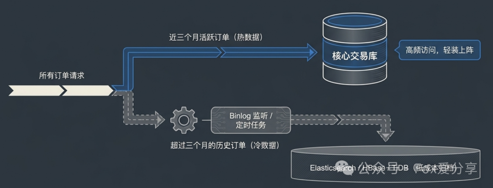

#### 二、 抗击瞬时高并发：多级缓存的艺术

在流量打过来的瞬间，任何依赖网络 IO 的分布式调用（甚至包括 Redis）都可能成为瓶颈。很多开发者在面对高并发时，习惯性地往 Redis 里塞数据，却忽略了热点 Key 导致的带宽打满和分片倾斜。

对于 电商秒杀 这种需要应对瞬间峰值的设计，我一直提倡优先低复杂度方案：本地缓存（Local Cache） > 规则前置过滤 > Redis 缓存。

本地缓存前置：对于商品基础信息、全局配置等极少变更的数据，直接用 Guava Cache 或 Caffeine 缓存在 JVM 本地。干掉那几毫秒的网络开销，吞吐量往往能翻倍。

规则过滤（白名单 / 布隆过滤器）：在流量到达核心逻辑前，通过极低成本的规则（如 IP 频控、设备黑名单、库存状态位前置检查）直接拦截掉 70% 的无效请求。

Redis 防超卖：到了扣库存这一步，利用 Redis 的 Lua 脚本保证原子性扣减即可，而不需要立刻将这股洪峰压入关系型数据库。

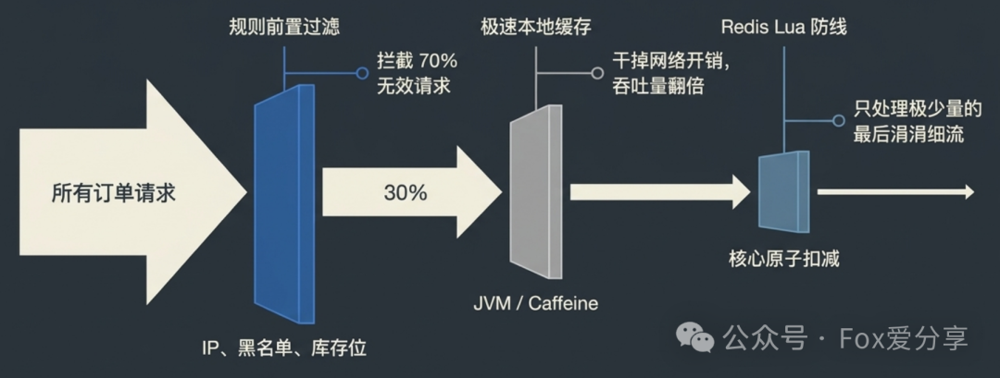

#### 三、 异步与批量：告别消息风暴与数据库死锁

当我们处理大并发落库时，逐条执行 UPDATE 或 INSERT 无异于让数据库 “慢性自杀”。

这时候，很多人会选择引入 MQ 进行削峰填谷。但如果 MQ 的消费者依然是逐条处理，遇到突发流量依然会导致消费堆积。更务实的做法是采用批量更新（Batch Updates）与本地消息表相结合的模式。

批量处理：在内存中开辟一个队列，通过定时器或队列长度阈值（如满 500 条或满 2 秒）触发一次批量的 DB 写入。把 500 次的 IO 开销压缩成 1 次，数据库的 TPS 压力会瞬间断崖式下跌。

本地消息表 + 定时补偿：在处理复杂的分布式订单状态流转时，相比于引入极其沉重的 TCC 或 Saga，同库下的本地消息表加上后台状态机轮询补偿，往往能以极低的改造成本，实现最终一致性。虽然它看起来不够 “极客”，但在绝大多数百亿级以下的业务线里，它就是最稳的底座。

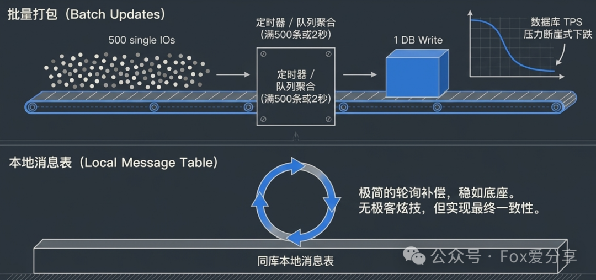

#### 四、 写在最后

架构设计的本质，从来不是为了炫技而堆砌前沿技术，而是在有限的资源下，用最简单的逻辑去解决最核心的问题。这也是我们在向 AI Agent、Harness 工程迈进时，同样适用的底层逻辑：越是花哨、越依赖复杂链路的架构，越容易在真正的生产环境里翻车。

少一点纸上谈兵的 “过度设计”，多一点脚踏实地的 “工程折衷”。

### 3. [Anthropic首次公开Claude记忆架构](https://mp.weixin.qq.com/s/qtnDtNjS6lYJCiPfPMCVWg)

> Datawhale Datawhale 2026年11月10日 23:21 浙江

Anthropic 官方研究团队刚刚正式公开了一篇长文《The components of agent memory》，首次系统披露了 Claude 内部的长期记忆架构设计。

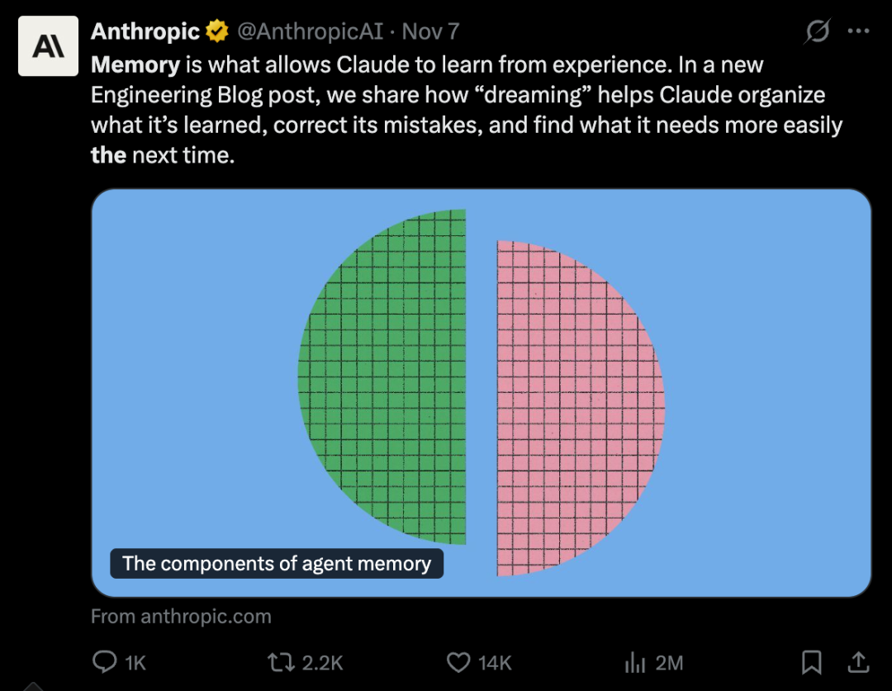

对于正在研发长程 Agent 的团队来说，跨会话的状态沉淀与记忆持久化始终是最卡脖子的难题。在实际工程中，许多团队做 Agent 记忆时的做法普遍粗暴：要么无脑把上一轮对话全量追加到当前上下文，要么外挂一个向量数据库把历史记录一股脑切块灌入，结果导致上下文迅速被琐碎细节占满，模型甚至被自己写下的错误前文带偏，陷入死循环。

Anthropic 这次拿出了完全不同的思路，并且已经跑在了 Claude Code 与 Managed Agents 的生产环境里。它的核心解法不是教大家去选型哪个数据库，而是搭建了一套包含四层金字塔与 “离线梦境（Dreaming）” 的动态闭环系统。

在这篇文章中，我们为大家系统拆解这套记忆架构到底是怎么设计的、各个组件如何协同运转，希望能为正在搭建长程 Agent 的开发者提供一份前沿的工程参考。

#### 一、传统外挂记忆的两个缺陷

在讨论具体设计之前，必须先厘清一个经常被混淆的前提：并不是所有能留存信息的地方，都叫 Agent 的 “长期记忆”。

在模型体系中，信息存留通常有三种方式：第一种是模型训练期间固化的内部参数权重（Weights）；第二种是单个会话上下文窗口内的即时少样本学习（In-context learning）；第三种是为了防止超长对话爆窗口而由模型自行生成的阶段性摘要（Compaction）。

Anthropic 明确界定，这里讨论的 Agent 记忆，专门指 Agent 从实际任务与交互中习得、并且能够跨会话持久留存、供后续轮次随时自主读取的知识与规则。

划清这条边界之后，我们来看看过去传统外挂记忆为什么总是行不通。

##### 1. 记下所有细节，反而把模型拖垮了

很多开发者的直觉是：Agent 记性越好、记的细节越多，能力就越强。但在长程动态环境中，这个假设完全站不住脚。

Anthropic 用 Claude 运行《宝可梦 红版》（Pokémon Red）做了一组极具反差的对比实验。在这项极其复杂的长程任务中，早期模型 Sonnet 3.7 采取了事无巨细的记录策略：每遇到一场野外战斗、拾取一个道具、与一位 NPC 对话，它都单独建一个文件存盘。

结果，当游戏推进到约第 10,000 步时，Sonnet 3.7 已经写下了 413 个文件、分布在 225 个文件夹中，累计占用了 977,930 字符。

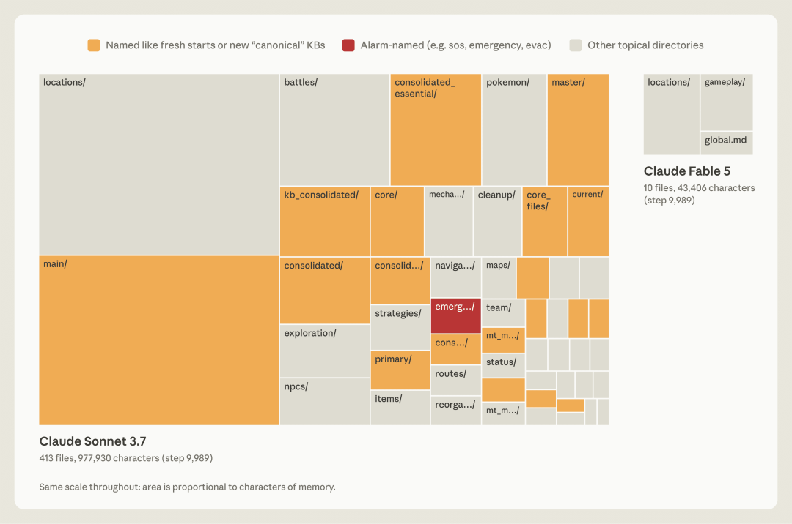

\**Treemap 面积直观对比：Sonnet 3.7 事无巨细的滥记拖垮了行动带宽，而 Fable 5 凭借 10 个策略文件稳步拿到 4 枚徽章。*

这种庞大记忆不仅没有帮到模型，反而成了沉重的负担。由于游戏环境在不断动态演化，事无巨细的记录会迅速过期失效。到了第 10,000 步前后，Sonnet 3.7 开始建立它的第 4 个主记忆目录；在随后的连续 17 步中，它创建了 6 个文件、删除了 9 个文件，所有算力和上下文都在忙于整理这些笔记，在游戏里没有推进任何有效操作，最终仅勉强拿到 1 枚道馆徽章。

相反，更成熟的模型 Fable 5 仅仅保留了 10 个文件（总计 43,406 字符），却顺利拿到 4 枚徽章；后续的 Opus 5.5 也采用紧凑策略直接通关。

记忆从来都不是免费的资产，它本身也是一种高昂的负债。 没有过滤机制的滥记，不仅会白白烧掉 Token，更会严重稀释模型的注意力，让 Agent 陷入 “为了记笔记而记笔记” 的僵死状态。

##### 2. 记错一条笔记，引发后续会话连环崩盘

在线记录的第二个原罪是：在线生成的笔记不可避免地会包含主观偏差或事实错误。

在宝可梦的月见山（Mt. Moon）任务中，存在一个致命的单向地形：洞穴入口旁潜藏着一个单向台阶，跳下去就会掉回刚走过的路线，无法原路攀爬。

在某次会话中，Claude 在在线笔记里错误地记下一句：“宝可梦中心在山洞东侧”。走出大门后，它依据这条错误笔记断定 “月见山已经走完了”，随即跳下了单向台阶，直接摔回原点。

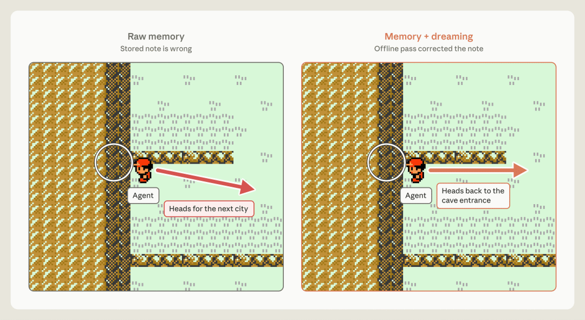

\**月见山单向台阶现场：未修正的错误笔记让 Agent 陷入无休止跳崖循环，修正后的笔记指引它调头重返洞穴。*

更致命的是由于导航工具无法感知高低落差，Claude 误以为自己向西走过头了，在笔记里加倍坚信自己走在正确道路上。在后续的会话中，每一次进入游戏的新 Agent 都无条件信任前人留下的错误笔记，导致角色连续 3 次跌落同一个台阶摔回原路，最终陷入死循环直接放弃，整场任务宣告失败。

这种现象被称为错误记忆的级联崩溃：当系统缺乏事实校准机制时，一条错误的长期记忆，会像病毒一样污染之后所有的独立会话。

#### 二、Agent 到底该记什么？

既然事无巨细地记录会拖垮系统，那么第一道防线显然是在输入端建立严格的筛选。

##### 1. 只记隐性规则，不记易变事实

面对环境中涌来的海量信息，Anthropic 得出了一条极其关键的分类判据：区分易变事实与隐性规则。

在任何长程环境中，信息都可以清晰地划分为两类：

易变事实（Ephemeral Facts）：例如 “NPC 当前站在哪个坐标”、“背包里还剩几个伤药”、“某张网页当前的 DOM 结构”。这类信息在屏幕上肉眼可见，且随时在动态刷新。把它们记入长期记忆毫无价值，因为模型直接重新看一眼屏幕的代价，远比从记忆库里调出可能已经过期的旧记录要便宜且准确得多；

隐性规则与策略模型（Latent Rules）：例如 “这个洞穴出去后千万不能跳右侧台阶”、“该 API 在并发调用时必须先拿锁”、“某类复杂报错的根因是环境变量缺失”。这类经验无法直接从当前的单帧屏幕中读出，必须由模型在多次跨会话的探索、碰撞与失败中提炼得出。

真正的长期记忆，只应该承载第二类信息。

##### 2. 别用死板的 Prompt 限制强模型

那么，如何让 Agent 学会只记有价值的隐性规则？过去许多工程团队的做法是：在 Prompt 里给 Agent 写下一堆死板的限制，比如 “严禁记录具体坐标”、“只准记录失败教训”。

但 Anthropic 在 CL-Bench 评测中的实验结果，给出了一个反直觉的警告：这种死板的规则，对强大的模型反而是负向约束。

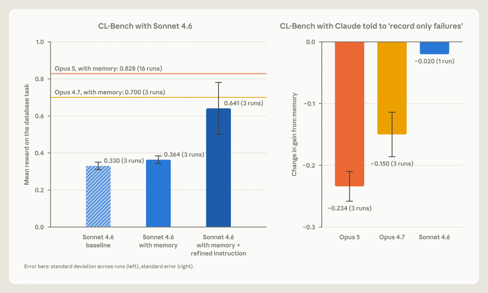

\**提示词对记忆收益的影响：限制过严会让强模型（Opus 5）收益大跌 0.234，而宽松提示能让弱模型表现更佳。*

实验数据显示：

- 当研究人员向强大的 Opus 5 施加严苛的限制性提示词（强制它只记录失败经验）时，模型的平均奖励从 0.828 暴跌至 0.594，收益净损失了 0.234；
- 相反，如果给予明确的方向引导（提示它先读记忆再验证假设），原本能力较弱的早期模型 Sonnet 4.6 跑分近乎翻倍；而更强大的模型如 Sonnet 5 则无需提示便能自主高频调阅记忆。


这揭示了一条极其重要的架构哲学：越强大的模型，系统越不应该用死板的规则去锁死它的记录动作。 强模型的优势恰恰在于它能敏锐权衡当前情境的显著性。工程架构该做的事，不是替它做决定，而是为它提供分层的存储容器与事后修正的自愈管道。

#### 三、Claude 的四层记忆金字塔

在解决了 “记什么” 的筛选哲学之后，核心问题来到了存储结构：沉淀下来的经验，究竟应该以怎样的形式组织？

Anthropic 在文章中正式公开了 Claude 的内部记忆分层模型。这套架构不是平铺直叙的单一向量库，而是一套严密的四层金字塔：

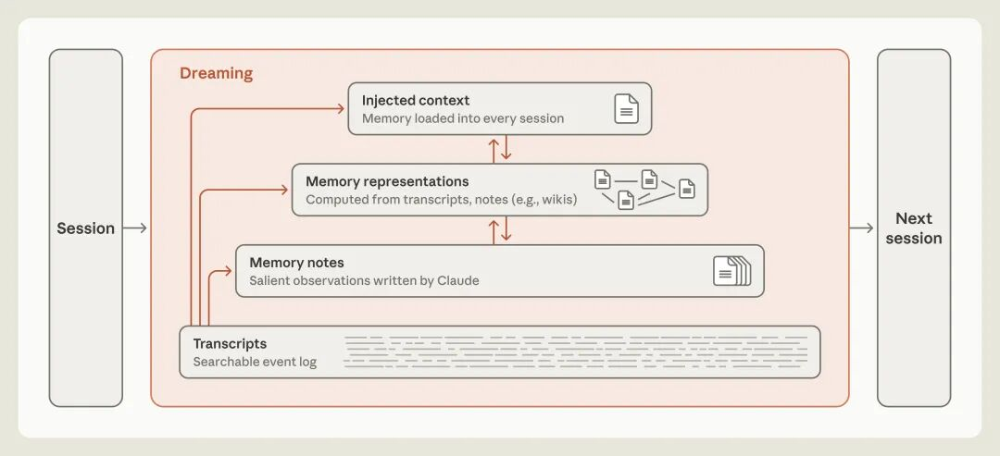

\**四层记忆金字塔架构：从底层海量原始记录，逐步向上提炼为笔记、Wiki 表示与顶层注入索引。*

这四层自底向上依次为：

1. 底层：原始执行流水（Transcripts） 这是整个架构的基石。它无损记录了 Agent 过去的完整对话历史、工具调用参数、执行结果与外部环境反馈。它是整个系统唯一的真实底账（Ground Truth），支持关键词检索与全文检索；
2. 第二层：记忆笔记（Memory Notes） 在每次会话运行过程中，Claude 自主打标签或写入的显著观察（Salient Events）。它记录了单次任务的局域教训，通常以平铺的 Markdown 笔记形式存在；
3. 第三层：知识地图与网络（Wiki / Knowledge Representation） 这是整个架构中最具生产力的一层。系统不会让零散的笔记无限累加，而是利用离线算力，把碎片化的笔记抽象、归纳并交叉链接成一张结构化的 Markdown Wiki 网络；
4. 第四层：开局注入上下文（Injected Context） 当一个全新会话启动时，系统自动预加载进上下文的极轻量摘要。它绝不包含海量细节，而是充当最高级别的元数据导航。

这种分层设计彻底重塑了记忆的利用效率。以软件工程代码库 Stainless 的实测为例：

如果让 Agent 每次都去底层数以万计的原始流水中捞取代码规范，单次检索往往要暴力吞掉上万 Token 的上下文，而且检索命中极度不稳定。

Anthropic 让 Claude 在处理该任务的 128 轮交互中，持续将学到的模式沉淀成结构化的 Markdown Wiki。

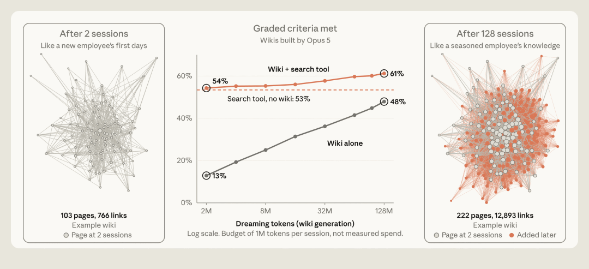

\**Stainless 128 轮 Wiki 生长：知识网络不断自愈裂变，任务评测奖励曲线同步大幅攀升。*

随着交互深入，这张 Wiki 从最初零星的几个孤立页面，动态演化成包含多级目录、交叉双向链接、包含明确架构规范的知识网络。量化结果显示：当 Agent 协同查阅这张紧凑的 Wiki 地图与搜索工具时，在跨语料问答评测中不仅准确率显著攀升，平均每个问题还减少了约 20,000 Token 的盲目检索开销。

#### 四、离线梦境：Agent 的夜间纠错机制

如果只搭建了上面四层金字塔，这套系统依然可能因为一条错误笔记而走向崩溃（正如前面提到的月见山跳崖惨剧）。

因为在在线交互时，模型的所有算力都在疲于应对当下的任务，它根本没有余力回看全局，更容易在局部压力下记下充满偏差的结论。

为了解决这个闭环难题，Anthropic 引入了被称为 “离线梦境（Dreaming）” 的自我对账与演化引擎。

这个命名的灵感直接源于认知神经科学：人类大脑在清醒时负责收集经历，而在进入慢波睡眠与快速眼动睡眠（REM）时，海马体会进行高频的离线回放（Hippocampal Replay），将白天的短期记忆重放、修剪、剔除噪音，最终整合进大脑皮层的长期结构中。

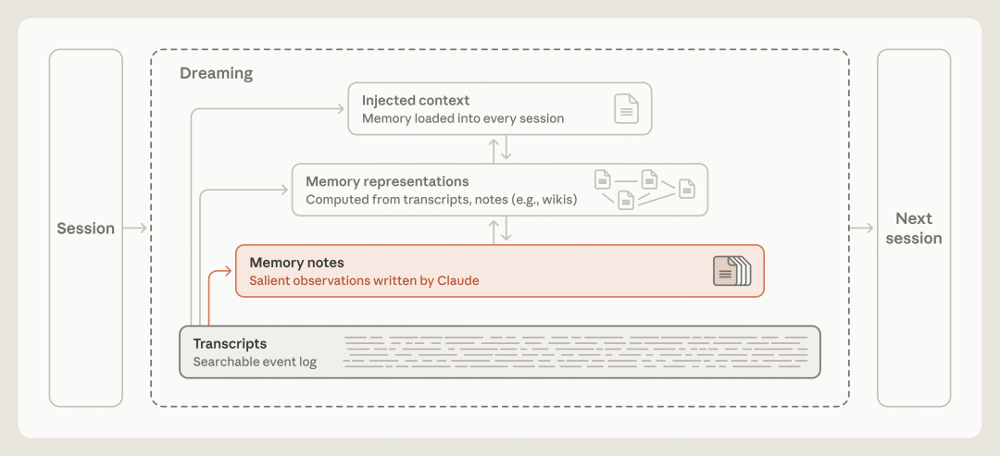

\**Dreaming 运行机制：在离线状态下穿透各层，调取底层原始执行记录比对核验，重写错误笔记。*

在 Agent 系统中，Dreaming 拥有三大不可替代的工程特性：

##### 1. 对照底层流水底账，推翻线上的错误总结

在线生成的笔记只是一层易腐烂的二次加工缓存。当 Agent 闲下来进入 Dreaming 阶段时，系统会启动专用的审判模型，直接调取底层最原始、未经任何修饰的执行流水（Transcripts）。

在月见山的惨痛教训后，研究人员让系统执行了一次离线 Dreaming。审判模型对比了角色的实际移动坐标流水与上层笔记，立刻抓出了破绽：“笔记声称宝可梦中心在东侧，但底层流水证明角色走出大门向东走直接坠崖重置”。

Dreaming 当场删除了这条虚假笔记，将其重写为：“穿过月见山后切勿向右侧悬崖跳跃，必须返回洞内向北行进”。

在随后针对华蓝市（Cerulean City）的长程实测中，经过 Dreaming 修正的 Agent 在第 1,935 步顺利穿越月见山抵达华蓝市；而未修正的对照组由于记忆错误在同一台阶连续跌落 3 次，最终彻底迷失倒退回深灰市，任务宣告失败。

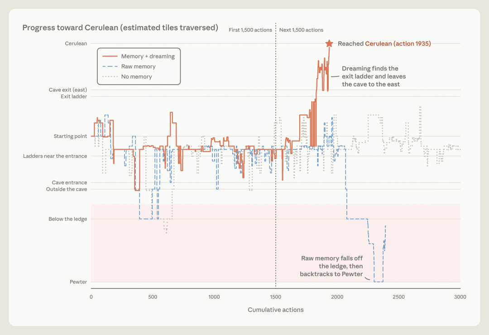

\**长程实测对比：经过离线 Dreaming 纠偏的 Agent（修正组）顺利穿越月见山抵达华蓝市，未修正组在悬崖处迷航折返。*

##### 2. 拓扑结构的自动修补与去重

除了事实层面的纠错，Dreaming 还承担着 “知识地图园丁” 的职责。

当知识网络不断扩张时，死链（Broken links）和孤岛页面不可避免地会出现。在第二轮 Dreaming 过程中，模型会自动遍历整张 Markdown Wiki，扫描所有被引用但尚未创建的文件名，自动根据历史记录把缺失的页面补齐；同时把被多次验证的临时教训合并为通用规范，剔除已过期的临时记录。

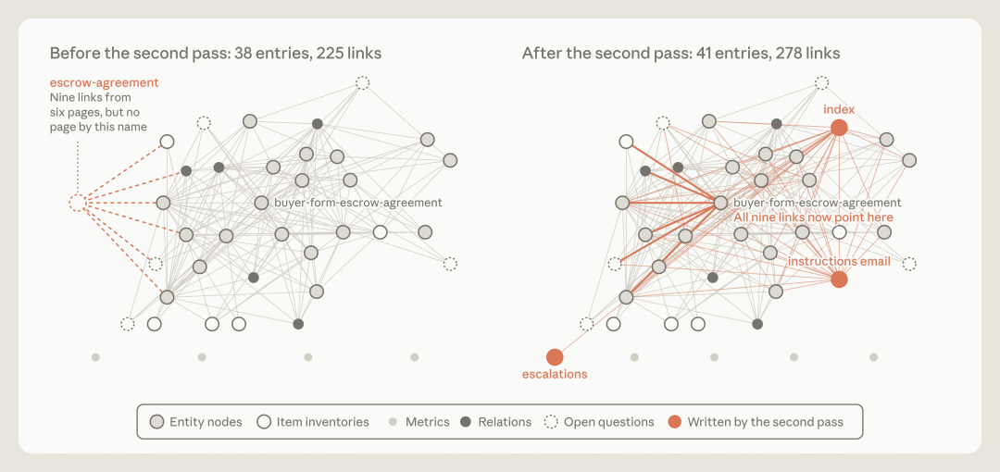

\**知识拓扑自愈：Dreaming 自动检测出死链并重定向，生长出缺失的核心策略页面。*

#### 五、Claude Code 的生产落地实践

很多技术论文描绘的架构极尽奢华，但一旦推向生产环境，高昂的延迟、膨胀的 Token 成本和脆弱的上下文管理就会让系统彻底崩塌。

Anthropic 在文章中给出了他们将这套架构落地到实际生产工具（如 Claude Code）时的真实工程做法。

##### 1. 只加载前 200 行：顶层做目录，底层做仓库

很多开发者在尝试做跨会话记忆时，容易把累积下来的记忆文件无节制地塞进 System Prompt。但在生产环境中，过长的预置指令会导致模型对核心任务的指令遵循度呈断崖式下跌，同时还会成倍推高每一次调用的首字延迟与开销。

Claude Code 采取了极其硬核的截断设计：在每次会话启动时，它绝不全量加载 `MEMORY.md`，而是严格限制只加载前 200 行或 25 KB 文本。

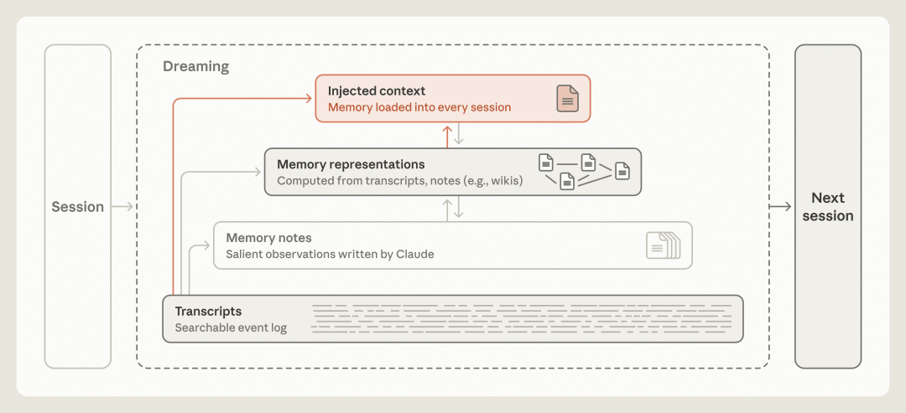

\**生产级访问路径：顶层注入轻量目录索引，底层知识按需检索深读。*

这前 200 行充当的完全是目录索引的角色：它只告诉模型 “我已经掌握了哪些模块的知识、这些细节分别存放在底层的什么路径下”。

当模型在后续执行中需要某项具体规范时，它会拿着索引指引，主动通过本地工具发起按需检索。顶层做目录，底层做仓库，化解了上下文容量与信息完整性之间的矛盾。

##### 2. 生产环境里的三个工程权衡

在真实业务中部署这套记忆架构时，Anthropic 提醒开发者必须在三个核心维度上做好工程权衡：

第一是写入时机的权衡（在线捕获 vs 离线梳理）。在线记录的好处是能趁热打铁捕获当下的显著性事件，但写笔记的动作本身会挤占模型宝贵的上下文带宽；离线 Dreaming 将整理开销转移到了后台，但需要付出额外的离线算力，且无法当场反哺当前轮次。

第二是记忆漂移与实效维护（定期剪枝 vs 全量沉淀）。长程记忆库绝不是一个只增不减的冷库。随着业务环境和代码库的演进，过期的记忆笔记如果不及时清理，就会误导未来的 Agent。系统不能无休止地全盘扫描所有历史，需要引入访问频次与置信度衰减机制，定期对陈旧记忆做退火与淘汰。

第三是检索与表示的平衡（轻量索引 vs 深度知识图）。单纯依赖原始流水检索，模型很容易在海量碎屑中迷失；而维护一份完美结构化的 Wiki，又需要持续投入大量的 Dreaming 算力。Anthropic 在实践中采取的折中，正是用轻量的 Markdown 索引结合底层的分块检索，在准确率与工程开销之间取得平衡。

生产级 Agent 记忆的精髓，从来不是把系统打造成吞下一切的垃圾桶，而是在每一个环节做精巧的减法。

#### 写在最后

梳理完整套 Claude 记忆架构设计，其实可以提炼出三条对所有开发者都极具实操价值的底层法则：

1. 不要盲信中间记忆，永远保留原始底账：记忆笔记只是一层易碎的二次加工缓存。无论上层结构怎么变，底层未加工的原始执行流水（Transcripts）必须无损存档，那是系统在发生级联崩溃时唯一的自愈抓手；
2. 顶层做目录，底层做仓库：不要幻想把所有经验直接注入开局上下文。顶层只放精炼的小型索引目录，具体的规则与知识下沉到底层，由 Agent 依靠索引按需深读；
3. 给强模型目标，不要写死死板规则：强模型的优势在于复杂的上下文理解与显著性权衡。与其用死板的硬编码规则去限制它该记什么、不该记什么，不如把精力放在搭建稳定的分层存储与离线对账闭环上。

### 4. [CS2680 Modern AI Systems: Agents and System Optimizations](https://cs2680.seas.harvard.edu/)

这是哈佛的一门课，讲述从 Agent 到 GPU，可惜不是公开课，只能看看课程 PPT。

## tip [🔝](#weekly-126)

## share [🔝](#weekly-126)

[readme](../README.md) | [previous](202611W1.md) | [next](202611W3.md)
