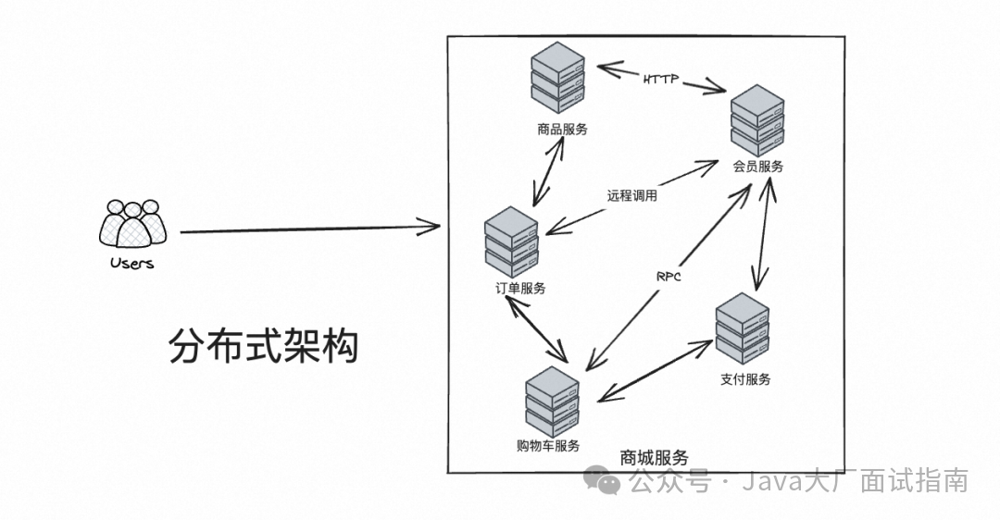

# Weekly #127

@Range : 2026-11-15 - 2026-11-21

@City: Hangzhou

[readme](../README.md) | [previous](202611W2.md) | [next](202611W4.md)


\**Photo by [Eren Yildiz](https://unsplash.com/@eren16) on [Unsplash](https://unsplash.com/photos/grey-sphere-on-beige-mountain-peak-B5RL__RyWio)*

-[toc]

## algorithm [🔝](#weekly-127)

## review [🔝](#weekly-127)

### 1. [面试官：如何设计一个高可用架构？](https://mp.weixin.qq.com/s/UkXX0BJZLpm-waxe3dDQYA)

> 程序员陈哥 Java大厂面试指南 2026年11月19日20:27 湖北

#### 先给结论

**高可用的核心思路是：消除单点，用冗余换可用；用故障转移缩短恢复时间；用限流、降级、熔断防止局部故障扩散；用监控与演练保证机制真的有效。**

可用性以 “几个九” 衡量，目标越高，冗余的粒度越大（从机器到机房到城市），成本也越高。设计时要先定业务目标，再选方案。

#### 1. 集群与冗余：消除单点

任何只有一份的组件都是单点。无状态的应用服务多节点部署，前面用负载均衡分发请求，并配合健康检查自动摘除故障节点。负载均衡自身也要冗余，例如双机加 VIP 漂移。

分布式和集群是两个容易混的概念：

|  概念  |        部署方式        |          目的          |
|:------:|:----------------------:|:----------------------:|
| 分布式 | 不同服务器部署不同模块 | 拆分业务，横向扩展能力 |
| 集群   | 不同服务器部署相同服务 | 分担负载，冗余容错     |



实际系统两者同时存在：先按业务拆成多个服务，每个服务再以集群方式部署。

#### 2. 数据层高可用：副本与故障转移

有状态的数据层是高可用的难点。常见手段：
- **主从复制**：数据库、缓存都有主从架构，主库故障时提升从库为新主；
- **自动切换**：借助哨兵、Orchestrator、MHA 等组件，或云数据库自带的高可用能力，避免人工介入；
- **数据备份**：定期全量加增量备份，并演练恢复，防止误删数据被同步到从库。

异步复制存在数据丢失窗口，要依据业务对 RPO 的要求选择同步、半同步或异步。

#### 3. 流量治理：限流、降级、熔断

流量治理的目的是在局部故障或突发流量时保护整体不被拖垮：

| 手段 |             作用             |    发生位置    |
|:----:|:----------------------------:|:--------------:|
| 限流 | 控制请求量，防止过载         | 被调用方为主   |
| 降级 | 关闭非核心功能，保核心       | 调用方或服务方 |
| 熔断 | 下游异常时停止调用，快速失败 | 调用方         |

举例：大促时关闭退款、评论等非核心入口属于降级；支付渠道失败率突增时临时熔断该渠道，属于熔断；对每个调用方设置 QPS 上限属于限流。Sentinel、Hystrix、Resilience4j 等组件都可以实现这些能力。

#### 4. 多机房与异地多活

单机房整体故障（断电、网络中断、自然灾害）时，机房内的冗余全部失效。因此更高等级的可用性需要跨机房部署：
- **同城双活**：同一城市多个机房，网络延迟低，数据同步容易；
- **异地多活**：跨城市多个数据中心同时对外服务，任一中心故障，流量切到其他中心。

多活的难点在于数据同步延迟与冲突，通常要按用户或业务维度做单元化拆分，让一个用户的请求尽量落在同一单元内。

#### 5. 容灾与备份

容灾关注的是 “最坏情况也能恢复”。要明确两个指标：RTO（可接受的恢复时间）和 RPO（可接受的数据丢失量）。再据此选择冷备、暖备、热备，或者两地三中心等方案，并定期做容灾切换演练。

#### 6. 监控、自动化与发布治理

很多故障来自变更，而不是硬件。因此：
- **监控告警**：覆盖机器、应用、中间件、业务指标，并设置分级告警，缩短发现故障的时间；
- **灰度发布与快速回滚**：变更先小流量验证，出问题能一键回滚；
- **自动化运维**：自动扩缩容、自动摘除故障节点，减少人为操作失误；
- **容量规划与压测**：提前通过压测摸清水位，预留余量，大促前扩容。

#### 面试加分项
- **先问目标再设计**：先问清业务要几个九、RTO 与 RPO 是多少，避免过度设计。
- **整体可用性是短板效应**：链路上的服务串联，可用性相乘；关键路径上的任何一个单点都会拉低整体。
- **弱依赖要能降级**：把非核心依赖设计成 “挂了也不影响主流程”，例如推荐、积分、短信通知。
- **故障演练**：混沌工程或定期演练，验证切换、降级、限流真的可用。高可用方案如果没演练过，出事时往往失效。
- **权衡成本**：多活、热备代价高，不是所有业务都值得做。核心链路重点投入，边缘业务可以接受更低等级。

#### 限流、降级、熔断的区别

三者经常被合并成 “一把梭”，其实侧重点不同：
- **限流**是入口控制，通过滑动窗口、漏桶、令牌桶等算法限制请求量，解决 “来得太多” 的问题；
- **降级**是主动取舍，牺牲非核心功能保核心，比如用兜底数据替代实时计算，解决 “资源不够” 的问题；
- **熔断**是调用方的自我保护，下游错误率或超时率超阈值后暂停调用，一段时间后再试探恢复，解决 “下游已坏” 的问题。


### 2. [分库分表后，如何跨表查询](https://mp.weixin.qq.com/s/tB63Q7jNnYzytyJDiFF77g)

> Java私房菜 Java私房菜 2026年10月8日 20:42浙江

订单表拆成 32 张，订单明细也拆成 32 张。原来的一条 SQL 还想继续查：

```SQL
SELECT o.order_id, o.status, i.sku_id, i.quantity
FROM t_order o
JOIN t_order_item i ON i.order_id = o.order_id
WHERE o.order_id = ?;
```

分库分表以后，这条 SQL 能不能执行，先不要看 `JOIN` 语法。应该先问：这笔订单和它的明细，最后会不会落到同一个数据节点。

如果答案是会，查询仍然接近普通的单库 JOIN；如果答案是不会，就要跨节点拉取数据，再由中间件或应用完成关联。两种查询写出来可能只差一个条件，执行成本却不是一回事。

#### 先看路由

分片中间件收到逻辑 SQL 后，通常要经过解析、路由、改写、执行和结果归并。SQL 里带有可识别的分片键，它才能算出目标库表；没有分片键，就可能向全部数据节点发送查询。


Apache ShardingSphere 当前文档明确写到：SQL 不含分片字段时会执行全路由，性能较差。即使条件里出现了分片字段，如果字段被函数或复杂表达式包住，中间件无法提取它的值，也可能退化成全路由。

例如 `order_id` 是分片键，下面这种等值条件通常可以直接定位分片：

```SQL
WHERE order_id = 10001
```

但写成 `WHERE MOD(order_id, 100) = 1`，不能想当然地认为中间件一定能从表达式反推出分片。具体能否路由，要看产品、版本和分片算法的实现。

所以跨表查询先分三种情况：能定位一个分片；要查多个分片但只需归并结果；需要让不同节点上的数据参与 JOIN。越往后，网络传输、内存占用和失败处理越复杂。

#### JOIN 放在哪

高频关联查询，最好在分片设计阶段就把相关数据放到一起。

假设订单和订单明细都按 `user_id` 分片，两张表使用相同的分片算法。查询里带上 `user_id`，订单和明细就能被路由到同一个节点：

```SQL
SELECT o.order_id, o.status, i.sku_id, i.quantity
FROM t_order o
JOIN t_order_item i
  ON i.user_id = o.user_id
 AND i.order_id = o.order_id
WHERE o.user_id = ?
  AND o.order_id = ?;
```

ShardingSphere 把这种使用一致分片规则的表称为绑定表；Citus 使用的说法是表共置，也就是 co-location。名字不同，处理思路一样：让需要关联的数据按同一个业务维度落在同一节点，JOIN 留给节点内的数据库执行。

如果是地区、状态字典、商品类目这类数据量小、变化不频繁的表，可以把完整副本放到每个数据节点。ShardingSphere 称之为广播表，Citus 称为 reference table。大表和本地的小表关联，不需要为了几百条字典数据跨节点搬运结果。

麻烦通常出在分片键不一致。订单按 `user_id` 分，明细按 `order_id` 分，查询又只知道 `order_id`，一次关联就很难同时满足两张表的路由条件。

这时可以保存一份 `order_id -> user_id` 的路由索引，先查出用户，再定位订单分片；也可以在明细表冗余 `user_id`，让两张表按同一维度分片。冗余字段要考虑写入一致性，但它至少把高频查询的代价留在一个节点内。

另一种做法是在应用里拆成两次查询：先拿到一批关联 ID，再按目标分片分组，用批量 `IN` 查询补齐数据。这里不能退化成逐行查询，否则跨库 JOIN 没了，N+1 查询又来了。批量大小、并发数、超时和部分分片失败都要有边界。

ShardingSphere 的 Federation 执行引擎也能处理部分跨数据库关联，但当前文档仍把它列为实验性支持，并说明还需要较多优化。它可以解决一部分 “能不能查” 的问题，不代表适合承接每个在线请求。

#### 排序和聚合

不带分片键的列表查询，往往比 JOIN 更容易被低估。

比如在 32 个分片里按创建时间倒序取第 100001 到 100020 条。为了得到全局正确结果，中间件不能让每个分片只返回自己的第 100001 页，而是要从各分片取得足够的候选数据，再做全局排序和截取。

ShardingSphere 的分页改写文档给出的处理方式，是把 `LIMIT offset, size` 改成从 0 开始读取 `offset + size` 条。按这个逻辑计算，`LIMIT 100000, 20` 分发到 32 个分片，最多需要处理约 320 万条候选记录，最后只留下 20 条。SQL 没变复杂，深分页把读取量放大了。

能使用游标翻页时，应该保留上一页最后一条记录的排序键：

```SQL
WHERE (created_at, order_id) < (?, ?)
ORDER BY created_at DESC, order_id DESC
LIMIT 20;
```

`order_id` 在这里负责打破相同时间的排序并列。跨分片时，中间件仍要查询多个节点并归并，但每个分片不必从头扫描十万条。若列表本来就按 `user_id` 查询，把用户条件带上，通常还能继续缩到一个分片。

聚合查询也有类似差别。`SUM`、`COUNT`、`MIN`、`MAX` 可以先在各分片计算，再合并部分结果；全局 `AVG` 不能简单平均各分片的平均值，ShardingSphere 会把它改写为 `SUM` 和 `COUNT` 后再计算。

到了非分片键的 `GROUP BY`、全局 `DISTINCT`、复杂窗口计算，协调节点需要维护更多中间状态。数据量大时，与其继续给在线库增加归并压力，不如把查询送到专门的分析链路。

#### 复杂查询分流

分库分表解决的是单机容量和吞吐问题，它同时削弱了数据库在任意维度上自由关联的能力。这个代价需要在数据模型和查询入口里消化，不能全部交给中间件兜底。

在线详情、下单校验、用户订单列表这类请求，应该尽量携带分片键，或者先通过路由索引找到分片。频繁使用的关联字段，可以通过绑定表、共置、广播表或读模型提前准备好。

全站搜索、跨用户报表、全局排行榜和多维统计，更适合通过 CDC 或消息链路同步到 Elasticsearch、ClickHouse、数仓等查询系统。它们允许一定的数据延迟，换来更自由的过滤、聚合和扫描能力。低频后台查询确实可以采用全路由，但要限制并发、结果规模和超时时间，不能和在线交易请求共用一套无限制的执行策略。

我会把 “高频查询能否落到一个分片” 作为分片方案的验收项。跨库 JOIN 和全路由归并可以保留，但更适合作为少量查询的补充能力。否则分片从 4 个扩到 64 个以后，原来能跑的 SQL 还在，读取、传输和归并的成本却会跟着放大。

## tip [🔝](#weekly-127)

## share [🔝](#weekly-127)

[readme](../README.md) | [previous](202611W2.md) | [next](202611W4.md)
