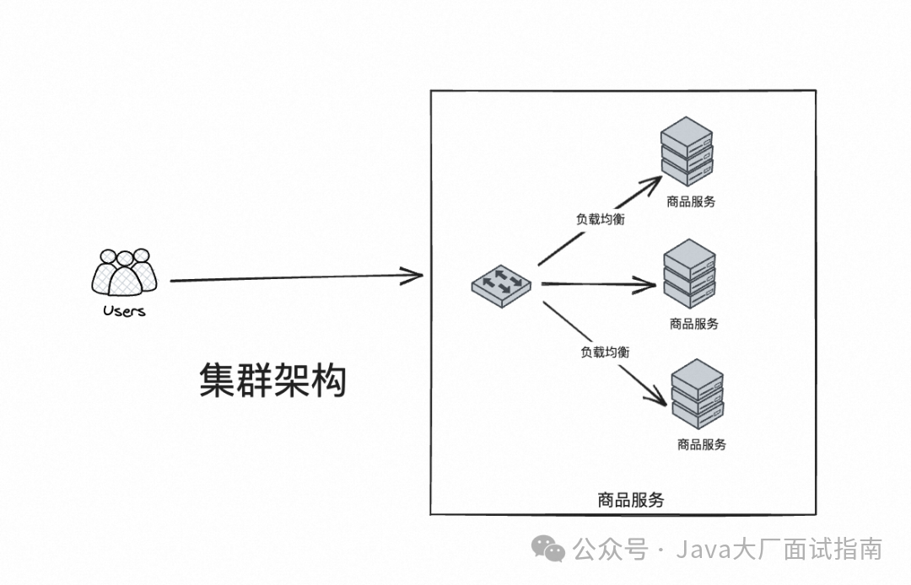

# Weekly #127

@Range : 2026-11-15 - 2026-11-21

@City: Hangzhou

[readme](../README.md) | [previous](202611W2.md) | [next](202611W4.md)

\**Photo by [Eren Yildiz](https://unsplash.com/@eren16) on [Unsplash](https://unsplash.com/photos/grey-sphere-on-beige-mountain-peak-B5RL__RyWio)*

-[toc]

## algorithm [🔝](#weekly-127)

## review [🔝](#weekly-127)

### 1. [面试官：如何设计一个高可用架构？](https://mp.weixin.qq.com/s/UkXX0BJZLpm-waxe3dDQYA)

> 程序员陈哥 Java大厂面试指南 2026年11月19日20:27 湖北

#### 先给结论

**高可用的核心思路是：消除单点，用冗余换可用；用故障转移缩短恢复时间；用限流、降级、熔断防止局部故障扩散；用监控与演练保证机制真的有效。**

可用性以 “几个九” 衡量，目标越高，冗余的粒度越大（从机器到机房到城市），成本也越高。设计时要先定业务目标，再选方案。

#### 1. 集群与冗余：消除单点

任何只有一份的组件都是单点。无状态的应用服务多节点部署，前面用负载均衡分发请求，并配合健康检查自动摘除故障节点。负载均衡自身也要冗余，例如双机加 VIP 漂移。

分布式和集群是两个容易混的概念：

|  概念  |        部署方式        |          目的          |
|:------:|:----------------------:|:----------------------:|
| 分布式 | 不同服务器部署不同模块 | 拆分业务，横向扩展能力 |
| 集群   | 不同服务器部署相同服务 | 分担负载，冗余容错     |

实际系统两者同时存在：先按业务拆成多个服务，每个服务再以集群方式部署。

#### 2. 数据层高可用：副本与故障转移

有状态的数据层是高可用的难点。常见手段：
- **主从复制**：数据库、缓存都有主从架构，主库故障时提升从库为新主；
- **自动切换**：借助哨兵、Orchestrator、MHA 等组件，或云数据库自带的高可用能力，避免人工介入；
- **数据备份**：定期全量加增量备份，并演练恢复，防止误删数据被同步到从库。

异步复制存在数据丢失窗口，要依据业务对 RPO 的要求选择同步、半同步或异步。

#### 3. 流量治理：限流、降级、熔断

流量治理的目的是在局部故障或突发流量时保护整体不被拖垮：

| 手段 |             作用             |    发生位置    |
|:----:|:----------------------------:|:--------------:|
| 限流 | 控制请求量，防止过载         | 被调用方为主   |
| 降级 | 关闭非核心功能，保核心       | 调用方或服务方 |
| 熔断 | 下游异常时停止调用，快速失败 | 调用方         |

举例：大促时关闭退款、评论等非核心入口属于降级；支付渠道失败率突增时临时熔断该渠道，属于熔断；对每个调用方设置 QPS 上限属于限流。Sentinel、Hystrix、Resilience4j 等组件都可以实现这些能力。

#### 4. 多机房与异地多活

单机房整体故障（断电、网络中断、自然灾害）时，机房内的冗余全部失效。因此更高等级的可用性需要跨机房部署：
- **同城双活**：同一城市多个机房，网络延迟低，数据同步容易；
- **异地多活**：跨城市多个数据中心同时对外服务，任一中心故障，流量切到其他中心。

多活的难点在于数据同步延迟与冲突，通常要按用户或业务维度做单元化拆分，让一个用户的请求尽量落在同一单元内。

#### 5. 容灾与备份

容灾关注的是 “最坏情况也能恢复”。要明确两个指标：RTO（可接受的恢复时间）和 RPO（可接受的数据丢失量）。再据此选择冷备、暖备、热备，或者两地三中心等方案，并定期做容灾切换演练。

#### 6. 监控、自动化与发布治理

很多故障来自变更，而不是硬件。因此：
- **监控告警**：覆盖机器、应用、中间件、业务指标，并设置分级告警，缩短发现故障的时间；
- **灰度发布与快速回滚**：变更先小流量验证，出问题能一键回滚；
- **自动化运维**：自动扩缩容、自动摘除故障节点，减少人为操作失误；
- **容量规划与压测**：提前通过压测摸清水位，预留余量，大促前扩容。

#### 面试加分项
- **先问目标再设计**：先问清业务要几个九、RTO 与 RPO 是多少，避免过度设计。
- **整体可用性是短板效应**：链路上的服务串联，可用性相乘；关键路径上的任何一个单点都会拉低整体。
- **弱依赖要能降级**：把非核心依赖设计成 “挂了也不影响主流程”，例如推荐、积分、短信通知。
- **故障演练**：混沌工程或定期演练，验证切换、降级、限流真的可用。高可用方案如果没演练过，出事时往往失效。
- **权衡成本**：多活、热备代价高，不是所有业务都值得做。核心链路重点投入，边缘业务可以接受更低等级。

#### 限流、降级、熔断的区别

三者经常被合并成 “一把梭”，其实侧重点不同：
- **限流**是入口控制，通过滑动窗口、漏桶、令牌桶等算法限制请求量，解决 “来得太多” 的问题；
- **降级**是主动取舍，牺牲非核心功能保核心，比如用兜底数据替代实时计算，解决 “资源不够” 的问题；
- **熔断**是调用方的自我保护，下游错误率或超时率超阈值后暂停调用，一段时间后再试探恢复，解决 “下游已坏” 的问题。

## tip [🔝](#weekly-127)

## share [🔝](#weekly-127)

[readme](../README.md) | [previous](202611W2.md) | [next](202611W4.md)
