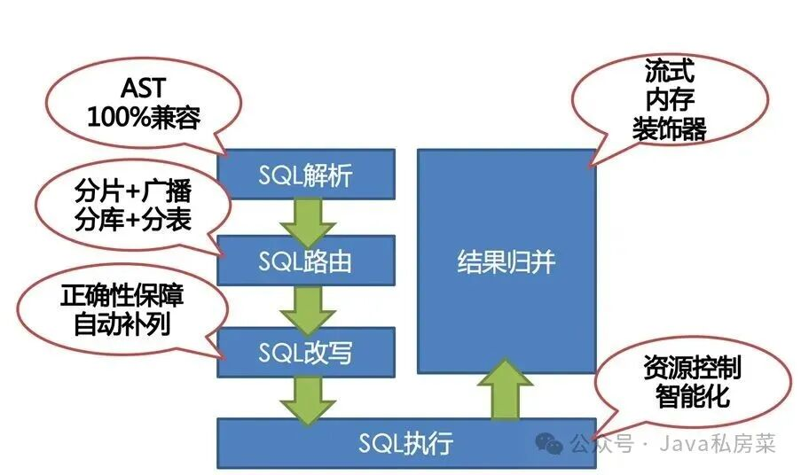

# Weekly #127

@Range : 2026-11-15 - 2026-11-21

@City: Hangzhou

[readme](../README.md) | [previous](202611W2.md) | [next](202611W4.md)


\**Photo by [Eren Yildiz](https://unsplash.com/@eren16) on [Unsplash](https://unsplash.com/photos/grey-sphere-on-beige-mountain-peak-B5RL__RyWio)*

-[toc]

## algorithm [🔝](#weekly-127)

## review [🔝](#weekly-127)

### 1. [面试官：如何设计一个高可用架构？](https://mp.weixin.qq.com/s/UkXX0BJZLpm-waxe3dDQYA)

> 程序员陈哥 Java大厂面试指南 2026年11月19日20:27 湖北

#### 先给结论

**高可用的核心思路是：消除单点，用冗余换可用；用故障转移缩短恢复时间；用限流、降级、熔断防止局部故障扩散；用监控与演练保证机制真的有效。**

可用性以 “几个九” 衡量，目标越高，冗余的粒度越大（从机器到机房到城市），成本也越高。设计时要先定业务目标，再选方案。

#### 1. 集群与冗余：消除单点

任何只有一份的组件都是单点。无状态的应用服务多节点部署，前面用负载均衡分发请求，并配合健康检查自动摘除故障节点。负载均衡自身也要冗余，例如双机加 VIP 漂移。

分布式和集群是两个容易混的概念：

|  概念  |        部署方式        |          目的          |
|:------:|:----------------------:|:----------------------:|
| 分布式 | 不同服务器部署不同模块 | 拆分业务，横向扩展能力 |
| 集群   | 不同服务器部署相同服务 | 分担负载，冗余容错     |


实际系统两者同时存在：先按业务拆成多个服务，每个服务再以集群方式部署。

#### 2. 数据层高可用：副本与故障转移

有状态的数据层是高可用的难点。常见手段：
- **主从复制**：数据库、缓存都有主从架构，主库故障时提升从库为新主；
- **自动切换**：借助哨兵、Orchestrator、MHA 等组件，或云数据库自带的高可用能力，避免人工介入；
- **数据备份**：定期全量加增量备份，并演练恢复，防止误删数据被同步到从库。

异步复制存在数据丢失窗口，要依据业务对 RPO 的要求选择同步、半同步或异步。

#### 3. 流量治理：限流、降级、熔断

流量治理的目的是在局部故障或突发流量时保护整体不被拖垮：

| 手段 |             作用             |    发生位置    |
|:----:|:----------------------------:|:--------------:|
| 限流 | 控制请求量，防止过载         | 被调用方为主   |
| 降级 | 关闭非核心功能，保核心       | 调用方或服务方 |
| 熔断 | 下游异常时停止调用，快速失败 | 调用方         |

举例：大促时关闭退款、评论等非核心入口属于降级；支付渠道失败率突增时临时熔断该渠道，属于熔断；对每个调用方设置 QPS 上限属于限流。Sentinel、Hystrix、Resilience4j 等组件都可以实现这些能力。

#### 4. 多机房与异地多活

单机房整体故障（断电、网络中断、自然灾害）时，机房内的冗余全部失效。因此更高等级的可用性需要跨机房部署：
- **同城双活**：同一城市多个机房，网络延迟低，数据同步容易；
- **异地多活**：跨城市多个数据中心同时对外服务，任一中心故障，流量切到其他中心。

多活的难点在于数据同步延迟与冲突，通常要按用户或业务维度做单元化拆分，让一个用户的请求尽量落在同一单元内。

#### 5. 容灾与备份

容灾关注的是 “最坏情况也能恢复”。要明确两个指标：RTO（可接受的恢复时间）和 RPO（可接受的数据丢失量）。再据此选择冷备、暖备、热备，或者两地三中心等方案，并定期做容灾切换演练。

#### 6. 监控、自动化与发布治理

很多故障来自变更，而不是硬件。因此：
- **监控告警**：覆盖机器、应用、中间件、业务指标，并设置分级告警，缩短发现故障的时间；
- **灰度发布与快速回滚**：变更先小流量验证，出问题能一键回滚；
- **自动化运维**：自动扩缩容、自动摘除故障节点，减少人为操作失误；
- **容量规划与压测**：提前通过压测摸清水位，预留余量，大促前扩容。

#### 面试加分项
- **先问目标再设计**：先问清业务要几个九、RTO 与 RPO 是多少，避免过度设计。
- **整体可用性是短板效应**：链路上的服务串联，可用性相乘；关键路径上的任何一个单点都会拉低整体。
- **弱依赖要能降级**：把非核心依赖设计成 “挂了也不影响主流程”，例如推荐、积分、短信通知。
- **故障演练**：混沌工程或定期演练，验证切换、降级、限流真的可用。高可用方案如果没演练过，出事时往往失效。
- **权衡成本**：多活、热备代价高，不是所有业务都值得做。核心链路重点投入，边缘业务可以接受更低等级。

#### 限流、降级、熔断的区别

三者经常被合并成 “一把梭”，其实侧重点不同：
- **限流**是入口控制，通过滑动窗口、漏桶、令牌桶等算法限制请求量，解决 “来得太多” 的问题；
- **降级**是主动取舍，牺牲非核心功能保核心，比如用兜底数据替代实时计算，解决 “资源不够” 的问题；
- **熔断**是调用方的自我保护，下游错误率或超时率超阈值后暂停调用，一段时间后再试探恢复，解决 “下游已坏” 的问题。


### 2. [分库分表后，如何跨表查询](https://mp.weixin.qq.com/s/tB63Q7jNnYzytyJDiFF77g)

> Java私房菜 Java私房菜 2026年10月8日 20:42浙江

订单表拆成 32 张，订单明细也拆成 32 张。原来的一条 SQL 还想继续查：

```SQL
SELECT o.order_id, o.status, i.sku_id, i.quantity
FROM t_order o
JOIN t_order_item i ON i.order_id = o.order_id
WHERE o.order_id = ?;
```

分库分表以后，这条 SQL 能不能执行，先不要看 `JOIN` 语法。应该先问：这笔订单和它的明细，最后会不会落到同一个数据节点。

如果答案是会，查询仍然接近普通的单库 JOIN；如果答案是不会，就要跨节点拉取数据，再由中间件或应用完成关联。两种查询写出来可能只差一个条件，执行成本却不是一回事。

#### 先看路由

分片中间件收到逻辑 SQL 后，通常要经过解析、路由、改写、执行和结果归并。SQL 里带有可识别的分片键，它才能算出目标库表；没有分片键，就可能向全部数据节点发送查询。



Apache ShardingSphere 当前文档明确写到：SQL 不含分片字段时会执行全路由，性能较差。即使条件里出现了分片字段，如果字段被函数或复杂表达式包住，中间件无法提取它的值，也可能退化成全路由。

例如 `order_id` 是分片键，下面这种等值条件通常可以直接定位分片：

```SQL
WHERE order_id = 10001
```

但写成 `WHERE MOD(order_id, 100) = 1`，不能想当然地认为中间件一定能从表达式反推出分片。具体能否路由，要看产品、版本和分片算法的实现。

所以跨表查询先分三种情况：能定位一个分片；要查多个分片但只需归并结果；需要让不同节点上的数据参与 JOIN。越往后，网络传输、内存占用和失败处理越复杂。

#### JOIN 放在哪

高频关联查询，最好在分片设计阶段就把相关数据放到一起。

假设订单和订单明细都按 `user_id` 分片，两张表使用相同的分片算法。查询里带上 `user_id`，订单和明细就能被路由到同一个节点：

```SQL
SELECT o.order_id, o.status, i.sku_id, i.quantity
FROM t_order o
JOIN t_order_item i
  ON i.user_id = o.user_id
 AND i.order_id = o.order_id
WHERE o.user_id = ?
  AND o.order_id = ?;
```

ShardingSphere 把这种使用一致分片规则的表称为绑定表；Citus 使用的说法是表共置，也就是 co-location。名字不同，处理思路一样：让需要关联的数据按同一个业务维度落在同一节点，JOIN 留给节点内的数据库执行。

如果是地区、状态字典、商品类目这类数据量小、变化不频繁的表，可以把完整副本放到每个数据节点。ShardingSphere 称之为广播表，Citus 称为 reference table。大表和本地的小表关联，不需要为了几百条字典数据跨节点搬运结果。

麻烦通常出在分片键不一致。订单按 `user_id` 分，明细按 `order_id` 分，查询又只知道 `order_id`，一次关联就很难同时满足两张表的路由条件。

这时可以保存一份 `order_id -> user_id` 的路由索引，先查出用户，再定位订单分片；也可以在明细表冗余 `user_id`，让两张表按同一维度分片。冗余字段要考虑写入一致性，但它至少把高频查询的代价留在一个节点内。

另一种做法是在应用里拆成两次查询：先拿到一批关联 ID，再按目标分片分组，用批量 `IN` 查询补齐数据。这里不能退化成逐行查询，否则跨库 JOIN 没了，N+1 查询又来了。批量大小、并发数、超时和部分分片失败都要有边界。

ShardingSphere 的 Federation 执行引擎也能处理部分跨数据库关联，但当前文档仍把它列为实验性支持，并说明还需要较多优化。它可以解决一部分 “能不能查” 的问题，不代表适合承接每个在线请求。

#### 排序和聚合

不带分片键的列表查询，往往比 JOIN 更容易被低估。

比如在 32 个分片里按创建时间倒序取第 100001 到 100020 条。为了得到全局正确结果，中间件不能让每个分片只返回自己的第 100001 页，而是要从各分片取得足够的候选数据，再做全局排序和截取。

ShardingSphere 的分页改写文档给出的处理方式，是把 `LIMIT offset, size` 改成从 0 开始读取 `offset + size` 条。按这个逻辑计算，`LIMIT 100000, 20` 分发到 32 个分片，最多需要处理约 320 万条候选记录，最后只留下 20 条。SQL 没变复杂，深分页把读取量放大了。

能使用游标翻页时，应该保留上一页最后一条记录的排序键：

```SQL
WHERE (created_at, order_id) < (?, ?)
ORDER BY created_at DESC, order_id DESC
LIMIT 20;
```

`order_id` 在这里负责打破相同时间的排序并列。跨分片时，中间件仍要查询多个节点并归并，但每个分片不必从头扫描十万条。若列表本来就按 `user_id` 查询，把用户条件带上，通常还能继续缩到一个分片。

聚合查询也有类似差别。`SUM`、`COUNT`、`MIN`、`MAX` 可以先在各分片计算，再合并部分结果；全局 `AVG` 不能简单平均各分片的平均值，ShardingSphere 会把它改写为 `SUM` 和 `COUNT` 后再计算。

到了非分片键的 `GROUP BY`、全局 `DISTINCT`、复杂窗口计算，协调节点需要维护更多中间状态。数据量大时，与其继续给在线库增加归并压力，不如把查询送到专门的分析链路。

#### 复杂查询分流

分库分表解决的是单机容量和吞吐问题，它同时削弱了数据库在任意维度上自由关联的能力。这个代价需要在数据模型和查询入口里消化，不能全部交给中间件兜底。

在线详情、下单校验、用户订单列表这类请求，应该尽量携带分片键，或者先通过路由索引找到分片。频繁使用的关联字段，可以通过绑定表、共置、广播表或读模型提前准备好。

全站搜索、跨用户报表、全局排行榜和多维统计，更适合通过 CDC 或消息链路同步到 Elasticsearch、ClickHouse、数仓等查询系统。它们允许一定的数据延迟，换来更自由的过滤、聚合和扫描能力。低频后台查询确实可以采用全路由，但要限制并发、结果规模和超时时间，不能和在线交易请求共用一套无限制的执行策略。

我会把 “高频查询能否落到一个分片” 作为分片方案的验收项。跨库 JOIN 和全路由归并可以保留，但更适合作为少量查询的补充能力。否则分片从 4 个扩到 64 个以后，原来能跑的 SQL 还在，读取、传输和归并的成本却会跟着放大。

### 3. [毛选：如果做不到这四点，就不要做领导](https://mp.weixin.qq.com/s/hqGxwDe4dHeSQZbtPpB4yg)

> 毛选智慧 毛选智慧 2026年11月21日 19:01 河南

看过太多的例子，职位上去之后人却没有跟上。

头衔是领导，但是做的事情还是执行。团队带不动、业绩提不上去，最后把自己累得半死，下面的人心里也憋着一股怨气。

实际上并不是每个人都可以坐在那个位置上的。

坐上去之前要问自己一下，这四个条件是否能够满足。

#### 一、不能受得了事情的人，就不要做领导

团队最害怕的是什么？并不是任务很难，而是出了问题没有人来兜底。

客户投诉的时候比下属还要慌张。项目搞砸了之后第一反应就是找人来背锅。

这样的人带领队伍的时候，下面的人永远也不敢放手去做事情。因为大家都明白——出了事情之后，领导会比谁都先逃走。

真正的领导者就是在风暴中站得住脚的人。

不一定是每次都可以解决问题，但是至少要让人觉得：天塌下来了有人顶着。

#### 二、不分钱，不能做领导

谈论理想是可以的，但是不能只谈理想。

很多人做领导的时候都是画大饼一套一套的，到了分钱的时候就装作不知道。或者平均主义、或者看心情、或者拖延不给。

时间长了以后能够干活的人就都离开了，留下来的都是混日子的人。

分钱这件事，并不是看谁大方，而是要看是否公平。

谁干得多，谁就得到更多的回报。贡献大的人要先上。规则要明了，兑现要迅速。

舍不得花钱的人，留不住人心。这并不是格局的问题，而是基本常识的问题。

#### 三、不敢做决定的话就不要当领导

开会两个小时后还没有结果。请示了三次之后仍然在 “再研究研究”。

这样的领导者，他的队伍也会越来越慢。

做决定这件事本来就不能够百分之百正确。但是一个错误的决定要比没有做出任何决定要好一些。

错误是可以调整的，但是停滞不前的话，机会就没有了。

当领导要有这样的魄力：我做决定，我负责。

犹犹豫豫的人适合做参谋而不适合做主心骨。

#### 四、管不住嘴巴的话就不要当领导了

很多人的看法并不重视这条规定。

有的领导者今天对 A 说 B 坏话，明天又去向 B 抱怨 C。团队里的消息传播速度比工作还要快。

有些领导情绪上来的时候就会说出很多话来。骂完自己痛快了，下面的人心里却很失望。

领导的话就是整个团队的方向标。

你随便说一句话，底下的人可能会想上三天的事情。一次发脾气之后，一个月之内都无法恢复过来。

不会说话的人迟早要把整个团队都给毁掉。

#### 最后再说一句

领导并不是官职，也不是头衔，更不是名片上的一个额外的称呼。

领导就是一种能力，也是一种责任。

能够承担责任、分清利害、敢于坚持己见、能够管住自己的嘴巴。

四条都做到的话，就不需要争了，位置自然就是你的。

做不到的地方就早点放弃吧。害人害己。

### 4. [都说 Go 1.27 换了 JSON：22 组用例跑完，没变](https://mp.weixin.qq.com/s/IqMMg5jIT9rFtaT7oDx3Iw)

> Zampo 青春不毕业 2026年11月4日 00:04 广东

> Go 1.27 把 `encoding/json` 换成 v2 实现，但兼容层保住了 v1 的行为：22 组用例 20 组逐字一致，只有无效 UTF-8 的转义写法和一处报错文本不同。真正先出事的是 `go test` 新默认的 `stdversion` 检查，和已移除的 `//go:debug` 设置；会改 JSON 语义的，只有你主动 import 的 `encoding/json/v2`。

网上说 Go 1.27 把 `encoding/json` 换了。我把同一个程序在两个工具链上各跑了一遍：`go1.26.5`，和刚装上的 `go1.27.0`，22 组用例，逐条对输出。

20 组完全一致。HTML 转义还是 `\u003c`，nil slice 还是 `null`，重复 key 还是后者胜，字段名大小写还是照样匹配。只有两处不同：无效 UTF-8 的转义写法，和一处报错文本。

先出事的是编译那一层。我那个 `go 1.21` 的老模块，`go test` 在 1.26.5 上是 ok，换到 1.27 直接 FAIL——`slices.Collect requires go1.23 or later`。

所以这篇只说三件事：JSON 到底变没变、什么会先挂、真要新语义该动哪一行。

#### 一、换了实现，不等于换了行为

Go 1.27 在 2026 年 8 月 19 日发布。release notes 里关于 JSON 最要紧的一句是：`encoding/json` 现在由 v2 实现支撑。

后面还跟着半句，更容易被忽略——遇到兼容性问题可以用 `GOEXPERIMENT=nojsonv2` 退回旧实现，而这条退路「预期在未来版本移除」。

注意这个开关的方向。它不是让你去试新实现，而是出事之后回头。默认值已经换了。

但「实现换了」和「行为换了」是两件事。`encoding/json` 这层 API 没动，兼容层负责把 v1 的语义钉住：字段怎么匹配、什么算空、转义怎么写、重复 key 怎么处理，都按老规矩。下面看它钉得有多牢。

#### 二、22 组用例，20 组逐字一致

方法是笨办法：一个 `main.go`，22 个用例函数，每条打一行 `CASE 名字 结果`；同一个文件分别用 `go1.26.5` 和 `go1.27.0` 跑，输出对齐比对。

一致的 20 组覆盖编码、解码、报错三面：HTML 转义、nil slice 与空 slice 的区别、`omitempty` 对各类字段、浮点格式、`time.Time`、重复 key、字段名大小写、未知字段、`null` 解到 int、大整数解到 `any`、多值流式解码、语法错误与尾随数据。逐条对下来，两个版本一个字节都不差。

变的两处：

- **无效 UTF-8 marshal**：1.26 输出 `{"u":"\ufffda"}`，1.27 输出 `{"u":"�a"}`。
- **`1e400` 解到 `any`**：报错从 `…into Go value of type float64` 变成 `…into Go struct field .n of type float64`。

第一处是写法变了，数据没变：`\ufffd` 是转义序列，`�` 是同一个字符的 UTF-8 字节。解回来一样，只有你拿原始字节做断言时才现形——比如测试里写死了 `\ufffd` 的字符串比对。

第二处只影响日志和错误匹配。谁在代码里 `strings.Contains(err.Error(), "Go value of type float64")`，这条会断。

复现这两条，一个程序够，在两个工具链下各跑一次：

```go
func main() {
 b, _ := json.Marshal(map[string]string{"u": string([]byte{0xff, 'a'})})
 fmt.Println(string(b)) // 1.26: {"u":"\ufffda"}   1.27: {"u":"�a"}

 var v map[string]any
 fmt.Println(json.Unmarshal([]byte(`{"n":1e400}`), &v)) // 报错文本不同
}
```

如果你的服务不做「无效 UTF-8 塞进 JSON」这种事、也没人拿错误字符串做判断，升级对 JSON 层就是零变化。给同一个程序加上 `GOEXPERIMENT=nojsonv2` 再跑一遍，22 组一行不差——那条退路确实退得回去。

#### 三、先挂的是 CI

JSON 没变，不等于升级没风险。我这边真正先失败的是编译和测试。

第一条，`go test` 从 1.27 起默认跑 `stdversion` vet 检查。这个检查本身早就有，1.27 把它放进了默认集合。我那个声明 `go 1.21` 的老模块里只用了 `slices.Collect`：

```bash
p/p.go:6:34: slices.Collect requires go1.23 or later (module is go1.21)
FAIL sv/p [build failed]
```

同一份代码，1.26.5 上是 `ok`。这条跟着 `go.mod` 里的 go 指令走：模块声明 1.21，就不许用 1.23 才有的标准库符号。它在你自己的包里报，报在 build 阶段。

第二条更硬。代码里的 `//go:debug` 指令留着已被移除的项，换工具链就编不过：

```bash
./main.go:1:1: invalid //go:debug: removed GODEBUG "asynctimerchan" set to old value "1"
```

1.27 删掉了 `asynctimerchan`、`gotypesalias`，以及五个 TLS 相关开关（`tlsunsafeekm`、`tlsrsakex`、`tls3des`、`tls10server`、`x509keypairleaf`）。这些开关没有回退的口子，写成旧值就是编译错误。

关键细节在这儿：**这条只看你换的是哪个工具链，不看你 go.mod 写几。** 我把 go.mod 退回 `go 1.26` 再编，1.27 照样拒绝；同一份代码用 1.26.5 工具链编是通的。所以「先不动 go 指令，只换工具链试试」这种渐进升级，挡不住这一条。

自查两条命令：

```bash
grep -rn "//go:debug" --include=*.go .
go test ./...   # 换成 1.27 的工具链跑
```

这类失败听起来吓人，其实是好消息：它响亮、出现在 CI 里、不静默。真正难查的是跑得通、输出却悄悄变了的那种。本篇实测的结论是，JSON 不在这个名单上。

#### 四、会变的是你主动 import 的那个包

`encoding/json/v2` 在 1.27 才不用开实验开关。1.25 它就在标准库里了，一直躲在 `GOEXPERIMENT=jsonv2` 后面，同一个 import 在 1.26 上直接编不过。同批还有一个更底层的 `encoding/json/jsontext`。它和 v1 兼容层差在哪，同一份数据跑一遍最清楚：

```go
type Req struct {
 Name string   `json:"name"`
 Tags []string `json:"tags"`
 Note string   `json:"note"`
}

r := Req{Name: "<a>&b"}
b1, _ := jsonv1.Marshal(r) // encoding/json
b2, _ := jsonv2.Marshal(r) // encoding/json/v2
```

两行输出：

```
{"name":"\u003ca\u003e\u0026b","tags":null,"note":""}
{"name":"<a>&b","tags":[],"note":""}
```

同一批默认值，换成新包就全变了。逐条列出来：

<table><thead><tr><th><section>行为</section></th><th><code>encoding/json</code></th><th><code>encoding/json/v2</code></th></tr></thead><tbody><tr><td><section>HTML 字符</section></td><td><section>转义成&nbsp;<code>\u003c</code></section></td><td><section>原样输出&nbsp;<code>&lt;a&gt;&amp;b</code></section></td></tr><tr><td><section>nil slice</section></td><td><code>null</code></td><td><code>[]</code></td></tr><tr><td><section>重复 key 解码</section></td><td><section>后者胜</section></td><td><section>报错&nbsp;<code>jsontext: duplicate object member name "a"</code>，值停在前一个</section></td></tr><tr><td><section>字段名匹配</section></td><td><code>{"A":7}</code><section>&nbsp;能填进&nbsp;<code>json:"a"</code></section></td><td><section>不匹配，静默留零值</section></td></tr><tr><td><code>omitempty</code></td><td><section>省&nbsp;<code>0</code>、<code>false</code>、<code>""</code>、nil</section></td><td><section>只省&nbsp;<code>""</code>&nbsp;和 nil，<code>0</code>&nbsp;与&nbsp;<code>false</code>&nbsp;照输出</section></td></tr><tr><td><code>omitzero</code></td><td><section>省零值</section></td><td><section>省零值</section></td></tr></tbody></table>

这些条目第二节里都出现过，那时它们没变。差别不在版本，在你 import 哪一个。

表里最容易忽略的是第四行：字段名不匹配不报错，只是留零值。客户端把 `name` 写成 `Name`，你不会收到任何提示，收到的是一串空字符串。

顺手纠一个流行说法：v2 对未知字段默认放过，我实测传 `{"zzz":1}` 不报错，想要严格得自己加选项。把「v2 更严格」当结论抄，会准备错方向。

边界因此很清楚：不 import 这个包，1.27 对你就只是工具链版本号变了；import 了，上面五条要逐条对齐——那不是升级，是换包。

框架层也不用跟着改。我拿 gin v1.12.0 做了一次端到端对照：同一个请求打 `ShouldBindJSON` 再 `c.JSON`，把大小写混写的字段名、重复 key、`null` 的 slice、`<a>&b` 一起塞进去，1.26.5 和 1.27.0 的响应体一个字节不差。原因回到第一节那句话：v1 的行为是用 v2 加一套选项拼回来的，不是被重写的。

#### 五、升级顺序

1. 先用 1.27 的工具链跑一遍 `go test ./...`。红点就是清单，比读 release notes 快。
2. 清掉 `//go:debug` 里的移除项，再考虑要不要提 go.mod 的 go 指令。
3. JSON 层默认什么都不动。也别为了保险去开 `GOEXPERIMENT=nojsonv2`——官方说这条退路要删，你等于给自己留一颗定时炸弹；想确认安全，拿自己的样本跑一遍对照更实在。
4. 真要 v2 的严格性和选项，按第四节那五条逐条对齐，先在一个独立包里试，别整仓替换。

另外一句：1.27 要求 macOS 13 以上，老 CI 机顺手看一眼。

#### 收口

「Go 1.27 换了 JSON」这句话没错，只是省掉的半句太多。它换的是实现，行为被兼容层摁住了——我这边 20 组用例逐字没变。真正先出事的，是代码里那行当年为绕过某个 bug 写下的 `//go:debug`，和一行从没动过的 `go 1.21`。

升级的风险位置，和你以为的差一个层级。

实测环境：macOS arm64，`go1.26.5` 与 `go1.27.0`，另有一次 gin v1.12.0 端到端对照，用例脚本留在临时目录；未做性能对照，除 gin 外的框架未逐个实测。`nojsonv2` 的移除时点，官方只说「未来版本」，没给版本号。

### 5. [设计模式真的有用吗](https://mp.weixin.qq.com/s/Ian7BwSdLN9bPUQQs-85Bw)

> 努力敲代码的小火 ZealYearning 2026年11月11日 09:38 江苏

> 本文由 [简悦 SimpRead](http://ksria.com/simpread/) 转码， 原文地址 [mp.weixin.qq.com](https://mp.weixin.qq.com/s/Ian7BwSdLN9bPUQQs-85Bw)

工作第三年，我才真正搞懂设计模式是干嘛的

刚入行那会儿，我也觉得这玩意儿就是纯八股。

面试疯狂背单例、工厂、策略、观察者，背得比谁都熟。

可真正上班第一天打开项目，瞬间懵了。

一个 Controller 两百多行代码，全是判空、参数拼装、VO 组装。

设计模式？影子都看不到。

但项目照样上线，需求照样交付，一点不耽误。

所以我当时的结论特别朴素：

设计模式，就是面试官拿来卡人的，工作里根本用不上。

这个认知，我足足信了两年。

真正的转折点，来自一个「越迭代越烂」的支付模块。

最开始业务简单，就微信、支付宝两个渠道，代码长这样：

```
if ("wx".equals(type)) {
    // 二十行支付逻辑
} else if ("ali".equals(type)) {
    // 二十行支付逻辑
}
```

刚写完看着还挺清爽，逻辑清晰、一眼看懂。

谁也没想到，后续需求疯狂叠加：

银行卡支付、月付抵扣、积分支付、企业转账……

短短几个版本迭代下来，再打开这个文件，已经七百多行代码、七个 else if 嵌套，每个分支里面还嵌套着多层判断。

那天我需要改一处退款逻辑。

就简单改几行代码，测试回归整整两天。

因为我根本不敢动，生怕改了一小块，其他支付渠道全部崩掉。

也是那天晚上，我重新翻了一遍策略模式。

不是我想学，是真的被自己写的屎代码恶心到了。

后来重构：

把每一个支付渠道单独拆成独立实现类，统一接口规范，通过  `Map<String, PayStrategy>`  统一注册分发。

新增支付渠道 → 新增一个类，老代码一行不动。

那一刻，我才真正理解：

所谓的开闭原则，不是背出来的，是踩坑踩出来、疼出来的。

聊点客观、真实的心里话。

网上很多文章说：「不用设计模式，短期爽、长期崩」。

这句话没错，但没说完整。

很多小项目、内部系统、临时需求，根本活不到 “长期”。

我做过不少内部运营后台，生命周期就两三个月，用完直接下线、不再迭代。

这种项目，我一行设计模式都没写。

全程平铺直叙 CRUD，快速交付、快速上线。

如果这种一次性需求，我硬套策略模式、责任链、工厂模式，

纯属过度设计、给自己加戏。

慢慢我总结出一个最真实的判断标准：

要不要用设计模式，从来不看 “高不高级”。

只看一件事：

「这块业务会不会频繁变、会不会频繁迭代、会不会新增分支？」

- 会变、分支多、对接多、迭代频繁 → 必须设计
- 一次性、固定逻辑、永不改动 → 平铺代码就是最优解

再聊聊我们每天都在用、却浑然不知的设计模式。

很多人觉得设计模式是书本知识，工作用不到。

其实我们线上踩的坑、写的优雅代码，全是设计模式的落地。

我举两个我亲身踩过的例子：

之前踩过 @Transactional 事务失效 的坑。

排查很久才明白：

同类内部方法  this  自调用，不走 Spring 代理。

那一刻我彻底懂了：

代理模式不是 UML 图，不是面试知识点，是真实决定你代码生不生效的底层逻辑。

还有 观察者模式。

最早写订单业务，状态变更、消息通知、短信推送、积分变动，全部堆在主流程里。

每新增一个下游业务，主流程就多一堆代码，越来越臃肿、越来越难维护。

后来改成  ApplicationEventPublisher  事件发布机制。

主流程只负责发布事件，下游业务全部通过  @EventListener  监听解耦。

主流程瞬间干净，新增业务无需改动核心代码。

不高深，但真的救命。

最后，说点程序员最真实的真心话。

设计模式不会让你少写 CRUD，

也不会让你直接升职加薪，

更不会让你的代码瞬间变 “大神级别”。

它解决的，是一个极其具体、极其现实的问题：

当你开始频繁复制粘贴、

当你堆满一堆又一堆 else if、

当你改一行代码就要全网祈祷别出 Bug、

当你不敢重构、不敢改动旧逻辑。

设计模式，就是前人给你留好的标准答案。

学它，不是为了面试炫技。

是为了在无数个加班深夜，

少骂两句三个月前写代码的自己。

当然，也实话实说：

原型、享元、桥接这类模式，

我工作三年一次都没主动用过。

面试该背还是要背，没办法，职场规则。

但这五个模式，真的无数次救过我的代码：

策略、模板方法、责任链、代理、观察者。

只要你被无尽的 if-else、臃肿流程、耦合代码折磨过一次，

你就彻底懂了，设计模式到底有什么用。

### 6. [毛选思维看世界 ‖ 一个不被任何人拿捏的方法：学会点破他人隐晦的恶意](https://mp.weixin.qq.com/s/BNqUNvrb9ZgKsrfkcNfZow)

> 崔建升 星火践行者 2026年11月12日 19:29 河北

生活中，你是不是经常遇到这种让人憋屈的情况：

同事当众开玩笑似地说：“你这人啥都好，就是有点死脑筋，不会变通。” 你要是翻脸，他说你 “开不起玩笑”；你不吭声，心里又膈应半天。

亲戚假惺惺地打听：“听说你最近又折腾新项目了？哎，这年头大环境不好，你可别把老本都赔进去啊。” 你听着不舒服，又挑不出他话里明显的毛病。

老板隐晦地敲打你：“这活儿其实谁都能干，但我看你平时挺踏实的，才交给你。” 潜台词是，你不干有的是人干，你干不好就是对不起我。

**这叫 “隐晦的恶意”。**

这种人最阴的地方就在于：他向你放冷箭，但箭上裹着棉花。 他故意恶心你、试探你、甚至打压你，却把话说得滴水不漏，把道德高地占得死死的。

你如果自我反省，你就输了；你如果憋在心里内耗，你就被拿捏了。

为什么会被拿捏？

大多数人的拿捏，都是从不动声色的试探开始的，很少有人一上来就明刀明枪。

**《矛盾论》里讲，事物是不断发展变化的，人性也是一样。** 坏人在第一次欺负你的时候，往往不会直接大打出手，他会先用一句 “半开玩笑” 的话，或者一个 “看似为你着想” 的建议，来试探你的底线。

如果你为了所谓的 “体面”，笑笑没说话，或者顺着他的话自我贬低两句，他的试探就成功了。

你的沉默，就是默许；你的 “不好意思”，就是邀请他下一次得寸进尺。

心理学上这叫 “服从性测试”，教员在军事上叫 “火力侦察”。你如果不还击，下一步他的炮弹就直接砸你阵地上了。

看透了这一层，我们再来读《毛选》，就会明白教员对待这种局面的最高心法： **“以斗争求团结，则团结存；以退让求团结则团结亡。”**

你之所以憋屈，核心就是你掉进了对方精心设计的 “隐晦恶意” 陷阱，而你又不敢开第一枪。解决这个问题最妙的招数只有一个：学会点破。

所谓点破，不是发脾气，不是扭脸就走，更不是情绪失控地互撕。而是把对方模糊的恶意，直接翻译成明面上的话，摆到台面上来。

隐晦的恶意一旦被说透，就彻底失效了。这就是典型的点破：我看见你言语里埋藏的刀子了，我也看穿你的 “关心” 了，你打开天窗说亮话吧。

 只要把这层窗户纸捅破，对方就无处躲藏。

为什么陷入内耗？

教员的《实践论》讲究实事求是。但遇到这种事，老实人最爱犯的毛病就是 “向内归因”。你会在心里反复想：他是不是真的觉得我死脑筋？我是不是真的能力不行？

你用别人的恶意来惩罚自己，这就是典型的主观脱离了客观。那个放冷箭的人心里门儿清，他就是故意让你难受的。

你越是在心里反复咀嚼，越是自我怀疑，他在那边越是得意。你点破他，把矛盾挑到明面上，其实是在保护你的内因；你不点破，他的外因就会疯狂侵蚀你的精神世界。

到底怎么反击？

绝不是让你破口大骂。教员教导我们要 “有理、有利、有节”。我们要用最温和的语气，打出最硬的拳头。

当同事故作玩笑说你死脑筋时，你不要去自证 “我不死脑筋”，你要盯着他的眼睛平静地问：“你刚才这句话，是想表达什么意思？我没太听懂，你能解释一下吗？” 这叫强行撕掉他的遮羞布，逼他对自己的话负责，他解释不出来，尴尬的就是他。

当亲戚阴阳怪气地劝你别赔本时，你可以笑眯眯地回：“谢谢关心，不过听你这话，是笃定我一定会赔钱对吧？” 把话挑明了，他绝对会赶紧摆手说没那个意思，一旦他退缩，你的边界就立住了。

如果老板敲打你 “这活谁都能干”，你可以装作很惊讶地说：“啊？老板，原来在您心里这活门槛这么低啊？那既然谁都能干，您为什么偏偏找我这个死脑筋呢？” 用他的魔法打败魔法，让他自己打自己的脸。

最高境界是什么？

当然，现实里还有一种人，最高级的点破，是连嘴都懒得动。

他并没有直接侵犯你的利益，也没有暗戳戳地坑你，他就是单纯地爱装、爱演。

我这人不会演戏，也看不惯演戏的人。社会上或身边总有些人喜欢装模作样、惺惺作态，不亲假亲、不近假近，总想让你感受到他对你的 “亲密无间、无微不至”。

有时候我不当面说穿他，不是因为我怕他，而是觉得没必要。在我眼里，他在台上演得唾沫横飞，其实就像那个穿着 “皇帝的新装” 裸奔的人。他不尴尬，尴尬的只是那些为了迎合他、假装鼓掌的人。

我坐在台下，静静地看着他演，心里跟明镜似的。不去附和，不去买账，就是我对他最狠的 “点破”。

教员讲过：“你打你的，我打我的。” 你想演你的戏，那是你的事；我不陪你演，但我心里早给你贴了标签。

不把宝贵的精力浪费在陪虚伪的人逢场作戏上，这就是最高级的拿捏。

教员还讲过一句极其霸气的话：“人不犯我，我不犯人；人若犯我，我必犯人。”

我们从小被教育要懂事、要大度，但很多时候，社会这所大学教给我们的第一课就是：你的底线，是你自己杀出来的。

遇到试图用隐晦恶意占你便宜的人，大胆点破他；遇到纯粹爱装模作样的 “戏精”，就当看一场 “皇帝的新装”，冷眼旁观。

真正成熟的人，从来不是什么都没脾气，而是心里有佛，手里有刀。用菩萨心肠待人，用雷霆手段护己。

当你学会了这一套，你会发现，那些喜欢拿捏别人的人，其实全是欺软怕硬的纸老虎。

最后，我还想告诉大家一句掏心窝子的话：

你要明白，有些人的坏是真实存在的，有些人的 “好” 也是真实存在的。当你真正看懂了人性和利益，这些烂人烂事就不再是你的牵绊。

教员在《矛盾论》里教我们要抓主要矛盾。你这一辈子的主要矛盾，是把自己的日子过好，把手艺练精，把认知拔高，而不是天天跟这些隐晦的恶意去缠斗。

看透了，点破了，转身就放下。把有限的生命和精力，全部放在更有价值的地方。这，才是一个成年人最顶级的清醒与通透。

【 哲语分享】

“在这个世界上，你必须做一个自己保护自己的人。没有人能像你一样懂得你自己的价值。”

—— 泰戈尔

## tip [🔝](#weekly-127)

## share [🔝](#weekly-127)

### 1. 逆向选择与道德风险

#### 一、逆向选择（Adverse Selection）

##### 1. 是什么
在交易或签约**之前**，一方掌握对方不知道的私人信息，导致市场出现“劣质者更愿意参与、优质者被挤出”的现象。

提出背景：阿克洛夫1970年《柠檬市场》用二手车市场做了经典分析，后来与斯宾塞、斯蒂格利茨共同获得诺贝尔经济学奖。

##### 2. 经典例子：二手车“柠檬市场”
二手车市场里，卖家知道车况，买家不知道。

- 好车卖家想卖高价，但买家不信，只愿出平均价。
- 坏车卖家最愿意按平均价出手。
- 结果：好车退出市场，坏车留下。
- 买家发现质量更差，进一步压价。
- 最后市场可能只剩“柠檬”（坏车），甚至萎缩。

这就是**逆向选择**：**信息劣势方无法区分好坏，价格机制失灵，优质品被劣质品挤出。**

##### 3. 其他例子
- **保险**：身体差的人更愿意买健康险，保险公司若无法区分，只能提高保费，结果健康的人退出，风险池恶化。
- **信贷**：高风险借款人更积极借钱，银行若无法识别，只能提高利率，结果低风险借款人被挤走。
- **劳动力市场**：能力低的人更愿意接受低薪，雇主若无法识别能力，工资被压低，高能力者不愿来。
- **婚恋市场**：条件差的人更急于承诺，对方若无法识别，容易“劣币驱逐良币”。

##### 4. 怎么应对
- **信号传递**：信息优势方主动证明自己，比如学历、证书、保修、品牌、第三方认证。
- **信息甄别**：信息劣势方设计机制让对方暴露信息，比如保险免赔额、不同套餐、试用期。
- **第三方认证与监管**：质检、信用评级、平台评价、强制披露。
- **声誉机制**：长期合作、品牌积累、差评系统。

#### 二、道德风险（Moral Hazard）

##### 1. 是什么
在交易或签约**之后**，一方因为行为不被对方观察，或者后果不由自己承担，而改变行为，做出对对方不利的事。

核心是：**签约后，行动不可观察，责任不完全自负。**

##### 2. 经典例子：保险
买了车险之后，有些人停车更随意、锁车更马虎，因为“反正有保险”。保险公司看不到投保人平时的谨慎程度，只能承担更高赔付。

这就是道德风险：**有了保障，反而更不小心。**

##### 3. 其他例子
- **委托—代理**：经理人拿固定年薪，可能不拼命；拿股权，才更关心长期价值。
- **bailout（救助）**：银行知道“大而不能倒”，可能更敢冒险，因为出事有人兜底。
- **共享经济**：共享单车、共享汽车，用户知道不是自己的，使用更不爱惜。
- **团队工作**：贡献不可观察，个别人偷懒搭便车。
- **政府项目**：预算软约束，花超了有人补，就容易超支。

##### 4. 怎么应对
- **激励兼容**：让行为人的利益和委托人一致，比如股权、绩效、奖金。
- **监督与审计**：增加行为可观察性。
- **共保与免赔额**：让行为人自己也承担部分后果。
- **合同约束**：明确责任、违约条款、惩罚机制。
- **声誉与长期关系**：一次乱来影响长期合作。
- **信息透明**：数据追踪、平台评价、过程留痕。

#### 三、两者对比

| | 逆向选择 | 道德风险 |
|---|---|---|
| 时间 | 交易**之前** | 交易**之后** |
| 隐藏什么 | 隐藏**信息**（类型、质量、风险） | 隐藏**行动**（努力、谨慎、用途） |
| 核心问题 | 坏人更愿意参与，好人被挤出 | 有了保障就乱来，责任不自负 |
| 典型场景 | 二手车、保险、信贷、劳动力市场 | 保险后不注意、经理人不努力、 bailout 后冒险 |
| 解决方向 | 信号、甄别、认证、披露 | 激励、监督、共担、合同 |
| 一句话 | **选之前就选错了人** | **选之后人变坏了** |

#### 四、两者常常连在一起

现实里，逆向选择和道德风险经常同时出现：

- **保险**：身体差的人更愿买（逆向选择）；买了之后不注意健康（道德风险）。
- **信贷**：高风险者更愿借（逆向选择）；借到钱后乱投资（道德风险）。
- **劳动力市场**：能力低者更愿接受低薪（逆向选择）；入职后偷懒（道德风险）。
- **平台经济**：差商家更愿低价引流（逆向选择）；成交后服务缩水（道德风险）。

所以可以这样串：

> **逆向选择是“入场前筛错了人”，道德风险是“入场后管不住人”。**
> **前者靠信号和甄别，后者靠激励和监督。**

#### 最后总结

> **逆向选择：交易前，信息藏起来，劣质者把优质者挤出市场。**
> **道德风险：交易后，行动藏起来，有保障的人开始乱来。**
> **一个发生在签约前，一个发生在签约后；一个靠信号甄别，一个靠激励监督。**
> **看懂这两个，就明白为什么市场需要认证、合同、保险条款、绩效制度和监管。**

[readme](../README.md) | [previous](202611W2.md) | [next](202611W4.md)
